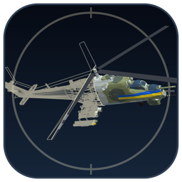

# HIND REBUILT

[English](README.md)



Simulátor vrtulníku Mi-24 pro Linux a Windows, znovu postavená hra *Hind* (Digital Integration, 1996):
flat-shaded polygonová grafika, zelený vektorový HUD a ovládání z klávesnice jako v originále.
Libovolné rozlišení, podpora joysticků, HOTASů a gamepadů přes SDL2 a kooperace po místní síti
až pro deset hráčů: piloti ve vlastních Hindech i střelci u zaměřovače a dveřních kulometů
([Hra po síti](#hra-po-síti-pilot-a-střelec)).

Hraje se: menu, plánování a vyhodnocení misí originálu, jeho výcvik, samostatné mise a kampaně
(Afghánistán, Kazachstán, Korea) a deník pilotů. Navíc je tu zcela nová kampaň, kterou původní
hra neměla: [Ukrajina](#ukrajina), noční lov dronů Shahed a proudových Geranů-3 s Mi-24 v barvách
bývalých českých Hindů. Vznikají další úpravy a doplňky.

## Obsah

<!-- toc:begin -->

- [Jak začít hrát](#jak-začít-hrát)
- [Data originální hry](#data-originální-hry)
- [Zvuk](#zvuk)
- [Menu](#menu)
- [Mise](#mise)
  - [Ukrajina](#ukrajina)
  - [Rozkazy wingmanovi](#rozkazy-wingmanovi)
  - [Průzkum a laserové označování](#průzkum-a-laserové-označování)
  - [Výsadek a evakuace](#výsadek-a-evakuace)
  - [Nepřítel střílí](#nepřítel-střílí)
- [Pilot's Log](#pilots-log)
- [Hra po síti (pilot a střelec)](#hra-po-síti-pilot-a-střelec)
  - [Z menu: Flight → Network](#z-menu-flight--network)
  - [Zprávy](#zprávy)
  - [Z příkazové řádky](#z-příkazové-řádky)
  - [Druhý pilot (wingman)](#druhý-pilot-wingman)
- [Sestavení](#sestavení)
  - [Pro Windows](#pro-windows)
- [Jak létat](#jak-létat)
  - [Tahák: kolektiv pro vodorovný let](#tahák-kolektiv-pro-vodorovný-let)
  - [Srovnání rychlosti se Shahedem](#srovnání-rychlosti-se-shahedem)
  - [Autorotace](#autorotace)
- [Ovládání (klávesnice)](#ovládání-klávesnice)
  - [Letové modely](#letové-modely)
- [HUD v navigačním režimu](#hud-v-navigačním-režimu)
- [HUD ve zbraňovém režimu](#hud-ve-zbraňovém-režimu)
- [Konfigurace](#konfigurace)
- [Vývojářské volby](#vývojářské-volby)
- [Struktura](#struktura)
- [Licence](#licence)

<!-- toc:end -->

## Jak začít hrát

1. **Opatři si původní Hind.** Data původní hry (modely, kokpity, krajina, zvuky, mise) remake
   neobsahuje a bez nich nepoběží. Legálně se dá koupit:
   - na [GOG](https://www.gog.com/en/game/hind) (DOS verze v DOSBoxu, s manuálem),
   - na [Steamu](https://store.steampowered.com/app/2577400/) (od roku 2025, vydává MicroProse).

   Poslouží i původní CD nebo jeho obraz (`.iso`), případně hra nainstalovaná v DOSBoxu.
   Na Linuxu se instalátor z GOG (pro Windows) rozbalí příkazem `innoextract setup_hind_*.exe`
   (balík `innoextract`), nebo se hra nainstaluje přes Heroic či Lutris. Hra ze Steamu se na
   Linuxu stáhne se zapnutým Protonem.
2. **Stáhni HIND REBUILT.** Pro Windows je připravený balíček `hind-win.zip`
   ([ke stažení na GitHubu](https://github.com/jan-vratny/hind-rebuilt/releases), rozbalit a spustit `hind.exe`), na Linuxu se hra přeloží jedním příkazem (viz [Sestavení](#sestavení)).
3. **Spusť ji.** Při prvním spuštění se zeptá, kde je původní hra: sama nabídne, co najde
   (instalaci z GOG, Steamu nebo DOSBoxu, CD v mechanice, obraz `.iso`), jinak stačí cestu
   napsat nebo vybrat v dialogu (viz [První spuštění](#data-originální-hry)).
4. **Leť.** Z menu Quickstart → Arcade rovnou do mise. Základní ovládání:

   | Klávesa | |
   |---|---|
   | šipky | cyklika (náklon a sklon) |
   | Q / A, nebo 1 … 0 | kolektiv (výkon); na vzlet 9 (90 %), na visení asi 8 |
   | Z / X | pedály |
   | Enter / mezerník | další zbraň / výstřel (cíl si zaměří počítačový střelec) |
   | F2 / F3 / F6 | kokpit pilota / střelce / pohled zvenku |
   | Esc | zpět do menu |

   Joystick, pedály nebo gamepad se nastaví v Preferences. Všechny klávesy jsou v kapitole
   [Ovládání](#ovládání-klávesnice).

Vyzkoušené je to zatím s CD, jeho obrazem a s hrou nainstalovanou v DOSBoxu; verze z GOG
a Steamu by měly fungovat stejně (jsou to tatáž DOS hra v DOSBoxu), kdyby ne, dej vědět.

## Data originální hry

Hra si všechno, co z originálu potřebuje, načítá přímo z jeho dat: 3D modely a jejich textury
(`3DDATA`), obrázky menu a plánování (`MENUSCRN`, `UIDATA`, `FONTS`), kokpity (`COCKPITS`),
krajinu bojových oblastí (`*.WZ`), zvuky (`SOUND`), mise a kampaně (`MISSDATA`) a formace
jednotek z `HIND.EXE`; z CD pak řeč, hudbu a animace. Z originálu se nic neukládá do
repozitáře.

HIND REBUILT je neoficiální fanouškovský projekt, nemá nic společného s Digital Integration
ani s držiteli práv na původní hru. *Hind* a *Digital Integration* jsou ochranné známky svých
vlastníků; jejich jména se tu používají jen k označení původní hry. Projekt neobsahuje žádný kód
ani data originálu; formáty souborů byly zjištěny kvůli interoperabilitě. Hraje se s daty originálu, která si hráč musí opatřit sám:
stačí CD originálu, jeho obraz (`.iso`), nebo nainstalovaná hra (třeba v DOSBoxu). Bez nich hra
nepoběží.

**První spuštění:** hra hledá data v `[data] original_dir` v hind.ini, v `~/dosbox/c/DI/HIND`
a podobných místech. Když je nenajde, zeptá se na ně na vlastní obrazovce:
- **Nabídne, co našla:** nainstalovanou hru, CD v mechanice (na Linuxu připojená média
  v `/media`, na Windows jednotky CD) a obrazy `*.iso` s „hind“ v názvu v domovském adresáři,
  ve Stažených, na ploše a v adresářích DOSBoxu.
- **Cestu jde napsat** (Tab ji doplňuje a další stisky procházejí možnosti dokola jako v bashi, Shift+Tab zpět; Ctrl+V vloží) nebo vybrat v systémovém dialogu: F2
  složka, F3 obraz `.iso`. Na Windows je to dialog systému, na Linuxu zenity nebo kdialog,
  pokud jsou nainstalované.
- **Z CD nebo obrazu** si hra jednou zkopíruje svá data (asi 65 MB, všechno je na CD, i
  `HIND.EXE` v `FILESD`) do složky `original` vedle hind.ini. CD pak potřebuje už jen kvůli
  řeči v briefinzích, hudbě a animacím.
- **Výběr se zapíše** do hind.ini (`original_dir`, `cd`). Esc hru ukončí, protože bez dat se
  hrát nedá. Znovu se obrazovka vyvolá volbou `--setup`, jiný adresář se dá zadat i volbou
  `--original DIR`.

(Snímky a listy modelů dělané mimo obrazovku, tedy vývojové volby, běží i bez dat: vozidla
jsou pak kvádry, kokpit modelovaný a krajina procedurální.)

Krajina: výchozí je Afghánistán (`AFGHAN.WZ`). Mise se odehrává kolem letiště, ze kterého
startuje, volný let kolem Bagrámu. Další oblasti se volí v `[world] zone` nebo volbou `--zone`:
`kazak`, `korea`, `saratov`, `ukraine` (saratovská step ukrajinské kampaně), případně
`procedural` pro vlastní generovanou krajinu se zelenými poli, lesy a jezery. Barvu země
oblasti odvozujeme z její mlhy (viz Barva země oblastí níže), originál ji bere z textur
(`TEXT64*.RAW`), které ještě nečteme. Kazachstán a Saratov mají v datech originálu jen kopii
korejského seznamu letišť; hra si proto jejich letiště najde podle značení drah v krajině.
Volný let (bez mise) startuje na dráze toho největšího, mise tam, kde je postaví.

V krajině stojí budovy, mosty, hájky a křoviny oblasti z `GNDOBJS.BIN` s modely originálu
(města, vesnice, hangáry, vládní budova v Soulu…). Budovy mají v `3DOBJS.BIN` vrcholy uložené
zhuštěně, po bajtech (popis v `src/gamedata/original.hpp`). Dráhy letišť oblasti se skládají
ze značení originálu: řady pruhů středové čáry, čísla na koncích a značky dosednutí. Pod ně
se položí asfalt a terén kolem se srovná. Pojížděcí dráhy, odstavné plochy a stojánky jsou
plochy mapy originálu (`FEATURES.BIN`, silnice a letiště), a tak je hra jako originál kreslí
na zem kolem dráhy, všechno v šedé barvě 11 jeho palety. Hráč stojí tam, kde ho mise postaví
(ve výcviku na odstavné ploše u hangárů). Kazachstán a Saratov mají letiště podle značení drah
(viz výše). Vlastní
letiště se stojánkou a budovami zůstává jen tam, kde oblast žádné nemá (start „v poli“),
a při `[world] scenery = 0`.

## Zvuk

Zvuky jsou z originálu (`SOUND/MAXIMAL.BLK`, bloky 8bitových vzorků 11025 Hz). Co který
blok je, se zjistilo poslechem a seznam je v `src/gamedata/sound.hpp`. Hraje se:

- motor a listy rotoru, hlasitější a vyšší s otáčkami rotoru, zvenku slabší se vzdáleností;
- kanón a kulomet, dokud střílí; odpaly raket, Šturmů a pum; natáčení věže; podvozek;
  dosednutí od lehkého ťuknutí po tvrdý dopad podle rychlosti klesání; vrzání draku při
  velkém přetížení; světlice; havárie;
- výbuchy podle zbraně (ve vodě šplouchnutí) a palba nepřítele. Ozvou se se zpožděním podle
  rychlosti zvuku a slabší se vzdáleností;
- hlasy, jeden po druhém:
  - Nataša: selhání a požár motoru, málo paliva, přetížení motoru, nízké otáčky rotoru,
    „pull up“, ozáření radarem podle druhu, odpálená střela, pozemní palba;
  - WSO: zapnutí a vypnutí, nabitá zbraň, zbraně zajištěné, co za cíl zaměřil (podle jména
    objektu originálu), zničený cíl;
  - řízení letu: povolení ke startu na začátku mise, kurz k dalšímu waypointu
    („vector“ a tři číslice), povolení k přistání u domovského letiště, napomenutí za palbu
    do vlastních.

Z CD originálu (viz `[data] cd`) hraje hudba v menu a ve vyhodnocení misí a briefingy
a vyhodnocení se předčítají. Drony v ukrajinské kampani mají vlastní zvuky, které hra skládá
sama (pístový Shahed, proudový Geran-3).

## Menu

Hra začíná v menu originálu (obrázky a tlačítka z `MENUSCRN`, stisknuté tlačítko je
samostatný obrázek originálu):

- **Quickstart**: **Arcade** a **Invincible** nabídnou válku (jako v originálu, manuál str. 5)
  a vzlétnou rovnou do její náhodné samostatné mise s nejsnazším letovým modelem a nekonečnou
  municí; Invincible navíc bez havárií a poškození. Quickstart se nehodnotí podle cílů mise: havárie je FAILURE, přežití SUCCESS a přežití s 3000 body OUTSTANDING; debrief ukáže skóre, čas ve vzduchu a co jsi sestřelil. V Arcade má jen dveřní GŠG počítanou munici: po 1500 ranách 6 s nabíjí („RELOADING GSG“) a pak má zase plno.
  - **Ukrajina** v Quickstartu: mise ve dne (noční nálety se posunou na 11:00) a bez letu na
    hlídkovou čáru. Bojiště se přetočí, až je první dron 7 km od středu čáry, a Hind, wingman
    i Hip startují tam ve vzduchu čelem k němu. Pak se nečeká: ve vzduchu je 16 dronů v nepřetržitém proudu, každý přilétá z 2,5–8,5 km před Hindem
    a míří kolem něj, odkud přesně, je při každém spuštění hry jiné. Sestřelený se za 6 s vrátí a ten, který přeletí 9 km za hráče, taky. V proudu letí i jedna střela Banderol (viz níže): přilétá z 15–22 km, po cestě uhne do strany a pak letí na Hind, kde je právě teď, a mine ho o pár set metrů (za necelé dvě minuty od začátku); sestřelená nebo vzdálená 9 km za ním se vrátí znovu. Co Hind nese, určuje přepínač pod kamenem Ukraine na stránce volby války v Quickstartu (po Arcade nebo Invincible, klávesa W, pamatuje si ho hind.ini jako `[weapons] quick_ukraine`): „Ukraine: R-60“ (výchozí) jsou R-60 na vnějších závěsnících, „Ukraine: Interceptors“ rampa stíhacích dronů, na Banderol ale nestačí. K tomu vždy oba dveřní kulomety. Vystřílené R-60 se za 20 s dobijí („RELOADING R-60“, „R-60 LOADED“), ale jen tady, v misích ne. Proud nekončí, palivo neubývá; let ukončí Ctrl+Q. Vyhodnocení
    mise počítá jen poslední stav dronů, skóre Arcade všechny sestřely. Wingmani po síti startují také ve vzduchu,
    vpravo za pilotem (kdo se připojí později, objeví se vedle pilota tam, kde právě letí).
  - **Arcade boduje:** zničené cíle hráče (voják 10, nákladní auto 40, obrněnec 75, tank 150,
    protiletadlová obrana navíc 75 až 125, vrtulník 300, letadlo 400, Shahed 150, Banderol 500; naše a
    neutrální jednotky se odečítají dvojnásobně) a výsledek mise (úspěch 250, výborně 500).
    Skóre je vpravo nahoře v HUD. Invincible neboduje.
  - **Top Ten** (T) ukáže deset nejlepších skóre z Arcade (`topten.txt` vedle `hind.ini`), s křížkem u letu, který skončil havárií. Arcade a Invincible se nezapisují do Pilot's Logu, ten je jen pro mise.
    Když je skóre po letu dost vysoké, objeví se v tabulce prázdný řádek pro jméno pilota
    (předvyplní se pilot z Pilot's Logu); Enter ho zapíše, Esc ne.
- **Flight**:
  - **Training** ukáže 20 výcvikových misí (Saratov) se zadáním vpravo. Commit misi
    potvrdí, tlačítka Infinite weapons (I) a No crashes (N) zapnou nekonečnou munici
    a let bez havárií, WSO targets allies (A) nechá WSO zaměřovat i naše vlastní síly
    (jinak je přeskakuje; střílet na ně jde vždycky). Gunner hints (H) zapne nebo vypne
    ukazatel rány dveřních střelců na HUD (zapamatuje se v hind.ini).
  - **Single Mission** nabídne válku (Kazachstán, Korea, Afghánistán) a pak její
    samostatné mise. Na konci řádku je tečka, u mise, jejíž poslední zalogovaný let skončil neúspěchem, křížek (podle pilota).
  - **Campaign** nabídne válku a ukáže stránku její kampaně (obrázek originálu `C_AFGHAN.LBM`,
    `C_KAZAK.LBM`, `C_KOREA.LBM`; pro Ukrajinu náš v rámu afghánského: hra si ho při prvním otevření sama vykreslí
    mimo obrazovku, Hind za soumraku nad stepí, a uloží jako `C_UKRAINE.PPM` vedle `hind.ini`;
    smazáním se vykreslí znovu). Kampaň běží jako
    v originálu:
    - **Úrovně:** deset úrovní (ukrajinská osm), na každé dvě nebo tři mise. Hraje se náhodná
      mise úrovně, kterou jste ještě nezkusili, a když už všechny, pak některá neúspěšná.
    - **Úspěch** posune o úroveň výš, **neúspěch** stojí jeden ze tří životů a úroveň se
      zkouší znovu jinou misí. Poslední ztracený život kampaň ukončí, stejně jako vyhraná
      poslední úroveň; další kampaň začne od začátku.
    - **Texty:** na začátku úvod kampaně a situace první úrovně, po úspěchu situace další
      úrovně, po neúspěchu „stalemate“, nakonec prohra úrovně nebo výhra kampaně (soubory
      originálu `AFGHNL00.TXT` až `L10`, naše `data/missions/UKRAIL00.TXT` až `L08`). S CD je
      originál předčítá (viz `[data] cd`). Klik nebo Enter jde dál, Exit zpět na výběr války.
    - Po misi kampaně se hra vrátí na její stránku s tím, jak to dopadlo.
- Vpravo dole **GoTo** (G) otevře nabídku originálu a **Exit** vede o krok zpět. V hlavním
  menu je místo něj **Quit**, který se zeptá na ukončení hry (Y / N).

Obrazovka 640×480 se zvětší, jak velká se do okna vejde. Pixely původních obrázků zůstanou
ostré a stejně velké i při neceločíselném zvětšení: obrazovka se při něm (např. 2,25×)
nakreslí nejdřív v celém násobku (3×) a teprve celá se plynule zmenší do okna, takže písmo
má všude stejně silné tahy a ke všemu ostatnímu původní poměr. Na širokoúhlém monitoru leží jako deska
se stínem na broušené oceli z originálu (`TWO_PLYR.LBM`). Původní obrázky se nijak neupravují.

Ovládání:

- myší;
- šipkami a Enterem;
- počátečním písmenem tlačítka (Q, F, T, S, C, A…);
- Esc vede zpět.

**GoTo → Recognition** otevře knihovnu jednotek (`V_RECON.LBM`):
- **Obsah:** letadla a vrtulníky, vozidla a lodě ze soupisu v manuálu (Vehicle Inventory,
  str. 88–91) a k tomu drony Shahed-136 a Geran-3, střela Banderol a náš stíhací dron Litavr.
- **Model:** vlevo se otáčí model jednotky z dat originálu s jejími texturami. Vrtulníky mají
  naše listy rotoru, protože originál je kreslí sám. Pod modelem je název a kdo jednotku má.
- **Hlas:** kde ho originál má, střelec název jednotky vysloví.
- **Ovládání:** listuje se tlačítky ◂◂ ▸▸ nebo šipkami, Aircraft, Vehicles a Ships (A, V, S)
  přepínají seznam. Exit vrací na stránku, odkud se knihovna otevřela.

**GoTo → Animations** přehraje jako originál jednu z jeho animací, náhodně vybranou:
- **Odkud:** animace jsou jen na CD originálu (`ANIMS/*.Q3`, viz `[data] cd`). Bez CD hra
  řekne, že jsou na CD.
- **Přehrávání:** 12,5 snímku za sekundu, dvakrát zvětšené, bez zvuku a bez hudby. Na konci,
  nebo po klávese či kliku, se hra vrátí na stránku, odkud se animace pustila.
- **Formát:** vlastní formát DI (`src/gamedata/anim.hpp`): první snímek celý, další jako změny
  v blocích 8×8, jak je dekóduje `HIND95.EXE`.

**Preferences** otevře tlačítko v hlavním menu (P) nebo GoTo → Preferences. Je to obrazovka
originálu (`PREFSB.LBM`) s našimi nastaveními na ocelových lištách:
- **Vlevo zvuk a obraz:** zvuk, hlasitost, hlasy, stavby v krajině, dohled, celá obrazovka,
  hudba v menu.
- **Vpravo let a boj:** letový model, havárie, nepřátelská palba, zručnost nepřítele, nápověda
  střelce, míření myší a vyhlazování hran (Antialiasing, platí od dalšího spuštění hry).
- **Ovládání:** kliknutí přepne na další hodnotu, pravé tlačítko na předchozí. Šipky nahoru a dolů
  vybírají, doleva a doprava mění.
- **Skleněný panel** ukazuje, co vybrané nastavení dělá a kdy začne platit.
- **Uložení:** všechno se hned uloží do `hind.ini`. Zvuk, hlasitost, hudba a celá obrazovka platí
  okamžitě, vyhlazování hran od dalšího spuštění hry, ostatní od dalšího letu.
- **Panel vpravo dole** je joystick. Ukazuje živě polohu kniplu, kolektivu, pedálů, kloboučku
  a os rozhlížení, každou z toho zařízení, ke kterému patří.
  - Kliknutí na jméno (nebo šipky doleva a doprava, když je panel vybraný) přepíná hlavní
    zařízení: jeho tlačítka střílejí. Poslední volba je Off.
  - Kliknutí do panelu (nebo Enter) spustí učení os. Hra postupně řekne, čím pohnout: knipl
    doprava, knipl dopředu, kolektiv nahoru, pravý pedál, osa rozhlížení doprava a nahoru,
    klobouček nahoru. Vezme osu, která se pohnula nejvíc, z kteréhokoli zařízení, a podle směru
    pohybu pozná i obrácenou osu. Mezerník krok přeskočí (ovládání pak zůstane jen na
    klávesnici), Esc nechá nastavení, jak bylo.
  - Knipl, kolektiv a pedály tak můžou být tři různá zařízení. Skleněný panel ukazuje zařízení
    (A, B, …) a každé ovládání s jeho osou a polohou.

Esc za letu, Quit na
plánovacích obrazovkách i Esc po vyhodnocení mise vedou zpět do menu.

## Mise

Hraje se kampaň originálu. Výchozí je afghánská: 24 misí z `MISSDATA/AFGHNC*.DTA`, start
z letiště Džalálábád. Před startem se mise plánuje jako v originálu (obrázky z `MENUSCRN`,
písmo `FONTS/11X15.LBM`, barvy a zavírací čtvereček z `UIDATA`). Celou obrazovku vždy zabírá
mapa s trasou. Vpravo je cihlový panel „Map Tool Box“ s tlačítky Briefing, Takeoff, Zoom,
Rotate, Way, Disable, Back, Fit, Key, Met, 3D, Pay, Point, Task, Save, Restore a Exit dole.
Tlačítko reaguje po puštění myši, jako v originálu. Plánování se nezvětšuje s oknem: tlačítka,
okna a písmo mají stálou velikost (`[video] ui_scale`, výchozí 2 = dva pixely okna na pixel
originálu) a větší okno ukáže víc mapy; Map Tool Box zůstává u pravého okraje, Exit v rohu.
Teprve okno menší než 1120×800 se zmenší celé. Co tlačítko otevře, přijde v okně přes
mapu, které se zavírá čtverečkem vlevo nahoře (nebo Esc, to zavře přední okno). Okno jde
přesunout tažením za titulek (horní řádek) a zvětšit či zmenšit tažením za trojúhelníček v
pravém dolním rohu (originál tam má čtvereček `RESIZE.BM` a okno jím jen posouvá). Brífink se při změně
velikosti znovu zalomí, náhled 3D se zvětší s oknem. Výzbroj má pevnou velikost obrázku.
Klávesy:

- **Briefing** (B): cihlové okno s názvem mise v záhlaví a bílým textem úkolu po stránkách (PgUp/PgDn, šipky,
  kolečko). Ukazuje jen rozkaz; další odstavce souboru mise patří k vyhodnocení.
- **Takeoff** (Enter), **Exit** (Esc bez otevřeného okna).
- **Mapa** jako v originálu, kreslená po pixelech v 640×480 z dat oblasti:
  - plošky terénu v pískových odstínech palety mapy (`3DPAL.RGB`, barvy 192–207);
  - voda, silnice, letiště, města, řeky a cesty z `FEATURES.BIN`;
  - vrstevnice po 250 stopách z výškové mřížky (při oddálení řidší; originál je nechává všechny
    a mapa je pak nepřehledná);
  - mřížka po 1 km (při oddálení širší);
  - kruhy dosahu protivzdušné obrany jako v originálu: kolem stanovišť ze sekcí `:Gameplay AAA`
    a `SAM` mise, modře na našem území a oranžově na nepřátelském, kanóny 2 námořní míle
    a rakety 5 (změřeno na mapě originálu), kompas;
  - se Sides (strany) je každý čtvrtý pixel tečka, na našem území modrá, na nepřátelském
    oranžová (`:Gameplay Sides`);
  - trasa bíle (body v kroužku, cíle X, Y, Z v trojúhelníku, vybraný bod modrý, odlet ve
    čtverečku), pod ní cihlově trasa, jak ji dala mise (po přesunu bodu zůstane jeho stopa).

  **Zoom**, **Rotate**, **Way** a **Disable** jsou jako v originálu režimy mapy (zapnutý je
  zamáčknutý) a určují, co dělá klik a tažení myší po mapě:
  - **Zoom** (+, také o kus přiblíží): tažení kreslí šedý obdélník se středem v místě, kde
    tažení začalo, rohem u myši a poměrem stran obrazovky. Tažení doprava přiblíží: oblast
    obdélníku vyplní obrazovku. Tažení doleva oddálí: celá obrazovka se vejde do obdélníku.
    Klik sám nic nedělá.
  - **Rotate**: tažením se mapa otáčí kolem středu obrazovky o úhel, o který myš obkrouží
    střed; z klávesnice čárka a tečka po 15°.
  - **Way** (W): otevře okno bodů; klik do mapy přesune bod vybraný v okně na to místo a při
    držení ho táhne (odlet a přistání jsou pevné). Šipky ho posouvají (se Shiftem pětkrát
    dál), **Ins** (Insert, I) vloží bod za vybraný, **Del** (Delete) ho smaže.
  - **Disable** (D): myš na mapě nedělá nic, okno bodů se zavře.

  **Back** (−) oddálí, **Fit** (F) vrátí výchozí pohled (celá trasa, sever nahoře). Kolečko
  přibližuje k myši. Pravé tlačítko posune mapu o půl obrazovky k té straně, na kterou
  kliknete (vlevo, vpravo, nahoru, dolů), jako v originálu; prostředním tlačítkem jde mapa
  navíc táhnout v každém režimu, šipky ji mimo režim Way posouvají. Tab / Shift+Tab vybere bod. Kliknutí do mapy bez tažení (mimo Way)
  ukáže to místo v okně 3D.
- **Way** (W): okno s tlačítky **Ins**, **Del**, **Info** (Shift+W) a body trasy (A, B, X, C…). Info
  otevře okno vybraného bodu jako v originálu: poloha (východ, sever v metrech, výška ve
  stopách) v políčkách po číslicích, typ, rychlost v uzlech, zdržení, čas letu k bodu a
  délka úseku. Levé tlačítko na číslici ji zvýší, pravé sníží (pevné body nejdou posunout).
  PgUp/PgDn mění rychlost o 10 uzlů, se Shiftem zdržení o 5 s. U cíle je v nadpisu, co
  na něm stojí, např. „Waypoint X (Government Building)“: nejbližší budova oblasti nebo
  jednotka mise do 200 m, pro kterou má WSO jméno (jména podle hlášek WSO, jako je
  vyslovuje originál).
- **Key** (K): sloupec přepínačů vrstev mapy: Grid Lines, Waypoints, Compass, Allied AAA,
  Allied SAM, Enemy AAA, Enemy SAM (kruhy dosahu protivzdušné obrany), Sides (čí je které území).
- **Met** (M): vítr a počasí. **Task** (T): Task Box se lety úkolu (hráč Immortal, wingmani).
  Klik na wingmana ukáže jeho trasu oranžově.
- **Point** (O): okno, které při pohybu myši nad mapou ukazuje výšku terénu, čí je území
  a co je pod kurzorem.
- **Save** (S) si trasu zapamatuje, **Restore** (R) ji vrátí (bez uložené vrátí trasu mise).
- **3D** (3): okno s 3D pohledem na místo, které kliknete na mapě (nebo vyberete Tabem).
  Režimy dole (PgUp/PgDn): **Sat** snímek kolmo shora, **Point** kamera krouží kolem místa,
  **Fly** kamera k místu doletí. Šedý nápis „3D“ na mapě ukazuje, kde je kamera.
- **Pay** (P): okno s obrázkem `PAYLOAD.LBM` s Hindem a zbraněmi vyskládanými na betonu. Kliknutím
  na závěsník vyberete pár závěsníků. Kliknutí na zbraň na zemi otevře u kurzoru nabídku
  závěsníků, na které se dá zavěsit (Inner, Outer, Wingtip Pylon), a klik na položku ji tam
  zavěsí, jako v originálu. Klik na zavěšenou zbraň ji sundá, takže jde vrtulník odzbrojit
  (kromě kulometu ve věži). Klik na kulomet v okně ho odebere. Dole je cihlový pruh s tím, co je pod myší nebo na vybraném
  závěsníku. Z klávesnice (když je okno vpředu):
  - šipky nahoru a dolů nebo 1–3 vyberou závěsník;
  - šipky doleva a doprava střídají zbraně, které se na něj vejdou;
  - N závěsník vyprázdní.

  Zbraň, která na vybraný závěsník nepatří, se zavěsí na nejvzdálenější závěsník, kam patří
  (Šturm tedy na konce křídel).

  V dolních rozích leží navíc čtyřhlavňový kulomet GŠG-7.62 do dveří kabiny se střelcem (obrázek
  není z originálu, viz `CREDITS.cs.md`). Klik na něj nabídne Left Door, Right Door a Both Doors.
  Kulomet pak trčí z okénka kabiny. Klik na bok trupu za kokpitem vybere dveře. Z klávesnice
  jsou dveře 4 a 5 (nebo šipkou dolů za závěsníky), šipky doleva a doprava kulomet přidají nebo
  odeberou a N ho odebere. Kulomet se střelcem váží asi 150 kg: kulomet 19 kg, 1500 nábojů 7,62 × 54R
  v článcích po 25 g, lafeta asi 10 kg a střelec s výstrojí 85 kg. Data misí originálu o kulometech
  ve dveřích nic neříkají: mise na drony (Shahed, Geran-3, Gerbera) je mají ve dveřích oba,
  ostatní žádný, a tady se to dá změnit.

  Platí pravidla originálu. Například FAB-500, ZAB-500, 57mm kontejner (UB-32), UPK-23 a KMGU
  jen na vnitřní závěsníky, R-60 jen na vnější, 9M114 na vnější a konce křídel.
  Na betonu leží vlevo 57mm kontejner (UB-32, 32 raket S-5), vedle něj 80mm (B-8V20, 20 raket
  S-8), na závěsnících se kreslí obrázky originálu `UB32A_*` a `B-8_*`. Zavěšená výzbroj se kreslí
  do obrázku výřezy originálu. Mise si výzbroj nakládá sama podle svých dat (`:Weapon`),
  stejně jako originál. Na obrazovce se dá změnit a uloží se do `[weapons]` v hind.ini (ta
  platí pro volný let).

Enter vzlétne s naplánovanou trasou a výzbrojí, Esc hru ukončí. Na pohyblivé mapě je vidět trasa a červeně bod,
ke kterému se letí. Ručička HSI ukazuje na tento bod a počítadlo pod ní vzdálenost k němu.
Na HUD pod stupnicí kurzu ukazuje kurz k tomuto bodu malá stříška, mimo rozsah stupnice se drží
u bližšího okraje.
Po proletění bodu (do 800 m) se navigace přepne na další, klávesa W přepne ručně a po
posledním bodě vede navigace domů.

Na bojišti jsou síly z mise:
- naše kolony, hlídky, tábory a parkující letadla;
- mudžahedíni s kulomety DŠK, minomety a RPG.

Jednotky jezdí a chodí po trasách z mise, vrtulníky a letadla létají. Mise dávají proudovým
letounům rychlosti vrtulníku (Su-25 kolem 200 km/h, pod pádovou rychlostí), proto letí ve vzduchu
aspoň 450 km/h a na přiblížení k přistání 250 km/h. Formace (např.
„Mujaheddin with DSHK Machine Gun“) se čtou přímo z `HIND.EXE`. Vyhodnocení se řídí čísly
z mise: kolik zničených cílů je potřeba pro úspěch a kolik pro vynikající výsledek. Pro úspěch
musí padnout hlavní cíle (nejvýš tolik, kolik jich mise má) a do počtu z mise se počítají
i ostatní cíle (KOREAC14 chce 20 zničení, hlavních cílů má jen 6). Budovy oblasti do 400 m od
cílových bodů trasy, které nestojí na našem území, jsou také cíle. Když mise nemá hlavní cíle
a pro úspěch nechce nic (její cíle jsou právě budovy: radar v KOREAS02, vesnice v AFGHNS01),
stanou se budovy u cílů hlavními a zničit je potřeba aspoň polovinu. Jak to počítá originál,
zatím nevíme. Přistáním doma (do 2 km od startu) mise končí a zobrazí se výsledek.

Mise mají na konci sekce `:Gameplay`. `Sides` říká, čí je která buňka oblasti (16384 stop),
a na body z `AAA` a `SAM` hra sama staví protivzdušnou obranu strany té buňky. U nás stojí
na našem území ZSU-23-4 a SA-13, u nepřítele v Afghánistánu DŠK a Strely mudžahedínů,
v Kazachstánu ZSU-23-4 a Strely, v Koreji M163 Vulcan a Stingery. Jaké jednotky tam staví
originál, zatím nevíme. V Koreji je to přes sto stanovišť po celé oblasti.

Konec mise vypadá jako v originálu. Ctrl+Q za letu hru zastaví a ukáže tabulku „END MISSION?
Y/N“ z originálu (`COCKPITS/ENDMISS.640`). N nebo Esc letí dál, Y misi ukončí jako přerušenou.
Po konci mise (přistání doma, sestřelení nebo Y) přijde vyhodnocení jako v originálu: mapa
s trasou, vpravo nahoře jediné tlačítko Debrief (otevírá a zavírá okno, klávesa D) a vpravo
dole Exit (také Enter a Esc), které vede zpět do menu. Okno má v titulku misi a výsledek
(„Shipping Attack - ABORTED“, SUCCESS, OUTSTANDING, FAILURE). Pod ním je text mise pro ten
výsledek (`:Outstanding`, `:Success`, `:Failure`, přerušená mise dostane text neúspěchu). Pak
větami originálu (z `HIND.EXE`), jak se letělo a co se splnilo: „Good flying.“, nebo „Mission
Failed - Hind destroyed.“ a jak („Hind was shot down by ZSU-23-4.“, „Hind collided with …“,
„Your crash was a result of your vertical speed at the time of landing.“), výsadek, miny,
průzkum, „Enough targets for success.“ / „Insufficient targets destroyed.“ a cíle u bodů trasy
(„However, not all waypoint targets were destroyed.“). Pod tím naše počty (kolik primárních
cílů je potřeba) a nakonec jako v originálu seznam, co kdo zničil: „Targets destroyed by you:“,
„by your wingman:“ (nebo jméno hráče po síti), „by other allied forces:“ a „by enemy forces:“,
pod každým skupiny „Enemy Targets“, „Allied Targets“, „Friendly Fire Casualties Caused“,
„Civilian Casualties“ a řádky „23 x MUJAHEDDIN“. Názvy jednotek jsou zatím naše (originál má
vlastní, delší). Delší text se posouvá jako v originálu: posuvník vlevo pod zavíracím čtverečkem
(jezdec se dá táhnout, klik nad něj či pod něj posune o stránku), kolečko myši, šipky, PgUp/PgDn,
Home/End. Pak se hra zeptá, jestli misi zapsat do Pilot's Logu (viz níže).

Konkrétní misi zvolíte volbou `--mission AFGHNS03` nebo v `[world] mission`, seznam všech
vypíše `--missions`. `--mission none` je volný let nad cvičištěm u Bagrámu.

### Ukrajina

Vlastní kampaň remaku: lov dronů Shahed-136 nad ukrajinskými městy. V menu je na stránce válek
čtvrté tlačítko UKRAINE (složené za běhu z písmen tlačítek originálu, klávesa U). Válka se vede
na saratovské oblasti originálu, její step a řeka zastupují Ukrajinu. Mise jsou v
`data/missions/UKRAIC01` až `08` ve formátu originálu s jedním rozšířením: `:Drone Name`
(jednotka jménem, např. `Shahed_136`, `Mi_17_Hip_H`). Píše je skript
`tools/ukraine_missions.py` z popisu v metrech a sekundách.

Hind v ukrajinských misích, v tréninku se Shahedy (každá mise se Shahedy, Gerberami nebo Gerany-3) i ve volném letu nad `zone = ukraine` má (stejně jako všechny naše Hindy v té misi, AI wingman i parkující) barvy vyřazených
českých Mi-24V, které teď létají na Ukrajině (podle jejich fotek):
- **Maskování:** české tříbarevné, olivová, světle šedá a tmavá šedozelená, místo zelené
  s pískovou originálu.
- **Modrožlutý pruh** podél nosu pod kabinami a na boku kabiny za dveřmi.
- **Koncové desky křídel:** modrá nad žlutou.
- **Ocasní nosník:** dva bílé pruhy kolem dokola.

Maskování je vlastní dlaždice v atlasu textur (`render/livery.cpp`), značení maluje scénový
shader podle místa na trupu (`uLivery`).

- Shahed-136 letí asi 180 km/h nízko nad krajinou po trase se zalomeními a na jejím konci se
  vrhne na cíl (letiště, město, železniční most, elektrárnu, sklady). Když doletí, počítá se
  jako ztráta, ne jako sestřelený, a hlásí se „DRONE HIT ITS TARGET“. Kolik jich smí proletět,
  říká `:Failure Count` mise.
- Žádné dva Shahedy neletí stejně. Každý má trochu jinou rychlost (±8 %), mírně kličkuje kolem
  kurzu (asi o 15 m) a jeho výška se pomalu vlní o 20–45 m, nejníž 25 m nad zemí. Na konci
  přejde do střemhlavého letu na cíl pod úhlem 35° a o pětinu zrychlí. Vlastnosti se odvozují
  od místa startu, takže jsou při každém letu stejné.
- Sestřelený dron letí setrvačností dál a padá po balistické dráze. Čumák má ve směru pádu,
  točí se ve vývrtce jednou za sekundu kolem podélné osy a táhne za sebou kouř. Na zemi
  dohoří.
- Od mise Two Directions létají mezi Shahedy návnady Gerbera (`:Drone Name Gerbera`). Vypadají
  i létají stejně a Mi-17 je hlásí jako Shahedy. Nemají hlavici, takže na konci trasy jen
  spadnou a nic nezničí. Sestřelené se nepočítají, debriefing je uvádí zvlášť.
- V misích The Swarm a The Long Night přilétají i proudové Shahedy Geran-3 (Shahed-238,
  `:Drone Name Geran_3`): stejná černá delta s proudovým motorem, tryskou v ocasu a sáním na
  hřbetě (`render::buildGeran3`). Letí asi 330 km/h, výš a z větší dálky, a ve střemhlavém
  letu na cíl zrychlí asi na 550 km/h. Mi-24 je zezadu nedohoní a dveřní střelci na ně nemají
  ránu, takže se potkávají čelně: kanonem nebo R-60, které v těch misích nese na vnějších
  závěsnících (na vnitřních kontejnery UPK-23). Kulomet ve věži na dron stačí jen zblízka: Shahed potřebuje asi 20 zásahů a s rostoucí vzdáleností střel rychle přibývá. Mi-17 je hlásí jako „JET SHAHED“. Slyšet je proudový motor (šum spalin a
  kvílení kompresoru), hlasitější než Shahed. Za dne se to dá vyzkoušet ve výcviku
  „Operational Training - Jet Drones“ (`SARATT23`): čtyři Geran-3 na letiště v 11:30.
- Střela S8000 Banderol (`:Drone Name Banderol`, zatím jen v Quickstartu nad Ukrajinou): ruská
  proudová střela odpalovaná z dronu Orion, 5 m dlouhá, se šípovými křídly pod trupem
  (`render::buildBanderol`). Letí asi 500 km/h bez kličkování, nízko (asi 100 m, terén sleduje
  čtyřikrát strměji než Shahed) a ve střemhlavém letu na cíl zrychlí na 650 km/h. Mi-24 jí může
  jen vletět do cesty: R-60 ji vidí ze 7 km z kterékoli strany, stíhací dron je pomalejší a na
  ni se nevypouští. Mi-17 ji hlásí jako „BANDEROL“.
- AI Mi-24 našeho roje nad Ukrajinou (mise UKRAI*, i Quickstart) nesou to, co hráč ne
  (`sim::WingArms`). Má-li hráč na vnějších závěsnících R-60, mají všichni rám stíhacích dronů,
  jinak má wingman (první z nich) R-60 a ostatní stíhací drony. Wingman s R-60 vystřelí na
  rychlý dron (Banderol, Geran-3) do 6 km a do 90° od svého směru, na který ještě žádná naše
  R-60 neletí, vždy jen jednu a počká na výsledek. Stíhací drony pouští posádka jako u hráče,
  ale na každý dron kromě Banderolu, i na Shahed (dveřní kulomet na něj AI Hind nemá). Jejich
  střely létají, zasahují a kreslí se jako hráčovy, výzbroj jim visí pod křídly (i se
  zbývajícími drony na rámu) a v síťové hře vidí obojí i ostatní hráči. Sestřely se počítají
  wingmanovi. V Quickstartu se jim R-60 dobíjejí jako hráči a roj
  od začátku letí s hráčem (rozkaz 2 Follow me), ne po trase mise; rozkaz 4 Resume flightplan ho
  na ni pošle zpět.
- Stíhací drony (kód výzbroje 30, náš): na vnitřních závěsnících rám se šesti drony Litavr (dvě
  patra po třech, prostřední dron vpřed), jak je ukrajinské posádky věší pod Mi-8 a Mi-17. Na
  Mi-24 visí pod křídlem mezi závěsníky a vzadu u odtokové hrany, spodní patro ještě za kolem,
  aby ho GŠG ve dveřích měl zakrytý křídlem a nepřekážel mu. Zabere tím i vnější závěsníky,
  na ty se pak nedá nic pověsit (mise s výzbrojí tam ji ztratí); na obrazovce Pay se proto
  nabízí jako „Both Pylons“.
  Litavr je metrový trup jako raketa, v nose kamera se dvěma objektivy, vzadu kříž malých
  ploutví, a místo raketového motoru čtyři ramena do X s gondolami a tlačnými vrtulemi. Každý je
  nasunutý na dvou hrotech, které po odpalu zůstanou trčet; na rámu ubývají odspodu. Jsou
  posádky, ne pilota: dveřní střelec (počítač, dokud u dveří nesedí hráč) sám vypustí dron jen
  na proudový Geran-3 do 5 km, na který ještě žádný neletí; pomalejší Shahedy nechává svému
  GŠG. Pilot mu ale může G (mimo pohled od dveří) poručit vypustit dron na svůj cíl (WSO,
  přepíná se B, nebo ten, který hlásí Hip), když je to nepřátelský dron do 5 km, i Shahed; bez
  takového cíle na nejbližší dron. Dokud střelec dron navádí (než se dostane na 1 km od cíle a dál
  letí sám), nemá volné ruce: další nevypustí a z GŠG nestřílí; druhý střelec ano. Na rámu
  visí špičkou vpřed (je to letadlo s tlačnými vrtulemi, ne kvadrokoptéra), takže z něj odletí dopředu a první vteřinu sám lehce zahýbá od vrtulníku; teprve
  pak se navádí nebo ho řídí hráč. Stíhací dron letí asi 400 km/h (skutečný Litavr 350, my mu
  přidali, ať dožene Geran-3), sám se navede (proporcionální navigace) a narazí do cíle
  (kinetický zásah, hlavice 0,5 kg, vybuchne do 4 m); když jeho cíl zmizí, vezme si nejbližší jiný, baterie
  vydrží dvě a půl minuty. D ve vzduchu je drží stejně jako dveřní kulomety. Pilotovi hlásí
  „INTERCEPTOR AWAY - 11 LEFT“. Nesou je všechny mise ukrajinské kampaně kromě The Swarm a výcvik „Operational Training -
  Interceptor Drones“ (`SARATT24`); na obrazovce Pay leží rám na betonu vedle GŠG (obrázek
  není z originálu, kreslí ho hra). Hráč u dveří (F4, nebo člen posádky po síti) je ale vypouští a řídí sám a automat
  pak žádné nevypouští: G vypustí stíhací dron a pohled se přepne do jeho
  kamery (v noci jako termovize, žhavé motory svítí). Obraz jde analogovým rádiem: je trochu
  měkký a zrnitý, s řádky, a čím dál je dron od vrtulníku, tím víc šumí (do 300 m čistý, ve
  4 km plný šumu s vytrženými řádky). Myš je při tom
  jako knipl: kam ji odsuneš, tam zůstane a dron zatáčí, dokud ji nevrátíš ke středu (kroužek
  kolem kříže je plná výchylka, kosočtverec poloha kniplu). Alt + šipky a klobouček zatáčejí,
  dokud je držíš, po síti i šipky. Joystick (gamepad levou páčkou) ho řídí jako letadlo, dopředu
  dolů; vrtulníku mezitím cyklika zůstane, kde byla, a po návratu ke dveřím se během vteřiny
  vrátí k páce. Tlačítko 1 (gamepad B) vybere další cíl, tlačítko 2 (X) dron pustí. Je to letadlo: do zatáčky se zlomek
  vteřiny naklání (kolem středu kniplu zatáčí jemně, na okraji naplno) a v plné rychlosti zatočí nejostřeji asi 6 g, tedy kruh o poloměru zhruba
  200 m; pomalejší má křídla méně vztlaku, takže ani po startu nezatočí ostřeji. Nahoře je
  rychlost, baterie a kolik jich zbývá. Kamera označí nepřátelská letadla, vrtulníky a drony
  do 3 km před ním malými rohy. Vybraný (zprvu ten nejblíž středu obrazu, B další) má hranaté
  závorky, jméno a dálku. Jakmile je do 1 km, závorky se zavřou do rámečku a „FIRE TO LOCK“:
  spoušť dron na cíl zamkne („Last Mile / Pixel Lock“ skutečného Litavru), ten pak už letí
  sám a hráč má volné ruce. Kamera zamčený dron sleduje až do zásahu, rámeček má v rozích
  čárky a „LOCKED“, a G vypustí rovnou další dron. Spoušť v kameře dronu nic jiného
  nestřílí. Bez zamčení vybuchne sám do 6 m od
  nepřátelského dronu, letadla či vrtulníku. Narazí-li do čehokoli, vybuchne taky: vlastní Mi-17
  to sestřelí, jiný Mi-24 jen do ocasu (zezadu), jinde zásah vydrží. Ve vlastním Mi-24 vyřadí motor na té straně (s jedním se dá tak tak přistát;
  druhý zásah z druhé strany vezme i ten), vzadu ocasní rotor; narazí-li do disku nosného
  rotoru, nebo v pětině případů, kdy střepiny letí nahoru do listů, je to konec.
  Znovu G, F4 nebo přepnutí na jiný pohled ho pustí, ať si cíl najde sám (hráč v síťové hře ho pustí jen klávesou G),
  a pohled se vrátí ke dveřím; když vybuchne nebo dojde baterie, vrátí se po chvíli sám.
- Zaměřovač R-60 vidí horkou trysku Geranu-3 (stejně jako letadla a vrtulníky) na 7 km. Slabý
  a vzduchem chlazený pístový motor Shahedu a Gerbery jen zezadu (do 60° od ocasu) na 1,5 km,
  odjinud na 600 m. Na Shahedy je proto hlavní zbraní kanon. Ukazatel `FAR` za jménem cíle na
  HUD s tím počítá.
- R-60 jako v originále (návod str. 68): hlavice zaměří jen cíl, který drží WSO (sám, nebo
  klávesami T a B), a to až je do 20° od nosu a v jejím dosahu. Zaměření potvrdí kříž přes
  zaměřovací kroužek na cíli. Bez zaměření vyletí neřízená, letí rovně a vybuchne, kam
  narazí. S vybranou R-60 hledá WSO vzdušné cíle až do 7 km a dává přednost těm, které
  hlavice může zaměřit; když drží cíl, který zaměřit nejde (třeba vzdalující se Shahed), sám
  přejde na takový, který jde.
- R-60 má model podle fotek (`render::buildR60`, 2,09 m, `--sheet-model r60`): skleněná kopule
  hlavice v oranžovém prstenci, za ní malé destabilizátory a kachní plošky, bílé tělo, vzadu
  čtyři seříznutá delta křídla s kolečky rolleronů a tryska. Visí tak na kolejnici APU-60 a do
  1,5 km se tak kreslí i v letu (plamen motoru jen 3 s, co hoří); dál zůstává čárkou.
- 9M114 Šturm má v letu taky model podle fotky (`render::buildShturm`, 1,83 m,
  `--sheet-model 9m114`): olivová, ogivální nos se stříbrným pruhem, spoje a úchyt na hřbetě,
  ocelový pruh a užší ocas se čtyřmi vyklopenými zahnutými ploutvemi (s výřezem v odtokové
  hraně), které ji roztáčejí. Točí se 11 otáček za sekundu (skutečná 8–15); při 60 snímcích
  za sekundu by ploutve blikaly nebo se zdánlivě točily pozpátku, proto jsou rozmazané přes
  pootočení za jeden snímek. Na závěsníku zůstává v odpalovacích trubkách.
- Horké motory v noci: tryska Geranu-3 slabě oranžově žhne i pouhým okem (do 3 km). V nočním
  vidění (V, zesilovač obrazu citlivý na blízkou infračervenou) svítí jako jasný bod se září
  až do 8 km. Pístový Shahed je v nočním vidění jen slabá tečka u motoru do 2,5 km. Stejně
  žhnou trysky proudových letadel; výfuky turbohřídelových motorů vrtulníků (i našich Mi-24)
  svítí v nočním vidění a v kameře stíhacího dronu jako dva jasné body se září.
- Let je trojice jako u skutečných posádek: hráčův Mi-24, wingman Mi-24 a Mi-17, který drony
  hledá a hlásí ten nejbližší hráči: „HIP: SHAHED 2 O'CLOCK 4.3 KM LOW“, na HUD ho ukáže kosočtverec
  (ve všech pohledech, v noci jediná šance ho najít). Hlášení zůstává na horním řádku displeje
  zpráv, dokud dron letí, a hodiny, kilometry i výška se průběžně přepočítávají, takže podle něj
  jde k dronu doletět; ostatní zprávy se střídají na spodním řádku. Po sestřelu Hip hned nahlásí
  další, a když už žádný nevidí, ohlásí „HIP: NO MORE CONTACTS“. Když si v plánování posuneš body trasy,
  wingman i Mi-17 poletí po nové trase (klíč `:Follow Player` v misi). Shahedy ale letí dál po svých kurzech. WSO si ho vezme za cíl,
  jakmile je v jeho dosahu, a věž s kanonem JakB na něj zamíří s předsazením (otočí se ale jen
  60° na stranu, takže je potřeba letět za ním, ne vedle). Dron od Hipa si WSO bere mlčky, co
  a kde to je, už stojí na displeji.
- Střelec ve dveřích (GŠG-7.62 z obrazovky Pay) střílí sám na nepřítele, kterého vidí ze svého
  okénka do 900 m, drony přednostně: krátké dávky se stopovkami, mířené s předsazením. Na cíl
  ve vzduchu ale střílí jen za dobrých podmínek, jako skutečné posádky: zblízka (nejlépe do
  120 m, nad 450 m vůbec), při podobné rychlosti (rozdíl 20 m/s je ještě dobrý, 50 m/s už
  špatný; vrtulník nemá brzdy) a shora (dron aspoň 5 m níž, nejlépe 25 m). Ze součinu těchto tří podmínek vychází,
  jak dobrá je rána. Pod 0,3 nestřílí a jen drží dron na mušce. Dokud se rána zlepšuje, protože
  se k dronu přibližujete, čeká a šetří náboje. Jakmile se přestane zlepšovat nebo se začne
  zhoršovat, pálí, a když už pálí, nepřestane. Čím je rána horší,
  tím víc mine. Při souběžném letu nad Shahedem ho sestřelí během vteřiny, při křížení, letu
  proti němu nebo z visu nevystřelí. Na HUD vpravo nahoře je, jak dobrou ránu mají, když je
  nepřátelský dron do 1 km: `DOOR L FIRE`/`WAIT`/`HOLD` (dveře, ze kterých na něj dosáhnou, nebo
  `NOT IN FIELD`) s pruhem kvality a čárkou na 0,3, pod tím každá podmínka zvlášť s pruhem
  a číslem, podle kterého se dá letět: `RNG` vzdálenost v m, `SPD` o kolik km/h je dron
  rychlejší (+ přidat, − ubrat; `V` jeho stoupání proti nám v m/s), `LOW` o kolik m je pod
  vrtulníkem. Ukazatel vypne přepínač „Gunner hints“ v seznamu misí (klávesa H) nebo
  `[hud] gunner_hints = 0` v hind.ini; hra si volbu pamatuje. Přes plán Pay jde nabrat levého, pravého nebo
  oba. Jejich kulomety jsou vidět i zvenku, natočené tam, kam míří. Na modelu originálu jsou
  pak dveře otevřené, v otvoru je vidět šedozelená kabina se sedačkami a střelec sedící za
  kulometem na sloupku u podlahy. Stejně je vidí i spoluhráči v síťové hře u ostatních Hindů.
- Shahedy je slyšet: vysokootáčkový dvoutakt (asi 230 výfukových pulzů za sekundu, nepravidelný, chraplavý, občas vynechá) s řezavou tlačnou vrtulí. V originálu tenhle zvuk není, takže ho hra
  skládá sama. Hraje se z místa dronu podle vzdálenosti, venku asi do 3 km, v kokpitu pod rotorem
  méně. Výška tónu se mění podle Dopplerova jevu, takže přilétající dron zní výš a odlétající níž.
  Slyšet jsou nejvýš tři nejbližší.
- Mise jsou v noci (měsíc, hvězdy), jedna v mlze nad řekou, jedna bez Mi-17. Za dne se lov dá vyzkoušet v tréninku: poslední tréninková mise „Operational Training - Drone Interception“ (`data/missions/SARATT21`, v 11:00 s Mi-17, tři Shahedy na letiště) s briefingem, jak na to. Pro hru ve více lidech je za ní „Operational Training - Drone Swarm“ (`SARATT22`): v poledne 24 Shahedů ve čtyřech vlnách po šesti a 4 Gerbery na letiště a město. Hlídková čára je jen 8 km od letiště, první vlna k ní dorazí asi dvě a půl minuty po startu a další přicházejí každé dvě a půl minuty.

### Rozkazy wingmanovi

Jako v originálu (manuál str. 28) dostává AI wingman, tedy druhý Hind mise, rozkazy klávesami
Ctrl+1 až Ctrl+4. Celá formace je dostává klávesami Shift+1 až Shift+4: všechny naše vrtulníky ve
vzduchu, i Mi-17 v misích se Shahedy. Odpoví rádiem hlasem z originálu („Hind leader, I'm following
you“, ve formaci „we're…“) a na displeji pod HUD.

| Rozkaz | Co udělá |
|---|---|
| 1 Go home | letí na místo, odkud vzlétl, a přistane tam |
| 2 Follow me | drží se 60 m vpravo a 40 m za tebou, další ve formaci vždy o kus dál; když zaostává, přidá |
| 3 Attack my target | letí na cíl tvého WSO, případně ten, který hlásí Mi-17. Na dron, letadlo nebo vrtulník zaútočí kanónem z 400 m, na pozemní cíl raketami z 1,5 km. Když cíl padne, zase tě následuje |
| 4 Resume flightplan | vrátí se na svou trasu z mise |

V síťové hře jsou Ctrl+číslo zprávy mezi hráči, rozkazy tam proto jdou jen přes Shift (celé
formaci).

Naše ostatní Hindy do 5 km, tedy AI wingman i Hindy ostatních hráčů po síti, má HUD označené
malým kroužkem s čárkou nahoru, aby se ve vzduchu daly najít.

### Průzkum a laserové označování

- **Průzkum** (body typu 6 v datech mise, v plánu X, Y): nad bodem stiskněte R a pár sekund
  zůstaňte v dosahu (1,5 km). Řízení letu odpoví „good / bad reconnaissance data“. U průzkumných
  misí je podmínkou úspěchu nahlásit všechny body.
- **Laserové označování** (bombardér MiG-27 s laserem naváděnými pumami, úkol typu 18): asi 40 s
  před shozem se ozve „Hind leader, laser designate“. Laser musí ozařovat cíl u jeho bodu (X).
  Buď cíl zaměřený WSO (T nebo silikonový WSO), nebo bez cíle místo, kam se díváte zaměřovačem,
  pokud je v zorném poli laseru (±14° od nosu, 20° nahoru, 60° dolů). Pak přijde „target
  illuminated“, v bodě shozu „bombs away“ a asi 30 s nato pumy dopadnou tam, kam laser právě
  míří. Pokud laser cíl ztratil, pumy minou. Úspěch ohlásí „Comrade, mission accomplished“.
  Pak se letí domů.

### Výsadek a evakuace

Kdo kde sedí a kdo na koho čeká, berou mise přímo z dat originálu: vrtulník má číslo nákladu
(`:Drone cargo`, hráč 1), skupiny vojáků číslo vrtulníku (`:Drone onboard`). Skupina s trasou
od bodu 15 sedí v kabině a vystoupí tam, skupina končící bodem 14 tam čeká na vyzvednutí. Míst
může být víc (piloti na třech místech v KOREAS06). Přistaňte do 300 m od místa a otevřete dveře
klávesou D. Dveře se otevřou rovnou, bez animace, jako v originálu: horní křídla nahoru, dolní
dolů jako schůdek.

- **Výsadek:** vojáci vyskakují jeden po druhém z kabiny (podlaha je výš než zem, tak
  poskočí), poodejdou od vrtulníku a pak jdou dál po své trase z mise. Palubní technik
  hlásí „Troop deployed“.
- **Evakuace:** čekající přicházejí, každá nosítka nesou dva vojáci, a vyskočí do kabiny.
  Hlášení „Casualties aboard“ nebo „Troops aboard“. Doma se po otevření dveří ranění vynesou
  („Casualties removed“).
- Dveře otevřené jinde: „Wrong deployment area“ nebo „Wrong boarding area“.
- Wingmani a Hipy vysadí a naberou svoje vojáky sami, když u jejich místa dosednou.
- Podmínkou úspěchu je počet vysazených a naložených mužů z mise (`:Humans deployed count`,
  `:Humans loaded count`). Mise končí přistáním doma.

Postavy jsou kloubové figury originálu (`Russian_Soldier_AK_47`, `Test_Human_Figure`,
`Casualty_on_Stretcher`). Při chůzi se jim kývají nohy i paže.

### Nepřítel střílí

Ozbrojené jednotky nepřítele zahájí palbu, když vrtulník vidí přes terén a mají ho na dostřel.
Nejdřív si ho pár sekund prohlížejí, pak střílí. Na vrtulník stojící na zemi nestřílí, na
cvičišti (`--mission none`) nestřílí vůbec.
- **AK-47** do 550 m: krátké dávky, proti pancéřované kabině a motorům skoro neškodné.
- **Kulomet DŠK** do 1,5 km: dávky se zelenými stopovkami. Mířidla dávají předsazení. Na
  visící vrtulník se kulometčík rychle zastřílí, při rychlém přeletu napříč hodně míjí.
- **RPG-7** do 700 m na nízko letící vrtulník: granát se po 920 m sám odpálí a střepiny
  zasáhnou do 12 m.
- **Strela-2** (SA-7), zezadu ze 3 km, z boku ze 2 km, zepředu z 1 km. Na výfucích jsou tlumiče
  EVU, střelu má připravenou jen část mužů. Posádka hlásí „MISSILE LAUNCH 5 O'CLOCK“.
- **Radarové kanóny** do 4 km a **Rapier** do 6,5 km (ten jde po povelu a klamné cíle na něj
  neplatí).
- **Stíhačky** (MiG, F-16, Su-25) ze 7 km a **bitevní vrtulníky** (AH-64, AH-1, nepřátelské Mi-24)
  ze 4 km: když vrtulník uvidí, opustí trasu mise a zaútočí. Stíhačka nalétává zezadu, střílí
  kanónem na přídi z 1,2 km, proletí, odletí pár sekund dál a otočí se k dalšímu náletu.
  Bitevní vrtulník se přiblíží na dostřel kanónu ve věži (do 1,5 km, věž otočná o 110° na obě
  strany) a drží se tam. Oba mají dvě rakety s infračerveným naváděním (Sidewinder, R-60,
  Stinger): odpalují je zepředu na 1–5 km a z různých směrů je zachytí jako Strelu (klamné
  cíle a rušič fungují). Když nemají koho napadnout, vrátí se na svou trasu, kde ji opustili.

Poškození: zásahy ubírají drak, motory a vyrovnávací rotor.
- Poškozený motor kouří a hoří, při požáru se rozsvítí FIRE, při vysazení ENG1 / ENG2.
- S jedním motorem zbývá asi 60 % výkonu (78 % na ukazateli).
- Bez vyrovnávacího rotoru jsou pedály mrtvé a vrtulník se roztáčí. Pomůže jen dopředná
  rychlost (kýl) a ubrat výkon.
- Proděravělá nádrž ztrácí palivo.
- Když drak klesne na 0 %, je vrtulník sestřelen a padá; nepřistane, při dopadu na zem vybuchne
  a rozletí se na kusy (i ostatní Hindy síťové hry).
- Srážka ve vzduchu s vrtulníkem, letadlem nebo dronem skončí jako v originálu havárií obou
  („MID-AIR COLLISION“). U vrtulníku se počítá i dosah listů rotoru, u našeho Mi-24 nos, ocas,
  konce křídel a konce listů.
- Zásah, který projde pláštěm, může vyřadit systém. V kokpitu se rozsvítí jeho kontrolka podle
  manuálu (str. 33, Failure warning lights) a na displeji se ukáže hláška „... FAILURE“. Co se
  pokazí, záleží na místě zásahu: v nose senzory a kanón, za kabinami avionika, vzadu nahoře
  rušič, dole podvozek.

  | Kontrolka | Co přestane fungovat |
  |---|---|
  | NAV | navigační počítač: HUD a HSI neukazují bod trasy, posádka ho nehlásí |
  | COM | rádio: neozve se řízení letu ani Mi-17 (žádná hlášení dronů) |
  | JAM | infračervený rušič: Strely už nesvádí |
  | TWI | výstraha před ozářením: RWR nesvítí a Natasha mlčí |
  | HUD | HUD pilota zhasne |
  | LLTV | noční vidění (V) |
  | FLIR | zvětšení zaměřovače střelce |
  | GUN | kulomet Jak-B nestřílí |
  | HMTD | věž nesleduje pohled střelce a nefunguje T |
  | LAS | laser: nedálkoměří a neoznačuje cíl pro bombardéry |
  | U/C | podvozek zůstane, kde byl |

  Dál svítí TORQ (přetížení), RPM (nízké otáčky rotoru) a FUEL (málo paliva nebo
  proděravělá nádrž). Které kontrolky v originálu odpovídají LLTV a FLIR, není jisté, přiřazení
  je náš odhad.

Při havárii Hind vybuchne a rozpadne se na díly, ze kterých ho skládá originál: střed trupu
s podvozkem a věží, obě poloviny přídě, zadní trup, ocasní nosník, ocas, křídla a rotory. Díly
odletí výbuchem a rychlostí nárazu, převracejí se, odskakují od země a zůstanou ležet u
hořícího vraku. Jako v originálu
se pohled přepne ven a kamera pomalu krouží kolem místa havárie; po novém startu se vrátí
do sedadla, ve kterém byla.

Ve vnějším pohledu je vlevo dole poškození (`DMG`) a klamné cíle.

Obrana:
- **F**: salva čtyř klamných cílů (ASO-2V, 128 nábojů). Odpálené hned po hlášení odpalu
  odlákají většinu Strel.
- **K**: infračervený rušič L-166 (kontrolka JAM, po startu zapnutý), zmate asi třetinu Strel.

Ve vyhodnocení je, čím byl vrtulník sestřelen. Pro představu na misi C01, celá trasa nad
nepřítelem bez boje: nízko (30 m) a pomalu (150 km/h) skoro jistá smrt, 220 km/h v 50 m nebo
150 km/h ve 150 m se většinou dá přežít s polovičním poškozením.

Taktika: držet se mimo dosah (Šturm z 3–4 km), nevisět nad nepřítelem, nízko za terénem,
klamné cíle při každém hlášení odpalu.

Nepřítel bojuje i s našimi jednotkami a ty mu palbu opětují: ozbrojená jednotka každé strany si
vybere nejbližší jednotku druhé strany, kterou vidí a má v dosahu (kolony, Hipy, vojáky, lodě),
a dávku po dávce, raketu po raketě ji ničí. Tanky střílí kanónem na 2 km (jen po zemi), obrněnci
kulometem, vojáci puškami, protiletadlová obrana i na letadla, bitevní vrtulníky a stíhačky
kanónem. Naši zasahují s 60 % úspěšnosti nepřítele (bitvu má vyhrát hráč). Jednotlivé
střely se nepočítají, každá dávka zasáhne s pravděpodobností klesající se vzdáleností (a proti
rychle letícímu letadlu), škoda je podle pancéřování, vojáci v krytu vydrží víc. Boj se rozhoří
jen do 5 km od hráče, takže bitva, kam je poslán, ještě probíhá, když tam doletí. Naše proudová
letadla odlétají své nálety bez ztrát. Bez zásahu hráče padnou obklíčení vojáci v Barikot Breakout
asi za minutu a půl, kolona v Relief of Barikot za sedm minut. Doprovod a obranu tak jde prohrát.
Jak rychle to nechá umírat originál, zatím nevíme.

Denní doba a počasí jsou podle mise (čas startu a `:Weather Condition`: 0 jasno, 1 zataženo,
2 slabá mlha, 3 hustá mlha), ve volném letu podle `[world] hour` a `weather`. Slunce vychází
v šest na východě a zapadá ve 20:30 na západě, v poledne je asi 58° vysoko. V noci je tma s hvězdami a krajinu slabě modře nasvítí měsíc. Kokpit je
za svítání a soumraku plně osvětlený, ztlumí se až za tmy (přístroje svítí dál). Při zatažené
obloze a v mlze je obloha šedofialová podle palety originálu `3DDATA/OVERCAST.RGB` a celý svět
(obloha i zem) ztmavne rovnoměrně bez červeného nádechu, za svítání v šest asi na polovinu
(podle snímků SARATT04 z originálu). Mlha zkrátí dohled (slabá asi na 3,5 km, hustá na 1,2 km).
Čas během mise běží, takže večerní mise se stmívá. Ve 20:30 je jako v originálu ještě šero:
obloha modrošedá, zem rovnoměrně asi na 40 % denního jasu, bez hvězd a bez červeného nádechu.

Vrtulníky a letadla vrhají za slunečného dne stín jako v originálu: jejich silueta se položí
po směru slunce na zem pod nimi. Trup ztmaví zem rovnoměrně, točící se rotor dělá tečkovaný
disk (každý druhý pixel), stojící rotor stín listů. Kde se stíny překrývají, ztmaví se zem
jen jednou. Za letu leží stín kus vedle podle výšky slunce. V noci, za šera a pod mraky
stíny nejsou, kreslí se do 4 km od oka.

V hluboké noci (23:00, podle snímků SCUD Hunting z originálu) je obloha skoro černá a zem jen
tmavě šedá. Pohyblivá mapa v kokpitu je za tmy také tmavá, jako v originálu: země zčerná,
voda zůstane modrá a čáry svítí dál. Od soumraku svítí na drahách světla: bílá po okrajích
každých 30 m a zelená řada přes každý konec. Hvězdy a měsíc jako světlý srpek na obloze
originál nemá, remake je přidává. Hvězdy jsou skutečné: asi 2900 hvězd do 5,5 magnitudy
z Yale Bright Star Catalogue (`src/render/stars.inc`, generuje ho `tools/stars.py`). Stojí tam,
kde nad oblastí opravdu jsou: v Afghánistánu na 34,5° s. š., v Kazachstánu na 47°, v Koreji
na 38°, v Saratově na 51,5° a na Ukrajině na 49,5°, vždy za letní noci 1. července. Polárka
je nad severem ve výšce zeměpisné šířky a obloha se během noci otáčí. Jas a velikost hvězd
odpovídají magnitudě, barva barevnému indexu (Antares je oranžový, Rigel modrobílý).

Barva země oblastí: paleta originálu (`3DPAL.RGB`, pro všechny oblasti stejná) má v obou
škálách země béžovou Afghánistánu; jiný je jen `FOG.RGB` oblasti, jehož položky 4 a 8 dávají
barvu země v dálce. Škály se proto přebarví posunem odstínu, sytosti a jasu od výchozího
`3DDATA/FOG.RGB` k barvě oblasti (Saratov, Kazachstán a Korea olivově zelené, jako na snímcích
originálu), body bez vlastní barvy (255, jen textura) dostanou barvu země oblasti.

Noční vidění (V) zbarví celou obrazovku, výhled, kokpit i HUD, do jedné tyrkysové škály podle
jasu: pixel jasu L (0–255) má barvu (0, 40 + L, 40 + L), změřeno na snímcích originálu se
zapnutým a vypnutým viděním. Jako v originálu nic nezesvětlí, jen přebarví.
Zatím chybí: minomety. Mudžahedíni je v misích mají, ale nestřílí z nich.

Mapa oblasti je mřížka 257 × 257 bodů po 4096 stopách (asi 1,25 km), takže celá oblast
měří zhruba 320 × 320 km. Výšky jsou ve stopách a dna údolí a řek mají v originále výšku 0,
proto se celá krajina zvedá o 300 m, aby se nic nepočítalo jako moře. Barvy terénu jsou
z palety oblasti. Mezi body se terén interpoluje a přidává se drobný procedurální reliéf.
Formát je popsaný v `src/gamedata/zone.hpp`.

## Pilot's Log

Deník pilotů jako v originálu (manuál str. 13–14), s obrázky originálu (`MENUSCRN/LOG.LBM`,
`PRM_*.LBM`, `MED_*.LBM`). Otevře se tlačítkem Pilot's Log v hlavním menu (L) nebo GoTo → Logs.
Je v něm až 10 pilotů. První je Comrade Immortal, kterému se nic nestane. Další pilot se
založí tlačítkem Create (jméno se napíše a potvrdí Enterem), Rename ho přejmenuje, Delete
smaže. Kliknutím nebo šipkami se vybere pilot, který bude létat.

Deník u pilota vede nálet, bojový nálet (bez výcvikových misí), počty misí (všech, bojových,
outstanding, úspěšných, neúspěšných) a stav kampaní (Inactive, Active, Won). Hodnost roste
s počtem odlétaných misí: Sergeant 0, Lieutenant 5, Captain 15, Major 30, Colonel 50.
Medaile:
- Řád rudé hvězdy za dvě vyhrané kampaně, nebo za jednu a 10 vyhraných samostatných misí.
- Leninův řád za tři kampaně, nebo za dvě a 20 misí.
- Zlatá hvězda Hrdiny SSSR za tři kampaně a 30 misí.

Povýšení a novou medaili hra po zápisu ukáže na obrázku z originálu, kliknutím nebo klávesou
se pokračuje. Uloženo je v `pilotlog.txt` vedle `hind.ini`.

Po debriefingu samostatné nebo výcvikové mise se hra zeptá „Do you wish to log this
mission?“:
- **Yes (Y, Enter):** misi zapíše.
- **Retry (R):** hned ji poletí znovu bez zápisu.
- **No (N, Esc):** misi zahodí.

Mise kampaně se zapíší vždy. Přerušená mise (Ctrl+Q), volný let a hra po síti se nezapisují.

Havárie má následky jako v originálu, jen pro Comrade Immortal ne. Tvrdý dopad nebo sestřel
pilota zabije: Killed In Action, ve výcviku Killed In Training. Pak už se mu nic nezapíše. Kdo
havárii přežije, je 24 skutečných hodin zraněný, nebo 48 hodin nezvěstný, pokud je do 5 km
nepřítel. Po tu dobu se mu mise nezapisují.

Rozdíly proti originálu, které ještě porovnáme: originál má uživatele s deseti piloty každý
(tady jeden seznam) a zajetí (POW) po opuštění mise na nepřátelském území. Nevíme taky
přesně, které mise se počítají do hodnosti.

## Hra po síti (pilot a střelec)

### Z menu: Flight → Network

Tlačítko Network (i Two Player) v menu Flight otevře obrazovku síťové hry, tedy originální
`NETWORK.LBM`:
- **Vlevo** jsou hry, které se ozývají v místní síti. U každé je jméno hry, její pilot, jeho
  wingmani a kdo sedí u zaměřovače a u levých a pravých dveří.
- **Vpravo** jsou ocelové lišty:
  - **Your name** a **Game** jsou tvoje jméno a jméno hry. Píšou se rovnou do lišty, Enter je
    potvrdí a hra si je pamatuje v `hind.ini`. Výchozí jméno je jméno pilota z deníku.
  - **Host this game** hru založí. Pak se vybírá mise jako obvykle a dole v menu je vidět, kdo
    se připojil. Znovu stisknuté (Stop hosting) hru zavře.
  - **Seat** vybírá místo: Pilot (vlastní Hind jako wingman), Gunner (zaměřovač), Left door gun,
    Right door gun. Člen posádky na svém místě zůstane: vnější pohledy může přepínat, na pilotovo ani střelcovo
    sedadlo ne. Střelec u dveří může klávesou F4 přejít k druhým dveřím, když tam kulomet je a nikdo u něj nesedí. O místech rozhoduje hra pilota: kdo přijde k obsazeným dveřím později, přejde bez ptání k druhým, a když jsou obsazené oboje nebo místo střelce, vrátí se do menu se zprávou.
  - **Join** připojí k hře vybrané vlevo (také dvojklik nebo Enter). **By address** připojí
    k zadané adrese (`ip` nebo `ip:port`), když se hra v seznamu neukáže.

Hra se ohlašuje každou sekundu na port 7024: multicastem do skupiny 239.255.70.24 (slyší ho
každá hra v místní síti i na stejném počítači), pro jistotu také broadcastem a přes loopback. Když se k pilotovi připojíš z menu, Esc při čekání nebo v letu tě vrátí do menu.

**Firewall:** hry si musí moci posílat UDP 7024 (ohlášení) a TCP 7024 až 7033 (spojení).
Když hra jednoho hráče druhou nevidí, nebo se připojení zasekne na „WAITING FOR THE PILOT'S
GAME“ (po chvíli se objeví „NO ANSWER: A FIREWALL…“), blokuje je firewall na počítači, který
nic nedostává. Ve Windows je potřeba hře povolit aspoň soukromé sítě (viz [Pro Windows](#pro-windows)).
Na Linuxu s ufw (Ubuntu, Mint) se porty otevřou pro místní síť takto (adresu sítě uprav podle své):

```sh
sudo ufw allow from 192.168.1.0/24 to any port 7024 proto udp
sudo ufw allow from 192.168.1.0/24 to any port 7024:7033 proto tcp
```

S firewalld (Fedora) `sudo firewall-cmd --permanent --add-port=7024/udp --add-port=7024-7033/tcp`
a `sudo firewall-cmd --reload`.

Ve hře může být až devět dalších hráčů:
- **Wingmani:** až tři, každý ve vlastním Hindu. Střely, rakety, pumy i stíhací drony zasáhnou i ostatní Hindy hry a počítá je hra pilota. Dveřní střelec, který střílí sám, drží palbu, když má jiný Hind v palebné čáře. Hindy stojí v řadě 30 m od sebe vpravo od
  pilotova.
- **Posádka:** u každého pilota až tři lidé, u zaměřovače, u levých a u pravých dveří. Platí to
  pro hostitele i pro každého wingmana.

Wingmana bere hra hostitele. Posádku bere hra jejího pilota, takže wingmanova hra také naslouchá
(na dalším volném portu) a ohlašuje se v síti jako řádek pod svou hrou. Každý vidí všechny Hindy
ve hře. Nepřítel střílí po nejbližším z nich a zásahy do všech počítá hra hostitele.

### Zprávy

Jako v originálu si hráči posílají hotové zprávy klávesami Ctrl+1 až Ctrl+0. Zpráva se objeví na
displeji pod HUD se jménem odesílatele (vlastní jako „YOU: …“) a příjemci ji zahraje hlas z
originálu (TPLR). Komu jde, záleží na místě:

| Klávesa | Střelec / u dveří → svému pilotovi | Pilot → své posádce | Pilot → ostatním pilotům |
|---|---|---|---|
| 1 | Break left | Target left | Break left |
| 2 | Break right | Target right | Break right |
| 3 | Break off | Target ahead | Break off |
| 4 | Slow down | Target behind | Regroup |
| 5 | Fly faster | Take defences | Take defences |
| 6 | Turn left | Take ground targets | Take ground targets |
| 7 | Turn right | Take air targets | Take air targets |
| 8 | Straight ahead | Hold your fire | Low on weapons |
| 9 | Go around again | Going round again | Going round again |
| 0 | Let's go home | Let's go home | I'm going home |

Pilot s posádkou posílá Ctrl+číslem posádce a Ctrl+Shift+číslem ostatním pilotům. Pilot bez
posádky posílá ostatním pilotům obojím. Zprávu posádky slyší celá posádka, zprávu pilota všichni
piloti hry. Hostitel je předává dál.

### Z příkazové řádky

Dva hráči v jednom vrtulníku po místní síti. Pilot spustí hru s `--host`. Střelec se k ní
připojí s `--join ADRESA`, kde adresa je IP nebo jméno pilotova počítače, případně `adresa:port`.
Port je 7024, dá se změnit volbou `[net] port`. Na obou počítačích musí být originální hra
se stejnými daty.

```sh
./build/hind --host                    # pilot: hraje normálně, střelec se může kdykoli připojit
./build/hind --join 192.168.1.20       # střelec: čeká, až pilot vzlétne, a pak letí s ním
```

Celou hru počítá pilotův počítač: let, zbraně, nepřítele, drony i vyhodnocení mise. Střelcova
hra dostává až 60× za sekundu stav letu a mezi dvěma stavy nechává věci letět dál. Výbuchy,
kouř a zvuky si kreslí a přehrává sama podle toho, co se u pilota stalo. Když pilot plánuje
let nebo je v menu, střelec to vidí na obrazovce a počká. S pilotovým vzletem, restartem
nebo další misí kampaně začne znovu i střelcova hra.

Střelec si sám přepíná pohledy (F2, F3, F6, rozhlížení, zoom) a noční vidění. Patří mu
kulomet Jak-B ve věži a Šturmy (9M114). U pilota se kulomet a Šturmy při výběru zbraně (Enter)
přeskakují. Zbraně na závěsnících (rakety, UPK-23, pumy, miny a R-60) si může vybrat a odpálit
pilot i střelec. Každý má svou spoušť a oba můžou střílet zároveň. Rakety a UPK-23 míří po ose
vrtulníku, takže kam letí, určuje pilot. Na pilotově displeji se objeví „GUNNER AT THE SIGHT“.

Má-li Hind na vnitřních závěsnících stíhací drony, vypustí střelec v kokpitu střelce (F3)
klávesou G vlastní dron a řídí ho z jeho kamery stejně jako u dveří (viz [Ukrajina](#ukrajina)).
Znovu G ho pustí, ať si cíl najde sám, a pohled se vrátí k zaměřovači. Dokud dron řídí, z věže nestřílí.
Když hráč v síťové hře odejde z kamery dronu jiným pohledem, automat dron nepřevezme: letí dál rovně, dokud mu nedojde baterie, a stejné místo se k němu vrátí klávesou G.

| Střelec | |
|---|---|
| joystick nebo šipky | v kokpitu střelce (F3) otáčí zaměřovačem a věží, dopředu míří dolů. Kloboučkem a Alt + šipkami se rozhlíží jako jinde |
| myš | v kokpitu střelce i u dveří míří jako joystick (kurzor se schová, ve hře zůstane) |
| tlačítko 0 / mezerník / levé tlačítko myši | výstřel jeho zbraní (Šturm jeden na stisk, navádí se zaměřovačem) |
| tlačítko 1 / Enter | Jak-B, Šturmy, pak zbraně na závěsnících (kromě stíhacích dronů), zajištěno a znovu |
| G | v kokpitu střelce a u dveří: vypustit stíhací dron a řídit ho |
| . / , / kolečko myši | zvětšení zaměřovače 1×, 3,3×, 10× |
| Ctrl+Enter | zajistit |
| D | dveřní střelci střílí sami / drží palbu, totéž jako u pilota ve vzduchu |
| S, B, T | Silicon WSO zap/vyp, jiný cíl, cíl ve směru zaměřovače. Když střelec pohne zaměřovačem, WSO se vypne, stejně jako ve hře jednoho hráče |

Z kokpitu pilota a z vnějšího pohledu míří věž po ose.

Když je v kabině GŠG, přejde střelec klávesou F4 ke dveřnímu kulometu. Další F4 ho přepne
k druhým dveřím. Kulomet je těžký: joystick, šipky nebo myš říkají, kam ho střelec chce mít,
a kulomet se tam s pohledem stočí se setrvačností. Otočení a ustálení trvá asi půl sekundy,
rychlost je nejvýš 2,5 rad/s. Joystickem nebo šipkami míří kulometem z okna v rozsahu ±70° dopředu
a dozadu, 70° dolů a 30° nahoru, a spouští jím. Kulomet u dveří, u kterých střelec zrovna
není, střílí sám jako ve hře jednoho hráče. Věž mezitím ovládá Silicon WSO, pokud je zapnutý,
ale nikdo z ní nestřílí.

Hra umí i vlastnoručně postavenou lafetu: skutečný model kulometu se dvěma osami a spouští, který
se ohlásí jako joystick s názvem obsahujícím „GSG Door Gun“. Po zapojení se nemusí nic nastavovat.
Řídí kulomet u dveří, ve hře jednoho hráče i po síti, jakmile s ní pohneš (do té doby zůstávají
myš a klávesy), a to přesně: stupeň na lafetě je stupeň ve hře, bez dobíhání, protože váhu už
máš v rukou. Pilotovi nikdy nesáhne na cykliku, ani když je zapojená sama. Její spoušť a tlačítka
platí jen u dveří a v kameře dronu. Jiná zařízení se nastaví v `[joystick]` (`door_…`).

Místo si střelec vybere už na čekací obrazovce: 1 kokpit střelce (výchozí), 2 levé dveře,
3 pravé dveře, nebo předem volbou `--view gunner|door-left|door-right`. Klávesou 4 (nebo
`--view wingman`) si místo toho vezme vlastní Hind a letí jako wingman (viz níže). Když vrtulník na
zvolené straně kulomet nemá, posadí ho hra k druhým dveřím, případně do kokpitu. Pilotovi
hra ohlásí, kde střelec sedí („GUNNER AT THE LEFT DOOR“) a každé přesednutí.

Když se spojení přeruší, letí se dál. Pilot uvidí „GUNNER LEFT - SILICON WSO AT THE SIGHT“,
zaměřovač převezme Silicon WSO (zapne se, pokud byl vypnutý) a dveřní kulomety zase střílí
dveřní střelci sami. Střelcova hra ukáže, že se spojení ztratilo, a znovu čeká. Pilotova hra
ho kdykoli přijme zpátky, i uprostřed letu. Ztrátu spojení obě hry poznají, i když ji síť
neohlásí (vytažený kabel, uspaný počítač): za letu chodí zprávy 60× za sekundu, a když 10 s
nepřijde nic, je druhá strana pryč. Střelcova hra má po startu nové mise 20 s na nahrání
světa.

### Druhý pilot (wingman)

Druhý hráč může místo střelce pilotovat vlastní Mi-24. Jeho hra počítá jeho let, zbraně
a jeho Silicon WSO sama, takže řízení reaguje hned. Bojiště (cíle, nepřítel, drony, mise) ale
dál počítá pilotova hra a wingmanova ho vidí z jejích snímků. Wingman stojí na startu 30 m
vpravo od pilota a má stejnou výzbroj. Co jeho střely zasáhnou, pošle jeho hra pilotově, ta
zásah uplatní a výbuch vrátí oběma. Sestřely se tak počítají do společné mise. Oba vidí
vrtulník toho druhého, jeho stín i jeho střely. Hlášení Mi-17 o dronech dostanou oba. Pokud
mise má vlastního AI wingmana Mi-24, uhne hráči: dokud hráč letí, zmizí z bojiště.

Nepřítel střílí na oba. Každá posádka míří na bližší z vrtulníků, zásahy dopadnou na kterýkoli
a raketa Strela nebo Rapier se navádí na ten, na koho byla vypuštěna. Poškození wingmana
počítá pilotova hra a posílá mu ho ve snímcích i s hlášeními („MISSILE LAUNCH 4 O'CLOCK“,
poruchy systémů).

Wingman má vlastní vymetače (F světlice, C dipóly) a rušičku (K) se svými 96 + 96 náboji.
Zapíná je ve své hře, náboje počítá pilotova. Světlice odlákají jen rakety vypuštěné na něj.
Když wingman havaruje, pilot uvidí „WINGMAN DOWN“ a výbuch a debriefing to zmíní („The
wingman's Hind was lost“, případně kým). R ve hře po síti nefunguje, let začíná znovu jen
pilot (pro oba).

Když havaruje pilot (hostitel) a nějaký wingman ještě letí, mise pokračuje. Skončí, až všichni
wingmani havarují nebo přistanou doma, případně když pilot dá Ctrl+Q. Pilotův Hind je ale ztracený,
takže mise končí neúspěchem. Sestřely wingmanů se do vyhodnocení počítají. Kamera po pádu chvíli
obíhá vrak a pak přejde na Hind, který ještě letí. F5 / Shift+F5 přepíná mezi zbývajícími Hindy
a nápověda dole na obrazovce to připomíná i s Ctrl+Q. Stejně se může dívat havarovaný wingman
nebo střelec (u nich Ctrl+Q hru opustí).

## Sestavení

Po instalaci balíčků stačí spustit `./build.sh`. Skript hru přeloží a spustí testy. Ručně se to dělá takto:

```sh
sudo apt install cmake libsdl2-dev libglm-dev
cmake -B build
cmake --build build -j
./build/hind              # okno 1600x900
./build/hind --fullscreen # nativní rozlišení
./build/hind --display left  # okno na monitoru nejvíc vlevo (left / right / číslo SDL displeje)
ctest --test-dir build    # testy letového modelu
```

### Pro Windows

Hra se dá přeložit pro 64bitová Windows přímo na Linuxu (křížový překlad MinGW-w64):

```sh
sudo apt install mingw-w64 zip    # jednou
./build-win.sh                    # -> dist/hind-win.zip
```

Skript si SDL2 pro Windows (oficiální balík pro MinGW) stáhne sám do `third_party/`, které je
mimo git, a GLM zkopíruje ze systému. Výsledek je `dist/hind-win.zip` s `hind.exe`, `SDL2.dll`
a `data/missions` (a `data/speech`, je-li). Jiné knihovny nepotřebuje, běhové knihovny C++ jsou přilinkované staticky.
Testy se pro Windows nespouští.

Ve Windows stačí balíček rozbalit a spustit `hind.exe`. Originální hru hledá ve složce `HIND`
vedle hry, v `C:\DI\HIND`, `C:\HIND`, `C:\DOSBox\c\DI\HIND` nebo v uživatelské složce
(`dosbox\c\DI\HIND`). Když ji nenajde, zeptá se na ni při prvním spuštění (CD v mechanice,
obraz `.iso` nebo složka hry, viz První spuštění). Konfigurace je v `%APPDATA%\hind\hind.ini`
(případně `hind.ini` ve složce, odkud se hra spouští).

Hra po síti jde z menu (Flight → Network) stejně jako na Linuxu, nebo z příkazové řádky
(`hind.exe --join IP_PILOTA`). Windows se při prvním spuštění zeptají, jestli hře povolit síť.
Povolit je potřeba aspoň soukromé sítě, jinak se hry navzájem neuvidí ani nespojí. Hra používá
UDP 7024 na ohlášení her a TCP 7024 až 7033 na spojení.

## Jak létat

Tohle platí pro letové modely Stable a Realistic. V režimu Novice řídí kolektiv stoupání (50 % = visení) a cyklika rychlost, takže stačí kapitola [Letové modely](#letové-modely).

**Vzlet.** Klávesou 9 nastav 90 %. Vrtulník se odlepí kolem 72–78 % a stoupá. Ve výšce asi 20 m dej 8, což je přibližně visení, doladí se Q/A. U země je potřeba méně, protože rotor pomáhá přízemní efekt: nad výškou asi 15 m zmizí a vrtulník bez přidání začne klesat. Podvozek zatáhneš klávesou U.

**Do letu.** Šipkou vpřed skloň nos a pusť. Ve Stable vrtulník drží sklon, který jsi mu dal, a rychlost se k němu sama ustálí, takže **rychlost určuje hlavně sklon nosu**: asi −1° je 100 km/h, −4° je 220 km/h, −8° je 310 km/h. Kolektiv pak drží výšku. Zpomalení je opačně: šipkou vzad zvedni nos.

**Kolektiv a rychlost.** Vodorovný let nepotřebuje s rychlostí pořád víc výkonu. Nejméně ho potřebuješ kolem 150 km/h (translační vztlak), pomaleji i rychleji ho přibývá. Proto při zpomalování z 150 km/h na visení musíš kolektiv **přidávat**, jinak vrtulník začne klesat. Hodnoty jsou v tahu níže.

**Zatáčení.** Šipkami do stran vrtulník nakloníš a po puštění se ve Stable sám vyrovná. V náklonu klesá část vztlaku do strany, takže v ostré zatáčce přidej kolektiv. Pedály Z / X otáčejí nos, hlavně v malé rychlosti. Při rychlém letu zatáčej náklonem. Pedály točí vrtulník kolem osy rotoru, ne kolem svislice: s nosem vysoko nahoře jím pedál přetočí přes bok dolů, takže jde udělat souvrat.

**Přistání.** Vysuň podvozek (U), přileť pomalu a nos zvedni jen tolik, aby rychlost klesala. Před dosednutím nech vertikální rychlost pod 2 m/s; u země ti přízemní efekt trochu pomůže. Brzdy jsou na B.

**Autorotace.** Viz [Autorotace](#autorotace) níže.

**Přetížení.** Nad 100 % kolektivu svítí TORQ a na displeji je ENGINE OVRTORQ. Nad 105 % začnou klesat otáčky rotoru.

**Realistic** má navíc reakční moment (při přidání výkonu je potřeba pravý pedál), posun neutrálu cykliky s rychlostí a turbulence ve visení. Kolektiv i sklon nosu z tahu sedí i tady, jen nos sám nedrží: viz [Srovnání rychlosti se Shahedem](#srovnání-rychlosti-se-shahedem).

### Tahák: kolektiv pro vodorovný let

Hodí se hlavně při srovnávání rychlosti s dronem: nastav kolektiv z tabulky a sklonem nosu doladíš rychlost. Shahed letí kolem 180 km/h, Geran-3 kolem 330 km/h. Hmotnost určuje výzbroj (palivo se nepočítá): drony a GŠG 9,85 t, čtyři raketové gondoly 11 t, nejtěžší výzbroj 11,7 t. Výše je řidší vzduch a kolektivu je potřeba víc.



<!-- collective:begin -->

| km/h | 9,85 t | 11 t | 11,7 t | 11 t, 1500 m | sklon nosu (11 t) |
|---:|---:|---:|---:|---:|---:|
| 0 | 74 % | 82 % | 88 % | 93 % | 0,0° |
| 50 | 67 % | 74 % | 79 % | 84 % | -0,4° |
| 75 | 61 % | 69 % | 73 % | 78 % | -0,5° |
| 100 | 57 % | 64 % | 68 % | 72 % | -0,9° |
| 125 | 53 % | 60 % | 64 % | 68 % | -1,3° |
| 150 | 53 % | 59 % | 63 % | 68 % | -1,9° |
| 175 | 55 % | 62 % | 66 % | 71 % | -2,6° |
| 200 | 59 % | 66 % | 70 % | 75 % | -3,3° |
| 225 | 64 % | 71 % | 76 % | 81 % | -4,2° |
| 250 | 69 % | 77 % | 82 % | 88 % | -5,2° |
| 275 | 75 % | 84 % | 89 % | 96 % | -6,2° |
| 300 | 83 % | 92 % | 98 % | 104 % | -7,4° |
| 325 | 92 % | 101 % | 107 % | 114 % | -8,6° |
| 350 | 105 % | 115 % | – | – | -9,9° |

<!-- collective:end -->

Hodnoty jsou změřené na letovém modelu v ustáleném vodorovném letu bez náklonu. Mezi visením a 50 km/h je průběh jen proložený, ustálený let se tam měřit nedá.

### Srovnání rychlosti se Shahedem

Cíl: dron 25 m pod tebou, 30–100 m stranou a rozdíl rychlosti pod 70 km/h. Pak střelci ve dveřích pálí s plnou kvalitou rány. Přímo pod sebou dron nevidí. Čísla platí pro 9,85 t a 450 m. Jsi-li těžší nebo výš, použij kolektiv z tahu, brzdění se tím skoro nemění.

**Tři pravidla:**

1. **Nos je plyn a brzda.** Každý stupeň proti rovnovážnému sklonu mění rychlost o 0,6 km/h za sekundu, takže pomalu. Když ze 250 km/h jen nastavíš sklon pro 180 km/h (−3°), je ani po minutě a půl ještě nemáš a přeletíš dron o 700 m. Nos je proto potřeba zvednout výrazně nad rovnovážný sklon a pak ho vrátit.
2. **Kolektiv je výška.** Délku brzdění skoro nemění (z 300 km/h s nosem +10°: 45 % trvá 12,7 s, 70 % trvá 11,3 s), ale rozhoduje o tom, kde skončíš: 10 % navíc je asi 8 m/s stoupání.
3. **Rychlost se dá vyměnit za výšku.** Přileť rychle a níž než dron, zvedni nos a nech se vynést nad něj. Brzdíš krátce a nahoru tě to dostane samo.

**Postup:**

1. Leť za dronem rychleji a pod ním, 30–100 m stranou na straně střelce.
2. Když k němu zbývá brzdná dráha z tabulky a asi 60 m rezervy, nastav kolektiv a zvedni nos.
3. Při 185 km/h vrať nos na −3° a kolektiv na 55 % (klávesa 5, doladit Q/A). Rychlost se pak drží na 182–185 km/h. Při nosu +20° začni vracet už kolem 190 km/h, jinak podjedeš pod 180.
4. Střelci začnou pálit do 2–3 s po vyrovnání.

| Přilet | Nos | Kolektiv | Brzdění | Brzdná dráha | Začni pod dronem | Skončíš nad dronem |
|---:|---:|---:|---:|---:|---:|---:|
| 250 km/h | +10° | 60 % | 7 s | 80 m | 10 m | 25 m |
| 250 km/h | +10° | 70 % | 7 s | 75 m | 45 m | 25 m |
| 300 km/h | +10° | 60 % | 12 s | 210 m | 30 m | 25 m |
| 300 km/h | +10° | 70 % | 11 s | 195 m | 90 m | 25 m |
| 300 km/h | +20° | 70 % | 6,5 s | 110 m | 40 m | 35 m |

Brzdná dráha je o kolik metrů se k dronu přiblížíš, než se rychlosti srovnají. Shahedy létají většinou 150 m nad zemí, takže hlubší podlet se vejde jen nad rovinou. Nižší kolektiv (55 %) tě skoro nevynese, na dobrou ránu pak chybí výška.

**Doladění.** `SPD` vpravo nahoře říká, o kolik km/h je dron rychlejší (+ přidat, − ubrat). Každý Shahed letí trochu jinak, 166–194 km/h, tedy −2,5° až −3,5° při kolektivu 54–58 %. Rovnovážný sklon se mění o 1° na 30 km/h. Rychlejší oprava: nos o 3° dál asi na 5 s je 10 km/h, potom ho vrať na nový sklon. Na klávesnici je ťuknutí šipkou 0,1 s asi 0,4° a 0,2 s asi 1,6°. Kolektiv 1 % je asi 0,8 m/s.

**Když jsi pomalejší než dron.** Z 150 km/h nos na −6° na zhruba 15 s a pak zpět na −3°. Dron ti mezitím uletí asi o 100 m, proto je lepší přiletět rychleji a brzdit.

**V Realistic** je výsledek stejný, sklon se do 300 km/h liší jen o 0,2° a kolektiv o 2 %. Rozdíl je v tom, že nos se sám zvedá a knipl ho musí držet:

| km/h | Knipl vpřed | Puštěný nos stoupá |
|---:|---:|---:|
| 100 | 5 % | 1,4°/s |
| 180 | 12 % | 2,7°/s |
| 250 | 22 % | 4,3°/s |
| 300 | 35 % | 5,7°/s |

- Brzdění tím začíná samo: pusť knipl a nos se zvedne, z 300 km/h je +10° asi za 3 s. Přidrž ho tam a v 185 km/h zatlač dopředu přes neutrál, jinak nos stoupá dál. Z vodorovného letu na 180 km/h je po puštění za 5 s nos na +8° a rychlost 160 km/h, za 20 s vrtulník stojí.
- Kolem 180 km/h je pak potřeba držet knipl 12 % vpřed. Klávesnice se vrací do středu, takže to znamená ťukat dvakrát až třikrát za sekundu (0,2 s je asi 1,1°). Tady se hodí joystick.
- Pedál se při 180 km/h a 55 % skoro nepotřebuje, reakční moment je tam vyvážený. Při 300 km/h je potřeba asi 6 %.
- Náklon se sám nevyrovná: drž ho. Nad 300 km/h se puštěný vrtulník postupně rozjede do zatáčky.

**Geran-3** se takhle dohnat nedá. Jeho 330 km/h je skoro tvé maximum (−10° a 94 %, Realistic 90 %), brzdit není z čeho a část z nich je ještě rychlejší. Leť mu naproti a zatoč před ním na jeho kurz.

### Autorotace

Klávesa O odpojí motory od rotoru: klesnou na volnoběh a rotor se točí jen tím, co má a co mu dodá vzduch proudící zespoda. Stejně se chová při výpadku obou motorů nebo bez paliva, jen tam se motory připojit nedají. Sestřelený vrtulník rotor nemá a padá. V režimu Novice klávesa nefunguje. Znovu stisknuté O motory připojí, plný výkon mají asi za 4 s.

Na HUD je místo krouticího momentu `RPM`, otáčky v procentech. Pod 90 % a nad 112 % svítí jinou barvou. Vztlak klesá se čtvercem otáček a pod 65 % rychle mizí, rotor přitom neběží přes 125 %.

Vyzkoušet se to dá v tréninkové misi „Autorotation Training“ (`SARATT25`): začíná se v 900 m nad letištěm rychlostí 200 km/h. Čísla jsou pro 9,85 t:

1. **Odpojení.** Hned po O sraz kolektiv na 35 %. Se 60 % spadnou otáčky za 5 s na 70 %.
2. **Klouzání.** Asi 150 km/h a kolektiv 35–45 %, podle toho drž otáčky na 90–110 %: více kolektivu je bere, méně je přidává. Klesáš 15–20 m/s. Z 900 m je to asi minuta a 3 km. Včas se otoč k letišti a vysuň podvozek (U).
3. **Vyrovnání.** Ve 50 m zvedni nos asi na +20°. Klesání i rychlost se zmenší a otáčky vzrostou.
4. **Dosednutí.** Ve 12 m vrať nos k vodorovné poloze a přidávej kolektiv podle klesání, ať dosedneš pod 4 m/s. Tím se otáčky rychle spotřebují a druhý pokus není. Na zemi kolektiv dolů a brzdy (B).

Vyrovnání je potřeba trefit jen zhruba: modelový pilot přistál ve více než polovině zkoušených kombinací s vyrovnáním mezi 30 a 90 m, ale bez vyrovnání se rozbije vždycky. Příliš brzy to ale nejde: s nosem +20° ze 70 m se rychlost většinou vytratí dřív, než jsi dole. Přistání s rychlostí kolem 90 km/h je v pořádku, dojede to po zemi. Realistic vychází stejně, jen v klouzání chybí reakční moment, takže pedál se skoro nepotřebuje.

Mise je splněná, když dosedneš vcelku a motory byly odpojené aspoň od 100 m nad zemí. Do 500 m od místa startu je to OUTSTANDING. Přistání s připojenými motory je FAILURE.

## Ovládání (klávesnice)

| Klávesa | Funkce |
|---|---|
| šipky | cyklika (po puštění se plynule vrací do středu) |
| Q / A (nebo = / -) | collective jemně nahoru / dolů |
| 1 … 9, 0 | collective 10 … 90 %, 100 % |
| Z / X | pedály (vyrovnávací rotor) vlevo / vpravo |
| U | podvozek |
| O | motory na volnoběh a rotor volně (autorotace), znovu připojit; ne v Novice |
| Enter (nebo E) | cyklus jako v originálu (manuál píše E, ve hře je to Enter): navigační režim, YAK-B, zbraně závěsníků od vnitřních po vnější a zase navigační režim. S odjištěnou zbraní je HUD ve zbraňovém režimu. |
| Ctrl+Enter (Ctrl+E) | zajistit zbraně (navigační režim) |
| mezerník (joystick tlačítko 0) | výstřel |
| joystick tlačítko 1 / 2 (gamepad B / X) | totéž jako Enter (další zbraň) / T (sledovat cíl); v kameře stíhacího dronu B (další cíl) / G (pustit ho) |
| B | na zemi brzdy, ve vzduchu WSO hledá jiný cíl (Rescan); v kameře stíhacího dronu další označený cíl |
| S | Silicon WSO (počítačový střelec) zap/vyp |
| T | sledovat cíl ve směru pohledu (Track target) |
| F | automatické vystřelování světlic zapnout / vypnout (pár zhruba každou sekundu, dokud nedojdou; 96) |
| C | automatické vystřelování chaffu zapnout / vypnout (96); kazí míření radarům (ZSU-23-4) a vede Rapier |
| K | infračervený rušič zap/vyp |
| Ctrl+1 … Ctrl+4 | rozkaz AI wingmanovi (mimo síťovou hru): 1 Go home, 2 Follow me, 3 Attack my target, 4 Resume flightplan |
| Shift+1 … Shift+4 | totéž celé formaci (všem našim vrtulníkům ve vzduchu, i Mi-17) |
| Ctrl+1 … Ctrl+0 | v síťové hře zpráva ostatním (viz Hra po síti, Zprávy) |
| Ctrl+Shift+1 … 0 | v síťové hře zpráva ostatním pilotům |
| I | HUD černý / zelený (ve dne začíná černý, v noci zelený) |
| L | podsvícení přístrojů (v noci) |
| V | noční vidění zap/vyp |
| F2 | kokpit pilota |
| F3 | kokpit střelce |
| myš | v kokpitu střelce (F3) a u dveří (F4) míří: pohyb otáčí pohledem (a věží), levé tlačítko střílí. Myš se v těch pohledech chytí v okně, v ostatních ji zase pustí |
| F4 | u dveřního kulometu (jen když je v kabině GŠG): výhled z okna kabiny s kulometem, zaměřovací kroužek ukazuje, kam kulomet míří. Další F4 přepne na druhé dveře, pokud je v nich kulomet. Ve hře jednoho hráče převezme hráč u dveří jejich kulomet: míří pohledem (myš, Alt + šipky, klobouček), spoušť střílí jen z něj. Po návratu na sedadlo střílí dveřní střelec zase sám |
| G | u dveří a v kokpitu střelce (F3) se stíhacími drony na závěsnících: vypustit dron a řídit ho z jeho kamery; znovu G (nebo F4, F3; hráč v síťové hře jen G) ho pustí a pohled se vrátí ke dveřím, resp. k zaměřovači; dron zamčený na cíl (spoušť do 1 km) letí sám a G vypustí další |
| F6 | vnější pohled |
| F7 | pohled ze zbraně (v originálu 7): kamera obíhá raketu, Šturm nebo pumu vypuštěnou naposled a drží ji až k dopadu, místo výbuchu ukazuje 2 s, pak přejde na další ve vzduchu. Otáčí se Alt + šipkami a přibližuje , / . |
| F8 | pohled od cíle (8): zpoza cíle (WSO, jinak kam zbraň letí) na přilétající zbraň, bez zbraně ve vzduchu na vrtulník |
| F9 | pohled na zamčený cíl (9): zvenku za vrtulníkem směrem k cíli WSO; letíš-li přímo na něj, vidíš se zezadu |
| F10 | vzdálený pohled (0): kamera zůstane, kde vrtulník byl, a otáčí se za ním |
| F12 | divácký pohled (−): kamera zůstane, kde právě je, a dívá se na vrtulník |
| F5 / Shift+F5 | pozorovat další / předchozí jednotku (=): kamera obíhá vozidla, letadla a drony, své i nepřítele, ukáže jméno; po havárii v síťové hře další / předchozí Hind, který ještě letí |
| Alt + šipky | rozhlížení v kokpitu (každé sedadlo zvlášť) / otáčení vnějšího pohledu. Pilot se rozhlíží jako v originálu doleva a doprava po širokém obrázku kokpitu (asi ±97°) a navíc až 60° nahoru: obrázek se posouvá dolů, ukáže domalovaný horní rám kabiny (`data/cockpit`) a nad ním volné nebe s kotoučem rotoru. Střelec se dívá i nahoru a dolů, protože tím míří. Při pohledu nahoru se jeho obrázek posouvá dolů (nahoře s domalovaným rámem), až zmizí pod okrajem. Při pohledu dolů obrázek nemizí skokem: od 2° pod výchozím pohledem průhlední a kolem 8° zmizí, stejně jako u konce obrázku do strany. Mimo obrázek vidí střelec jen přes přilbový zaměřovač. Modelovaný kokpit se ukazuje jen bez dat originálu; totéž dělá kloboučkový přepínač (hat) na joysticku a D-pad gamepadu. Modifikátor jde změnit volbou `look_modifier` (Ctrl, Shift, Super) |
| J | vycentrovat pohled |
| , / . | oddálit / přiblížit vnější pohled (i F7 a F5); v kokpitu střelce zvětšení zaměřovače 1×, 3,3× a 10× (také kolečko myši). Při zvětšení je vidět jen obraz zaměřovače a zaměřovač se otáčí úměrně pomaleji |
| M | přepnout letový model (Novice / Stable / Realistic) |
| P | pauza: hra se hned zastaví a obraz během vteřiny ztmavne na polovinu jako v originálu; znovu P ho nejdřív rozjasní, pak hra běží dál. V pauze hra reaguje jen na P, Esc a Ctrl+Q (a snímek obrazovky) |
| R | odeslat průzkumná data (jako v originálu): asi 4 s viset v dosahu průzkumného bodu (1,5 km); řízení letu odpoví „good / bad reconnaissance data“. U průzkumných misí jsou všechny průzkumné body podmínkou úspěchu. |
| Backspace, Ctrl+R | návrat na začátek (letiště) |
| D | dveře nákladového prostoru otevřít / zavřít (výsadek a evakuace). S dveřními kulomety ve vzduchu místo toho dveřní střelci střílí sami (free fire, výchozí), nebo drží palbu (hold fire): jejich kulomety pak střílí jen z ruky, ve F4 nebo střelec po síti. U dveří je stav vidět vedle nábojů („HOLD FIRE“) |
| F11 | celá obrazovka |
| F1 | snímek obrazovky: uloží se jako BMP do složky obrázků, do `Hind` (na Linuxu `~/Obrázky/Hind` nebo `~/Pictures/Hind`, ve Windows `Obrázky\Hind` v profilu uživatele; jinam ho pošle volba `screenshots` v `[data]`). Hra krátce napíše SCREENSHOT SAVED |
| Ctrl+J | joystick zap/vyp |
| Alt+J | rekalibrace středu joysticku |
| Ctrl+Q | „END MISSION? Y/N“: Y ukončí misi (vyhodnocení), N letí dál |
| Esc | konec (zpět do menu) |

Výkon nad 100 % (max. 130 %) jde jen klávesou Q. Textový displej pak hlásí ENGINE OVRTORQ a svítí kontrolka TORQ, jako v originálu.

Zbraně: kulomet Jak-B ve věži pod nosem (1470 nábojů) míří z kokpitu střelce tam, kam se střelec
dívá (Alt + šipky), v rozsahu ±60° do stran, 20° nahoru a 60° dolů; kosočtverec ukazuje, kam
věž právě míří. Z kokpitu pilota střílí po ose. Výzbroj závěsníků se volí na obrazovce výzbroje
před misí, nebo v `[weapons]` v hind.ini. Jako v originálu: když po výstřelech z kulometu nebo dveřních GŠG
kdekoli přistanete a minutu stojíte, dostanou znovu plný náboj („Comrade, weapons
reloaded“, v ukrajinských misích bez „Comrade“), jednou za let. Ve vzduchu se GŠG nedobíjí (kromě Arcade). Čekání na stojánce před startem se nepočítá.
- **Rakety** S-8 (B-8V20, 20 na gondolu) a S-5 (UB-32, 32 na gondolu) letí v párech, držením
  spouště se odpalují v sérii.
- **Gondoly UPK-23** střílí po ose.
- **Pumy** FAB-250, OFAB-250 (tříštivá, dál proti nekrytým cílům), FAB-500 a ZAB-500
  (zápalná, nechá požár) padají po jedné na každé stisknutí, střídavě zleva a zprava. Na HUD
  ukazuje kroužek s tečkou, kam by puma právě dopadla. Puma se pouští, když cíl dojede pod
  kroužek, a z nízké výšky bývá kroužek pod spodním okrajem HUDu, takže je potřeba
  stoupat nebo klesat střemhlav.
- Shozené pumy z modelu zmizí a vrtulník je o jejich hmotnost lehčí.
- **9M114 Šturm** (2 na každém konci křídla, nebo na vnějších závěsnících): protitanková
  řízená střela s dosahem 5 km, letí asi 400 m/s. Odpaluje se jedna na stisk a rádiové povely
  ji drží na záměrné přímce zaměřovače střelce:
  - když WSO drží cíl (rámeček), vede ji na něj;
  - bez WSO ji vede pohled střelce, z místa pilota osa vrtulníku;
  - zaměřovač se otočí nejvýš 60° od nosu, když se vrtulník stočí dál, střela letí dál rovně
    a mine.

  Za jménem cíle na HUDu se ukazuje čas do zásahu (`T5`). Tandemová kumulativní hlavice
  zničí i tank, hodí se na palebná postavení, kamiony a minomety mimo dostřel DŠK.

Na zemi zbraně nestřílí.

Silicon WSO: jako v originále sedí v přední kabině počítačový střelec (po startu zapnutý, S ho
vypne). Sám vybírá živé cíle před vrtulníkem do 4 km, které nejsou schované za terénem,
a míří na ně kulometem s předsazením na dobu letu a pokles střely. Pilot jen volí zbraň a
střílí mezerníkem. Klávesa B ve vzduchu přepne na další cíl, T zamkne cíl, na který se právě
díváte (funguje i s vypnutým WSO). Na HUD je cíl v rámečku. Když je cíl blízko osy (v poli
laserového dálkoměru), objeví se v rámečku kříž a u názvu cíle dálka. Když je cíl pro zvolenou
zbraň příliš daleko, je za dálkou `FAR` (kulomet nad 1,5 km, UPK nad 2 km, S-5 nad 3 km, S-8
nad 4 km, Šturm nad 5 km): střelba by byla plýtvání. Rakety a UPK-23 míří
pořád po ose, takže na cíl v rámečku je potřeba natočit vrtulník. Ruční rozhlížení z kabiny
střelce (Alt + šipky) WSO vypne.

Kokpit: obrázky kokpitů se načítají z originální hry. Při rozhlížení doleva a doprava se
posouvají jako v originále. Pohled nahoru, dolů a dozadu a hra bez originálních dat
používají modelovaný kokpit.

Pilotní přístroje navíc:
- Otáčkoměr vlevo dole: levý a pravý motor a rotor, 0–120 %.
- Palivoměr: počítadlo v kg vlevo od ukazatele sklonu. Plné nádrže mají 2130 kg a spotřeba je
  asi 200 kg/h na volnoběh až 900 kg/h při plném výkonu. Bez paliva motory stojí.
- Počítadla pod kurzovým ukazatelem: kurz a vzdálenost na letiště v km.
- Pohyblivá mapa jako v originále: sever nahoře, mapa se neotáčí ani neposouvá. Pozice je
  v průsečíku dvojitých lišt s křížkem (`HMAPBAR`, `VMAPBAR`, `CMAPBAR.640`). Když lišty
  dojedou ke kraji, mapa se přecentruje. Letiště je v kroužku, mapa má šířku asi 6,7 km.
- Kontrolky TORQ (přetížení), RPM (otáčky rotoru pod 95 %), FUEL (pod 300 kg) a
  nebezpečné výšky u radiovýškoměru (pod 15 m).
- RWR nahoře vpravo: kontrolka směru (10, 30, 50, 90° doleva či doprava, nebo dozadu), oblouk
  blízkosti a třída hrozby. Radar má ZSU-23-4 (Gun Dish, třída 3, 8 km) a SA-13 (třída 4,
  10 km). Svítí, jen když radar vrtulník vidí přes terén. SA-9 a ostatní vozidla radar nemají.

Střelec má vpravo panel zbraní: počty na vnitřních a vnějších závěsnících, na koncích křídel
a náboje kulometu, u vybrané zbraně svítí kontrolka a v okénku je její název.

Cíle: 2,5 km severně od letiště jede na východ kolona (BRDM-2, BMP-2, cisterny) se ZSU-23-4
a SA-9. Další 1 km na severovýchod stojí tři T-62 a SA-13. Kulomet Jak-B prorazí jen lehce
pancéřovaná vozidla, tank zničí pouze rakety: S-8 má kumulativní hlavici a tank vydrží tři
přímé zásahy, BMP jen jeden. Výbuch S-8 zasáhne i vozidla do 10 m. Zničené vozidlo, letadlo nebo vrtulník se rozletí na kusy
(Mi-17 podle svých částí v datech, ostatní rozdělené podle polohy) a několik minut z místa stoupá kouř. Budova a tank zůstanou jako ohořelý vrak; ruským tankům (T-62, T-72, T-80) odletí věž. R vrátí vrtulník na letiště a obnoví cíle.

Rolování: odbrzdit (B), collective kolem 50 % (klávesa 5) a cyklika vpřed; pedály zatáčí.
Zabrzděný vrtulník na zemi pedály neotočí.

### Letové modely

- **Novice**: collective řídí stoupání (50 % = visení), cyklika vpřed/vzad mění rychlost bez
  ztráty výšky, automatické vyrovnání a sledování terénu.
- **Stable**: skutečná fyzika vrtulníku (translační vztlak, přízemní efekt, hustota vzduchu)
  bez křížových vazeb. Po puštění cykliky drží vrtulník podélný sklon a vyrovná náklon; po vzletu
  s kniplem uprostřed se nejdřív vyrovná do vodorovné polohy a ve visení ho disk rotoru odkloněný
  proti pohybu zastaví, takže sám neujíždí dozadu ani do strany.
- **Realistic**: navíc reakční moment rotoru (při přidání výkonu se stáčí doleva, je potřeba
  pravý pedál), posun neutrálu cykliky s rychlostí a turbulence ve visení. Pedály v rychlosti
  vrtulník jen vybočí (kýl ho drží ve směru letu: plný pedál ~50° při 100 km/h, ~10° při
  200 km/h) a vybočení ho naklání na stranu pedálu; zatáčí se náklonem cykliky.

Vzlet ve Stable: klávesou 9 nastavit 90 %. Vrtulník se odlepí kolem 72–78 % a stoupá.
Ve výšce kolem 20 m nastavit klávesou 8 80 %, což je přibližně visení (doladit Q/A).
Šipkou vpřed pak sklonit nos a vrtulník zrychlí. Při přistání ubírat výkon tak, aby
vertikální rychlost u země byla pod 2 m/s.

## HUD v navigačním režimu

Navíc k letovým údajům ukazatel dalšího waypointu jako v originálu: pixelovaný kroužek vlevo nebo
vpravo podle směru k bodu, výš nebo níž podle toho, jak vysoko je bod plánovaný (kroužek na
středu = letíte přímo na bod ve správné výšce), vlevo dole písmeno bodu a vzdálenost v km,
vpravo dole čas k němu (`---`, když se k němu nepřibližujete).

## HUD ve zbraňovém režimu

Podle manuálu originálu (obr. 5.3 a 8.0) a jeho screenshotů:

- rychlost a výška (`R:` radarová) na koncích kurzové stupnice, krouticí moment pod ní;
- vlevo stupnice dostřelu zbraně s ryskami minimálního a maximálního dostřelu, šipka ukazuje
  vzdálenost cíle, dokud ho měří laser;
- pod stupnicí zbraň a počet, např. `FAB250:4`;
- záměrný kroužek na cíli WSO, kreslený po pixelech jako v originálu: mimo dosah zbraně
  s křížem, v dosahu jen oblouk („koláč“) od 12 hodin, který se s blížícím se cílem zmenšuje;
- u pum bod dopadu (CCIP, kroužek s tečkou);
- se zapnutým silikonovým WSO a cílem pumy shazuje počítač: místo CCIP malý zaměřovací kroužek
  ukazuje boční odchylku cíle (navést ho na střed HUD), vpravo dole odpočet. Spoušť je potřeba
  držet, puma odpadne, když odpočet dojde na nulu;
- u 9M114 odpočet do zásahu.

## Konfigurace

Při prvním spuštění se vytvoří `~/.config/hind/hind.ini` (pokud v aktuálním adresáři existuje
`./hind.ini`, použije se ten). Soubor se zapíše jen jednou. Volby přidané v novějších verzích
v něm proto chybí a platí pro ně výchozí hodnoty. Kompletní soubor vznikne, když starý smažete.
Komentáře začínají `;` nebo `#`.

**[video]**

| Volba | Výchozí | Význam |
|---|---|---|
| `width`, `height` | 1600, 900 | velikost okna v pixelech |
| `fullscreen` | 0 | 1 = celá obrazovka v nativním rozlišení (přepíná i F11) |
| `display` | (prázdné) | monitor pro okno: `left` / `right` = krajní vlevo / vpravo, číslo = displej SDL, prázdné = podle systému |
| `vsync` | 1 | synchronizace se snímkovou frekvencí monitoru |
| `msaa` | 4 | vyhlazování hran (počet vzorků, 0 = vypnuto) |
| `fov` | 65 | svislé zorné pole ve stupních |
| `view_distance` | 16000 | dohlednost v metrech, dál je mlha |
| `ui_scale` | 2 | plánování mise: kolik pixelů okna má pixel originálu (0 = podle okna) |

**[audio]**

| Volba | Výchozí | Význam |
|---|---|---|
| `enabled` | 1 | 0 = bez zvuku |
| `volume` | 0.8 | celková hlasitost (0–1) |
| `voices` | 1.0 | hlasitost hlasů proti ostatním zvukům |
| `speech` | 1 | předčítání briefingů a vyhodnocení misí z CD originálu (viz `[data] cd`) |
| `music` | 1 | hudba originálu z CD v menu (THEME dokola, na stránce vyznamenání MEDAL) a ve vyhodnocení podle výsledku (SUCCESS, OUTSTAND, FAIL, DEATH, ztišená pod řečí); v letu nehraje. Také na stránce nastavení |

**[flight]**

| Volba | Výchozí | Význam |
|---|---|---|
| `model` | stable | letový model: `novice`, `stable`, `realistic` (ve hře přepíná M) |
| `no_crash` | 0 | 1 = náraz do země vrtulník nezničí |

**[keyboard]**: jak rychle klávesy hýbou ovládáním (plný rozsah ovládání je 1, hodnoty jsou za sekundu)

| Volba | Výchozí | Význam |
|---|---|---|
| `cyclic_rate` | 1.6 | rychlost vychylování cykliky šipkami |
| `cyclic_return` | 2.5 | rychlost návratu cykliky do středu po puštění |
| `pedal_rate`, `pedal_return` | 2.0, 3.0 | totéž pro pedály |
| `collective_rate` | 0.25 | nejvyšší rychlost změny collective klávesami Q / A (0,25 = 25 % za sekundu) |
| `collective_ramp` | 0.5 | za kolik sekund držení se Q / A rozjede na plnou rychlost (jako v originálu) |
| `collective_coast` | 0.25 | za kolik sekund po puštění se páka zastaví; z plné rychlosti dojede asi o 3 % |

**[keys]**: přiřazení kláves. Názvy jsou názvy kláves podle SDL (`Up`, `Space`, `F2`, `Q`,
`Keypad +` …). Klávesy 1–0 (collective 10–100 %), Esc, F11 a kombinace s Ctrl / Alt jsou pevné.

| Volba | Výchozí | Funkce |
|---|---|---|
| `cyclic_forward`, `cyclic_back`, `cyclic_left`, `cyclic_right` | šipky | cyklika |
| `collective_up`, `collective_down` | Q, A | collective |
| `collective_up_alt`, `collective_down_alt` | =, - | collective, druhá dvojice |
| `pedal_left`, `pedal_right` | Z, X | pedály |
| `gear` | U | podvozek |
| `engines` | O | motory na volnoběh / připojit (autorotace) |
| `brakes` | B | brzdy na zemi, ve vzduchu WSO hledá jiný cíl |
| `pause` | P | pauza |
| `reset` | Backspace | návrat na začátek (také s Ctrl) |
| `recon` | R | odeslat průzkumná data |
| `doors` | D | dveře nákladového prostoru; s dveřními kulomety ve vzduchu: dveřní střelci střílí sami / drží palbu |
| `flight_model` | M | přepnutí letového modelu |
| `view_pilot`, `view_gunner`, `view_external` | F2, F3, F6 | pohledy |
| `view_weapon`, `view_target`, `view_lock`, `view_remote`, `view_spectator`, `view_watch` | F7, F8, F9, F10, F12, F5 | další vnější pohledy originálu (v jeho manuálu 7, 8, 9, 0, −, =; číslice tu ovládají kolektiv) |
| `view_door` | F4 | u dveřního kulometu, znovu: druhé dveře |
| `interceptor` | G | u dveří a v kokpitu střelce: vypustit stíhací dron a řídit ho; znovu: pustit ho (dál letí sám); jinde: rozkaz střelci vypustit dron na tvůj cíl (bez něj na nejbližší dron) |
| `view_center` | J | vycentrovat pohled |
| `zoom_in`, `zoom_out` | ., , | přiblížení / oddálení vnějšího pohledu |
| `fire` | Space | výstřel |
| `weapon_select` | E | navigační režim / další zbraň (s Ctrl zajistit); Enter funguje vždy, jako v originálu |
| `silicon_wso` | S | počítačový střelec zap/vyp |
| `track_target` | T | sledovat cíl ve směru pohledu. Mimo pohled střelce Shift+T zrychluje čas ×2 → ×4 → ×8 → normál (Ctrl+T vypnout); jen v klidu: samo se vypne, když má WSO či Mi-17 cíl, když po nás někdo střílí nebo je nepřítel blíž než 3 km, a v síťové hře není |
| `next_waypoint` | W | navigace na další bod trasy mise, se Shiftem na předchozí |
| `flares` | F | vystřelování světlic zap./vyp. |
| `chaff` | C | vystřelování chaffu zap./vyp. |
| `jammer` | K | infračervený rušič (v originálu je automatický, tady jde vypnout; starý `hind.ini` s rušičem na I se přemapuje na K) |
| `hud_colour` | I | HUD a zaměřovače zelené nebo černé, jako v originálu; let začíná ve dne s černým, v noci se zeleným |
| `instrument_lights` | L | podsvícení přístrojů: v noci rozsvítí stupnice, ručky a počítadla, jinak jsou ztlumené; kontrolky svítí vždy (jako v originálu) |
| `night_vision` | V | noční vidění |
| `screenshot` | F1 | snímek obrazovky |
| `look_modifier` | Alt | modifikátor, se kterým šipky rozhlížejí: `Alt`, `Ctrl`, `Shift` nebo `Super` |

**[hud]**

| Volba | Výchozí | Význam |
|---|---|---|
| `gunner_hints` | 1 | ukazatel rány dveřních střelců na drony vpravo nahoře v HUD (přepíná i H v seznamu misí) |

**[enemy]**

| Volba | Výchozí | Význam |
|---|---|---|
| `fire` | 1 | nepřítel v misích střílí (0 = nestřílí) |
| `skill` | 1.0 | přesnost a rychlost reakce nepřítele: 0.5 slabý, 1.5 ostrý |

**[weapons]**

| Volba | Výchozí | Význam |
|---|---|---|
| `inner_pylons` | b8v20 | vnitřní závěsníky: `b8v20`, `ub32`, `upk23`, `fab250`, `fab500`, `ofab250`, `zab500`, `kmgu` nebo `none` |
| `outer_pylons` | b8v20 | vnější závěsníky: `b8v20`, `fab250`, `ofab250`, `r60`, `9m114` nebo `none` |
| `wingtip_pylons` | 9m114 | konce křídel: `9m114` nebo `none` |
| `door_guns` | none | GŠG-7.62 ve dveřích kabiny pro volný let: `none`, `left`, `right` nebo `both`. Mise mají své: oba v misích na Shahedy, jinak žádné (na obrazovce výzbroje jde změnit) |

Hodnoty přepisuje obrazovka výzbroje při každém vzletu.

**[mouse]**

| Volba | Výchozí | Význam |
|---|---|---|
| `aim` | 1 | myš míří v kokpitu střelce a u dveřního kulometu (0: nemíří a nechytá se v okně) |
| `sensitivity` | 0.0025 | radiánů na pixel pohybu |
| `invert_y` | 0 | 1: myš dopředu míří nahoru |

**[net]**

| Volba | Výchozí | Význam |
|---|---|---|
| `port` | 7024 | port hry po síti: na něm pilotova hra (`--host`) čeká na střelce (`--join`) |
| `name` | (pilot z deníku) | tvoje jméno v síťové hře |
| `game` | (jméno + 's game) | jméno hry, kterou zakládáš |

**[data]**

| Volba | Výchozí | Význam |
|---|---|---|
| `original_dir` | (prázdné) | adresář nainstalované originální hry (ten s `HIND.EXE`). Když je prázdný, hledá se v `~/dosbox/c/DI/HIND` a podobných místech |
| `cd` | (prázdné) | CD originálu: adresář (připojené CD nebo zkopírované soubory) nebo jeho obraz `.iso`. Na CD je adresář `SPEECH` s namluvenými briefingy a `SOUND` s hudbou, které instalace nemá. Když je prázdné, hledá se `SPEECH` v instalaci a pak `.iso` s „hind“ v názvu vedle ní nebo o pár úrovní výš, i v podadresáři `CDs` (např. `~/dosbox/CDs/Hind.iso`) |
| `screenshots` | (prázdné) | složka pro snímky obrazovky (F1). Když je prázdná, ukládají se do `Hind` ve složce obrázků uživatele |

**[world]**

| Volba | Výchozí | Význam |
|---|---|---|
| `zone` | afghan | krajina: `afghan`, `kazak`, `korea`, `saratov` (z originální hry) nebo `procedural` |
| `mission` | campaign | mise originálu (např. `AFGHNS03`), `campaign` pro kampaň oblasti, nebo `none` |
| `scenery` | 1 | budovy, mosty, hájky a dráhy letišť válečné zóny (`GNDOBJS.BIN`); 0 = holá krajina s vlastním letištěm |
| `hour` | 10 | místní čas startu ve volném letu (mise mají svůj) |
| `weather` | 0 | počasí ve volném letu: 0 jasno, 1 zataženo, 2 slabá mlha, 3 hustá mlha, 4 déšť |

**[campaign]**

| Volba | Výchozí | Význam |
|---|---|---|
| `afghan_level` | 1 | úroveň afghánské kampaně (stejně tak `kazak_`, `korea_`, `ukraine_`) |
| `afghan_lives` | 3 | zbývající životy |
| `afghan_failed` | | neúspěšné mise úrovně (čárkami) |
| `afghan_mission` | | mise vybraná pro úroveň |
| `afghan_show` | intro | co stránka kampaně řekne příště: intro, situation, stalemate, failure, won |

Starší `hind.ini` s číslem mise (`afghan = 5`) pokračuje od úrovně té mise.

**[joystick]**

| Volba | Výchozí | Význam |
|---|---|---|
| `enabled` | 1 | používat joystick (ve hře přepíná Ctrl+J) |
| `device` | 0 | hlavní ovladač (jeho tlačítka), když je jich připojeno víc (vypisují se při startu) |
| `device_name` | | totéž podle jména; platí, když je zařízení připojené |
| `deadzone` | 0.06 | mrtvá zóna kolem středu os (podíl rozsahu) |
| `expo` | 0.3 | exponenciální křivka: 0 = lineární, víc = jemnější kolem středu |
| `mapped` | 0 | osy zvolené v Preferences; gamepad pak nemá vlastní rozložení |
| `cyclic_x_axis`, `cyclic_y_axis` | 0, 1 | osy cykliky |
| `collective_axis` | 2 | plynová páka, -1 = nepoužívat (collective pak jen z klávesnice) |
| `pedal_axis` | 3 | kormidlo nebo twist, -1 = nepoužívat |
| `look_x_axis`, `look_y_axis` | -1, -1 | osy rozhlížení (třeba mini-páčka na plynu), otáčejí pohledem jako klobouček, jen plynule |
| `…_device` | | zařízení dané osy podle jména (`cyclic_x_device`, `pedal_device`, …); prázdné = hlavní |
| `invert_…` | 0 | obrátit osu (`invert_cyclic_x`, `invert_cyclic_y`, `invert_collective`, `invert_pedal`, `invert_look_x`, `invert_look_y`) |
| `look_hat` | 0 | kloboučkový přepínač (hat) na rozhlížení jako Alt + šipky, -1 = nepoužívat; u gamepadu D-pad |
| `look_hat_device` | | zařízení kloboučku; prázdné = hlavní |
| `door_device` | GSG Door Gun | lafeta dveřního kulometu podle části názvu; prázdné = žádná |
| `door_yaw_axis`, `door_pitch_axis` | 0, 1 | osy lafety (plný rozsah = od dorazu k dorazu: ±69° do stran, 69° dolů až 29° nahoru) |
| `door_fire_button` | 0 | spoušť lafety |
| `invert_door_yaw`, `invert_door_pitch` | 0 | obrátit osu lafety |

Osy se nejsnáz nastaví v Preferences (učení os pohybem). Dvě stejná zařízení se rozliší
příponou „#2“.

Při startu se do konzole vypíšou nalezené ovladače a jejich osy. Gamepad s mapováním SDL se
(dokud v Preferences nenastavíš osy) ovládá takto: levá páčka je cyklika, pravá páčka X jsou pedály, spouště a pravá páčka Y mění
collective. Střílí se tlačítkem A.

## Vývojářské volby

```sh
./build/hind --width 1280 --height 720 --windowed   # velikost okna a okno místo celé obrazovky (--fullscreen)
./build/hind --config ~/jiny.ini --setup  # jiná konfigurace; znovu se zeptat, kde je originál
./build/hind --start-air 60 200          # start ve vzduchu: 60 m nad letištěm, 200 km/h
./build/hind --start-air 150 150 --start-bank 30   # navíc v náklonu 30° vpravo (záporné = vlevo)
./build/hind --start-air 50 40 --start-pitch -30 --start-bank -60   # nos 30° dolů a náklon 60° vlevo
./build/hind --view gunner --screenshot shot.ppm   # pilot | gunner | door | door-left | door-right | external
./build/hind --mission SARATT02 --night-vision --screenshot shot.ppm   # se zapnutým nočním viděním
./build/hind --instrument-lights --screenshot shot.ppm   # s podsvícenými přístroji, znát v noci (--hud-black: černý HUD)
./build/hind --mission SARATT22 --view external --orbit 13,215,-7 --clean-shot --screenshot shot.ppm   # obrázek bez HUD (do menu)
./build/hind --top-ten-score 3000 --menu topten --screenshot shot.ppm   # Top Ten s řádkem pro nové skóre
./build/hind --virtual-joystick --menu prefs --menu-keys "475,339 frame axis:0:0:0.9 frame" --screenshot shot.ppm   # virtuální knipl a pedály: učení os bez hardwaru
./build/hind --mission UKRAIC01 --hour 13   # mise ve 13:00 místo jejího času (Shahedy za dne)
./build/hind --mission SARATT21 --intercept 10   # ve vzduchu u prvního Shahedu: dorovná tě za 10 s (150 m vlevo, 60 m pod tebou;
                                                 # --intercept 3,100,0: za 3 s 100 m vpravo ve stejné výšce)
./build/hind --mission SARATT21 --debug-door   # L zapne/vypne výpis: každou sekundu nejbližší Shahed očima dveřních střelců
./build/hind --fail all --screenshot s.ppm   # všechny systémy vyřazené (kontrolky; --fail 0,4 jen NAV a HUD)
./build/hind --mission KOREAS01 --abort --screenshot s.ppm   # vyhodnocení přerušené mise (--end-ask: tabulka END MISSION)
# Hra po síti na jednom počítači: střelec s Jak-B otočeným o 25° doleva, pilot letí, až se střelec připojí
./build/hind --join 127.0.0.1 --view gunner --fire yakb --look 25 --screenshot strelec.ppm --shot-time 25 &
./build/hind --wait-gunner --mission UKRAIC01 --start-air 60 120 --screenshot pilot.ppm --shot-time 25
./build/hind --start-air 60 80 --fire s8 --screenshot shot.ppm   # drží spoušť: yakb | upk | s8 | s5 | fab250 | fab500 | ofab250 | zab500 | 9m114
./build/hind --model realistic --no-crash
./build/hind --start-pos 100 -2400 0 --start-air 30 0   # start jinde: x, z (m od letiště; z = jih), kurz
./build/hind --zone korea --mission none  # jiná oblast originálu (afghan, kazak, korea, saratov, procedural)
./build/hind --mission AFGHNC05 --plan map --screenshot s.ppm   # plánování: briefing | map | payload (jinak ho snímek přeskočí; --briefing = --plan briefing)
./build/hind --plan map --plan-keys "Tab S-Right Insert 120,200" --screenshot s.ppm   # a pak klávesy a kliky (X,Y v 640×480; X,Y>X2,Y2 tažení)
./build/hind --menu training --menu-keys "Down Down Return" --screenshot s.ppm   # menu: main | quick | flight | training | single | campaign | exit
./build/hind --no-menu                    # rovnou do letu podle hind.ini (také s --mission, --plan, --start-air, --start-pos)
./build/hind --destroy 4 --shot-time 25 --screenshot s.ppm   # zničené cíle; snímek po 25 s
./build/hind --mission none --start-pos 0 -1500 0 --start-air 80 0 --arm yakb --screenshot s.ppm --shot-time 3
                                           # zbraň odjištěná bez střelby: HUD ve zbraňovém režimu
./build/hind --look 45 --screenshot s.ppm  # pohled z kokpitu otočený o 45° doleva (záporné = doprava)
./build/hind --view gunner --look-pitch -5 --screenshot s.ppm  # pohled skloněný o 5° dolů (napůl průhledný obrázek)
# lafeta bez lafety: virtuální joystick na osách X,Y se spouští (v ini door_device = Virtual Joystick, mimo obrazovku
# ještě SDL_JOYSTICK_ALLOW_BACKGROUND_EVENTS=1, jinak SDL vstup bez fokusu zahodí)
./build/hind --mission UKRAIC08 --view door-right --start-air 150 150 --virtual-mount 0.5,0,1 --shot-time 4 --screenshot s.ppm
./build/hind --mission SARATT24 --intercept 25,-1500,-50 --view drone --screenshot s.ppm --shot-time 4  # z pravých dveří hned stíhací dron, pohled z něj
./build/hind --view gunner --sight-zoom 2 --screenshot s.ppm  # zaměřovač střelce zvětšený (1: 3,3×, 2: 10×)
./build/hind --join 127.0.0.1 --say 3 --screenshot s.ppm --shot-time 4  # dvě sekundy po startu pošle zprávu Ctrl+3
./build/hind --view external --orbit 12,150,8 --screenshot s.ppm  # vnější pohled z 12 m, 150° kolem, 8° shora
./build/hind --mission AFGHNS02 --at-waypoint 3 --doors --view external --screenshot s.ppm --shot-time 9
                                           # na zemi v bodě plánu 3 (výsadek u X), dveře otevřené
# Se --screenshot (a --model-sheet) se okno nezobrazí: snímek se kreslí mimo obrazovku
# rychlostí 60 snímků za simulovanou sekundu.
./build/hind --mission UKRAIC08 --shot-time 5 --shot-frames 120 --screenshot s.ppm  # od 5. s 120 snímků za sebou (s-0000.ppm …), na video
# kamera 2,2 m vpravo, 0,9 m nahoře a 2,8 m před středem vrtulníku míří na pravé dveře; mezi 4,86 a 4,95 s se stočí
# na nejbližší nepřátelský dron a zúží záběr na 20°; --shot-slow 8 = osmkrát zpomaleně (8 snímků na 1/60 s);
# --shot-pan …,0.5 = stočí se jen napůl (kulomet i dron v záběru). Samotné --shot-cam vypíše, kde kamera byla
# („Shot camera at X,Y,Z“); --shot-eye X,Y,Z,4.4,2 = do 4,4 s kamera stojí v X,Y,Z a přiblíženě sleduje
# přilétající Hind, poslední 2 s na něj doletí
./build/hind --mission UKRAIC01 --intercept 6,30,-15 --shot-cam 2.2,0.9,-2.8,door --shot-pan 4.86,4.95,20 --shot-slow 8 --shot-time 4.8 --shot-frames 240 --clean-shot --screenshot s.ppm
./build/hind --model-sheet mi24.ppm       # Mi-24 z boku, shora, zepředu (100 px/m, pro porovnání s výkresem) a šikmo
./build/hind --model-sheet o.ppm --sheet-model obj:687   # objekt 687 originálu (Mi-17); shahed = dron Shahed-136, geran3 = Geran-3, litavr = stíhací dron, banderol = střela Banderol, r60 = střela R-60, 9m114 = střela 9M114
./build/hind --model-sheet mi24.obj       # model jako OBJ s barvami vrcholů (trojúhelníky, i rotory a podvozek)
./build/hind --mission UKRAIC08 --sheet-model original --model-sheet ua.obj   # model originálu s výzbrojí mise; s dveřními kulomety otevřené dveře, otvory vyříznuté do šedozelené kabiny, kulomet na sloupku u podlahy a střelec za ním
```

## Struktura

- `src/sim/heli.*`: letový model Mi-24, čísla podle originálního manuálu
- `src/world/terrain.*`: terén: krajina oblasti originálu (výšková mřížka, dráhy letišť), nebo
  procedurální. Fyzika i grafika používají stejný povrch z trojúhelníků.
- `src/sim/weapons.*`, `src/sim/targets.*`, `src/sim/wso.*`: zbraně, balistika, pozemní cíle,
  zásahy a poškození podle pancéřování, počítačový střelec
- `src/sim/enemy.*`: palba nepřítele (kulomety, RPG, Strely, Rapier), klamné cíle a rušič;
- `src/sim/battle.*`: boj nepřítele s našimi jednotkami;
  poškození vrtulníku je v `src/sim/heli.*`
- `src/sim/threats.*`: co zachytí RWR, tedy radary nepřátel s výhledem na vrtulník
- `src/gamedata/original.*`: čtení 3D objektů originální hry. Popis formátu je v hlavičce.
  Každý objekt má vrcholy, normály a display list s BSP uzly a polygony, barvy jsou indexy do
  palety. Kola a věže jsou podobjekty umístěné z hlavičky.
- `src/render/vehicles.*`: vozidla a jejich vraky
- `src/render/original_mi24.*`: Mi-24 z originálu složený z dílů jako ve hře (spodek nosu
  a zadní části podle podvozku, věž zvlášť, rotory naše); ostatní Hindy z wingmanského modelu
- `src/render/glcore.*`: vlastní zavaděč OpenGL 3.3. Obsahuje jen funkce a konstanty, které
  hra používá, a načítá je přes SDL, takže nepotřebuje žádnou další knihovnu. Novou funkci je
  potřeba přidat do seznamu `HIND_GL_FUNCTIONS`.
- `src/render/*`: OpenGL 3.3, streamování terénu po chuncích s LOD, HUD s vlastním vektorovým
  písmem. Mi-24 je model originálu (`original_mi24.*`). Bez dat originálu kreslí `models.cpp`
  vlastní jednoduchý Mi-24 (trup tažený přes průřezy, motory, křídla, ocas a podvozek
  z jednoduchých dílů). Rotory, závěsníky a jejich výzbroj a přístrojovou desku v kokpitu
  dodává `models.cpp` vždy.
- `tools/collective_chart.py`: změří na letovém modelu kolektiv pro vodorovný let a zapíše graf a tabulku do kapitoly [Jak létat](#jak-létat) (`docs/`). Spustit po každé změně fyziky; test v `hind_tests` jinak selže.
- `tools/gshg2sprite.py`: vyřízne GŠG-7.62 z fotografie `GShG_762.JPG` (viz `CREDITS.cs.md`, stáhnout do `blueprints/`) a zapíše dva
  obrázky do `src/menu/gshg_sprite.inc`: kulomet ležící na betonu se stínem a kulomet trčící
  z okénka. Potřebuje Pillow.
- `tools/make_icon.py`: ikona hry podle loga HIND REBUILT: Mi-24 z OBJ souboru (nynější ikona je z modelu Pfelpenssona, viz `CREDITS.cs.md`), příď v barvách ukrajinských misí (česká kamufláž s oblými skvrnami, modrožlutý pruh) a od rotoru dozadu drátěný model (`tools/half_wire.py`), na noční obloze. Píše `data/hind.svg`, `data/hind.png`, `data/hind.ico` a `src/render/icon.inc`, potřebuje numpy, Pillow a Inkscape
- `tools/readme_html.py`: náhledy README a CREDITS, jak je ukáže GitHub (`README.html` …, mimo git;
  vykresluje cmark-gfm, `build.sh` je obnoví sám, když je nainstalovaný).
- `tools/stars.py`: z katalogu jasných hvězd (Yale BSC5) zapíše `src/render/stars.inc`.
- `tools/ukraine_missions.py`: zapíše mise ukrajinské kampaně do `data/missions/` (cíle,
  hlídkové čáry, nálety dronů a jejich časy).
- `src/sim/spotter.*`: Mi-17, který hledá a hlásí drony.
- `src/net/*`: hra po síti. `link.*` je spojení TCP, které nikdy neblokuje snímek, `mirror.*`
  obsahuje zprávy mezi pilotem a střelcem a stav letu, který se mezi nimi posílá. Jednotky se
  posílají, jen když se změnily.
- `src/gamedata/zone.*`: krajina bojových oblastí originálu (`GRIDPOST.BIN`, paleta, letiště,
  objekty `GNDOBJS.BIN` a dráhy podle jejich značení)
- `src/gamedata/mission.*`: mise originálu (`MISSDATA/*.MIS`, `.TXT`, `.DTA`) a formace
  z `HIND.EXE`. Formát je popsaný v hlavičce.
- `src/sim/mission.*`: rozmístění sil mise, typy objektů originálu (vozidla, vojáci, letadla,
  stany), navigace po trase a vyhodnocení
- `src/gamedata/sound.*`: zvuky originálu (`SOUND/MAXIMAL.BLK`) a co který blok je
- `src/audio/mixer.*`: softwarový mixer nad zvukovým zařízením SDL;
  `src/audio/game_audio.*`: kdy co zní (motor, zbraně, výbuchy, hlasy)
- `src/menu/frontend.*`: menu originálu (hlavní, Quickstart, Flight, volba války, seznamy
  výcvikových a samostatných misí, ukončení)
- `src/menu/planner.*`: plánování mise jako v originálu (mapa s trasou, Map Tool Box, okna
  brífinku, výzbroje, bodů trasy, vrstev mapy, počasí, letů a místa pod kurzorem);
  `src/menu/raster.*`: kreslení po pixelech (čáry, kruhy, polygony) pro mapu;
  `src/gamedata/zonemap.*`: mapa oblasti pro plánování (`FEATURES.BIN`, `FEATURE1.LYR`,
  vrstevnice z `GRIDPOST.BIN`, paleta mapy); `src/render/canvas.*`: 2D kreslení obrazovek v souřadnicích 640×480 s písmem
  originálu
- `src/gamedata/picture.*`: čtení obrázků originálu (IFF PBM z Deluxe Paintu, `*.LBM`), palet
  (`*.RGB`) a malých obrázků bez hlavičky (`*.640`).
- `src/render/overlay.*`: kokpity z originální hry (`COCKPITS/PILOT.LBM`, `GUNNER.LBM`) přes 3D
  svět. Každý obrázek je panorama 1920×480 ze tří pohledů: doleva, dopředu a doprava. Okna
  mají barvu s indexem 0 a jsou průhledná. Při rozhlížení do stran se obrázek posouvá jako
  v originále, asi do 97° na každou stranu. Posledních 32 barev se bere z `COCKPITS.RGB`
  stejně jako v originálu, takže ciferníky jsou černé jako za letu. Nad obrázky přidává hra
  domalované řádky s horním rámem kabiny (`data/cockpit/pilot-top.pam`, `gunner-top.pam`,
  76 a 88 řádků). Při pohledu nahoru se obrázek posouvá dolů a s ním budíky i HUD.
- `src/render/gauges.*`: co se na originálních cifernících hýbe. Ručičky jsou ocejchované
  na jejich stupnice. Patří sem i karta kurzového ukazatele (číslice z `SMALLNUM.640`),
  značky ukazatele sklonu, stáčení a náklonu a kontrolky podvozku a brzd (`UCL*.640`,
  `BRAKEON.640`). Umělý a záložní horizont a pohyblivá mapa se kreslí pod obrázek, takže je
  ořízne rámeček okénka. Střelec má ručičky na svých čtyřech přístrojích vlevo.
  Z originálu jsou i varovné kontrolky (`WARNING.640`), válečková počítadla (`NUMERICS.640`)
  a panel zbraní střelce (číslice `WEAP_NOS.640`, kurzíva `WEAP_TXT.640`). RWR se rozsvěcuje
  přebarvením originálního panelu (`RWRBLAT.640`), rozděleného na kontrolky a segmenty.
- `src/render/cockpit.*`: modelované kokpity pilota a střelce pro pohled nahoru, dolů a dozadu
  a pro hru bez originálních dat. Mají
  funkční přístroje. Jsou to rychloměr,
  umělý a záložní horizont, variometr, oba výškoměry, kurzový ukazatel, g-metr, hodiny,
  krouticí moment, kontrolky a pohyblivá mapa. Staví se každý snímek a kreslí bez osvětlení.
- `src/gamedata/campaign.*`: kampaň jako v originálu (úrovně, životy, texty mezi misemi)
- `src/gamedata/cd.*`: CD originálu (adresář nebo obraz `.iso`): řeč, hudba, animace;
  `src/gamedata/anim.*`: animace z CD (`ANIMS/*.Q3`)
- `src/gamedata/install.*`, `src/menu/setup.*`, `src/platform/filedialog.*`: první spuštění
  (kde je originál, kopie dat z CD, systémový dialog)
- `src/sim/aircombat.*`: útoky nepřátelských stíhaček a bitevních vrtulníků
- `src/sim/debris.*`: rozpad Hinda při havárii
- `src/sim/orders.*`: rozkazy wingmanovi a formaci
- `src/sim/troops.*`, `src/render/figures.*`: výsadek a evakuace, vojáci a nosítka
- `src/sim/pilot_log.*`, `src/sim/topten.*`: deník pilotů, Top Ten
- `src/render/drones.*`: modely Shahedu-136 a Geranu-3; `src/render/livery.*`: barvy českých
  Hindů v ukrajinských misích
- `src/render/recognition.*`: otáčející se model v knihovně jednotek (Recognition)
- `src/render/daylight.*`, `src/render/sky.*`: denní doba, počasí, obloha, hvězdy a měsíc;
  `src/render/nightvision.*`: noční vidění; `src/render/effects.*`: střely, kouř, výbuchy,
  světla drah a žhavé motory dronů
- `src/platform/*`: konfigurace a vstup (klávesnice, joystick, gamepad)
- `tests/test_flight.cpp`: testy bez okna. Kontrolují křivku potřebného výkonu, vzlet,
  visení, Vmax, zbraně, zásahy cílů a dekódování originálních modelů (pokud je hra
  nainstalovaná). Automatický „pilot“ v nich odletí okruh v režimech Stable i Realistic.

## Licence

Kód je pod licencí MIT (`LICENSE`): kdokoli ho může používat, upravovat a šířit, i v jiných
projektech, jen musí zachovat upozornění na autora a licenci. Modely, obrázky, zvuky
a knihovny od jiných autorů mají vlastní licence uvedené v `CREDITS.cs.md`; modely M72 LAW
(`data/models/m72.mesh`, `data/models/m72rocket.mesh`) jsou pod CC BY-NC 4.0, tedy jen
k nekomerčnímu užití.
Data originální hry *Hind* součástí projektu nejsou a licence se na ně nevztahuje.
*Hind* a *Digital Integration* jsou ochranné známky svých vlastníků.

Napsáno s pomocí Claude (Anthropic).
