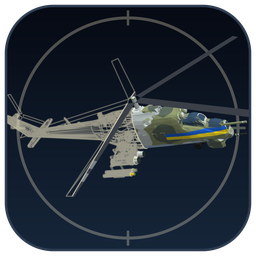

# HIND REBUILT

[Česky](README.cs.md)



A Mi-24 helicopter simulator for Linux and Windows, a rebuild of the game *Hind* (Digital Integration, 1996):
flat-shaded polygon graphics, a green vector HUD and keyboard controls as in the original.
Any resolution, joysticks, HOTASes and gamepads through SDL2, and co-op over the local network
for up to ten players: pilots in their own Hinds and gunners at the sight and the door guns
([Network play](#network-play-pilot-and-gunner)).

What can be played: the original's menu, mission planning and debriefing, its training, single
missions and campaigns (Afghanistan, Kazakhstan, Korea) and the pilots' log. On top of that there
is an entirely new campaign the original game never had: [Ukraine](#ukraine), hunting Shahed
drones and jet Geran-3s by night in Mi-24s in the colours of the former Czech Hinds. More changes
and additions are on the way.

## Contents

<!-- toc:begin -->

- [Getting started](#getting-started)
- [The original game's data](#the-original-games-data)
- [Sound](#sound)
- [Menu](#menu)
- [Missions](#missions)
  - [Ukraine](#ukraine)
  - [Orders to the wingman](#orders-to-the-wingman)
  - [Reconnaissance and laser designation](#reconnaissance-and-laser-designation)
  - [Troop drop and evacuation](#troop-drop-and-evacuation)
  - [The enemy fires](#the-enemy-fires)
- [Pilot's Log](#pilots-log)
- [Network play (pilot and gunner)](#network-play-pilot-and-gunner)
  - [From the menu: Flight → Network](#from-the-menu-flight--network)
  - [Messages](#messages)
  - [From the command line](#from-the-command-line)
  - [Second pilot (wingman)](#second-pilot-wingman)
- [Building](#building)
  - [For Windows](#for-windows)
- [How to fly](#how-to-fly)
  - [Cheat sheet: collective for level flight](#cheat-sheet-collective-for-level-flight)
  - [Matching speed with a Shahed](#matching-speed-with-a-shahed)
  - [Autorotation](#autorotation)
- [Controls (keyboard)](#controls-keyboard)
  - [Flight models](#flight-models)
- [HUD in navigation mode](#hud-in-navigation-mode)
- [HUD in weapon mode](#hud-in-weapon-mode)
- [Configuration](#configuration)
- [Developer options](#developer-options)
- [Structure](#structure)
- [License](#license)

<!-- toc:end -->

## Getting started

1. **Get the original Hind.** The remake does not contain the original game's data (models,
   cockpits, landscapes, sounds, missions) and will not run without them. It can be bought
   legally:
   - on [GOG](https://www.gog.com/en/game/hind) (the DOS version in DOSBox, with the manual),
   - on [Steam](https://store.steampowered.com/app/2577400/) (since 2025, published by MicroProse).

   The original CD or its image (`.iso`) will do too, or the game installed in DOSBox. On Linux,
   GOG's (Windows) installer unpacks with `innoextract setup_hind_*.exe` (the `innoextract`
   package), or install the game through Heroic or Lutris. The Steam game downloads on Linux with
   Proton turned on.
2. **Get HIND REBUILT.** For Windows there is a ready package, `hind-win.zip`
   ([download it from GitHub](https://github.com/jan-vratny/hind-rebuilt/releases), unpack it and run `hind.exe`); on Linux the game builds with one command (see [Building](#building)).
3. **Start it.** At the first start it asks where the original game is: it offers what it finds
   itself (a GOG, Steam or DOSBox installation, a CD in a drive, an `.iso` image), otherwise type
   the path or choose it in a dialog (see [The first start](#the-original-games-data)).
4. **Fly.** From the menu, Quickstart → Arcade goes straight into a mission. The basic controls:

   | Key | |
   |---|---|
   | arrows | cyclic (bank and pitch) |
   | Q / A, or 1 … 0 | collective (power); 9 (90 %) to take off, about 8 to hover |
   | Z / X | pedals |
   | Enter / space | next weapon / fire (the computer gunner locks the target) |
   | F2 / F3 / F6 | pilot's / gunner's cockpit / view from outside |
   | Esc | back to the menu |

   A joystick, pedals or a gamepad are set up in Preferences. All the keys are in
   [Controls](#controls-keyboard).

So far it has been tried with the CD, its image and the game installed in DOSBox; the GOG and
Steam versions should work the same (they are the same DOS game in DOSBox). If they do not,
let us know.

## The original game's data

The game loads everything it needs of the original straight from its data: the 3D models and
their textures (`3DDATA`), the menu and planning pictures (`MENUSCRN`, `UIDATA`, `FONTS`), the
cockpits (`COCKPITS`), the war zones' landscapes (`*.WZ`), the sounds (`SOUND`), the missions and
campaigns (`MISSDATA`) and the units' formations from `HIND.EXE`; from the CD the speech, the
music and the animations. Nothing from the original is stored in the repository.

HIND REBUILT is an unofficial fan project, not affiliated with Digital Integration or with the
holders of the rights to the original game. *Hind* and *Digital Integration* are trademarks of
their respective owners; their names are used here only to refer to the original game. The
project contains no code or data of the original; the file formats were worked out for
interoperability. It is played with the original's data, which players have to obtain
themselves: the original's CD is enough, or its image (`.iso`), or the game installed (e.g. in
DOSBox). Without them the game will not run.

**The first start:** the game looks for the data in `[data] original_dir` in hind.ini, in
`~/dosbox/c/DI/HIND` and similar places. When it does not find them, it asks for them on a
screen of its own:
- **It offers what it found:** an installed game, a CD in a drive (on Linux the media mounted
  under `/media`, on Windows the CD drives) and `*.iso` images with "hind" in the name in the
  home directory, the downloads, the desktop and DOSBox's directories.
- **The path can be typed** (Tab completes it and further presses go round the matches as in bash, Shift+Tab back; Ctrl+V pastes) or chosen in the system's
  dialog: F2 a folder, F3 an `.iso` image. On Windows it is the system's dialog, on Linux zenity
  or kdialog if installed.
- **From a CD or an image** the game copies its data once (about 65 MB; everything is on the
  CD, `HIND.EXE` too, in `FILESD`) into an `original` folder next to hind.ini. The CD is then
  needed only for the briefings' speech, the music and the animations.
- **The choice is written** into hind.ini (`original_dir`, `cd`). Esc quits the game, as without
  the data it cannot be played. The screen comes back with `--setup`; another directory can also
  be given with `--original DIR`.

(Screenshots and model sheets made off screen, the developer options, run without the data
too: the vehicles are boxes then, the cockpit modelled and the landscape procedural.)

Landscape: the default is Afghanistan (`AFGHAN.WZ`). A mission takes place around the airfield
it starts from, free flight around Bagram. Other zones are chosen with `[world] zone` or
`--zone`: `kazak`, `korea`, `saratov`, `ukraine` (the Saratov steppe of the Ukrainian campaign),
or `procedural` for our own generated landscape with green fields, forests and lakes. The
zone's ground colour we derive from its fog (see The zones' ground colour below); the original
takes it from textures (`TEXT64*.RAW`) we do not read yet. Kazakhstan and Saratov have only a
copy of Korea's list of airfields in the original's data; the game therefore finds their
airfields by the runway markings in the landscape. Free flight (without a mission) starts on the
runway of the biggest, missions where they put you.

The landscape has the zone's buildings, bridges, groves and bushes from `GNDOBJS.BIN` with the
original's models (towns, villages, hangars, the government building in Seoul…). Buildings
have their vertices packed bytewise in `3DOBJS.BIN` (described in `src/gamedata/original.hpp`).
The zone's runways are put together from the original's markings: rows of centre line stripes,
numbers at the ends and touchdown marks. Asphalt is laid under them and the terrain around is
levelled. The taxiways, aprons and stands are areas of the original's map (`FEATURES.BIN`,
roads and airfields), and the game paints them on the ground about the runway as the original
does, all in its palette's grey 11. The player stands where the mission puts them (in training
on the apron by the hangars). Kazakhstan and Saratov have their airfields by the runway markings
(see above). Our own airfield with a stand and
buildings remains only where the zone has none (a start "in the field") and with
`[world] scenery = 0`.

## Sound

The sounds are the original's (`SOUND/MAXIMAL.BLK`, blocks of 8-bit samples at 11025 Hz). Which
block is what was found out by listening, and the list is in `src/gamedata/sound.hpp`. Playing:

- the engine and the rotor blades, louder and higher with the rotor's speed, quieter with
  distance outside;
- the cannon and the machine gun while firing; launches of rockets, Shturms and bombs; the
  turret turning; the landing gear; touchdowns from a light tap to a hard impact by the sink
  rate; the airframe creaking under high g; flares; crashes;
- explosions by weapon (a splash in water) and enemy fire. They are heard delayed by the speed
  of sound and quieter with distance;
- voices, one after another:
  - Natasha: engine failure and fire, low fuel, engine overtorque, low rotor speed,
    "pull up", radar lock by type, missile launch, ground fire;
  - the WSO: on and off, weapon armed, weapons safe, what target he has locked (by the
    original's object name), target destroyed;
  - flight control: clearance for takeoff at the start of a mission, the heading to the next
    waypoint ("vector" and three digits), clearance to land at the home airfield, a reprimand
    for firing on friendlies.

From the original's CD (see `[data] cd`) the music plays in the menu and the debriefings, and
the briefings and debriefings are read aloud. The drones of the Ukrainian campaign have sounds
of their own that the game synthesises (the piston Shahed, the jet Geran-3).

## Menu

The game starts in the original's menu (pictures and buttons from `MENUSCRN`; a pressed button
is a separate picture of the original):

- **Quickstart**: **Arcade** and **Invincible** offer a war (as in the original, manual p. 5)
  and take off straight into a random single mission of it with the Stable flight model (M switches to another) and
  infinite ammunition; Invincible also without crashes and damage. Quickstart is not judged by the mission's targets: a crash is FAILURE, coming through SUCCESS and coming through with 3000 points OUTSTANDING; the debriefing shows the score, the time in the air and what you shot down. Own and allied units take off twice their worth (an allied Hind −600), so the score can go below zero. In Arcade only the door GShG counts its rounds: after 1500 it reloads for 6 s ("RELOADING GSG") and is full again.
  - **Ukraine** in Quickstart: the mission by day (the night raids move to 11:00) and with no
    flight out to the patrol line. The battlefield runs ahead until the first drone is 7 km
    from the line's middle, and the Hind, the wingman and the Hip start there in the air,
    facing it. Then there is no waiting: 16 drones are in the air in a steady stream, each coming in from 2.5–8.5 km ahead of the Hind and heading past it, from where exactly differs each time the game is run. One shot down comes back after 6 s, and so does one that gets 9 km past the player. One Banderol cruise missile flies in the stream too (see below): it comes in from 15–22 km, turns off to a side on the way and then heads for where the Hind is now, missing it by a few hundred metres (in under two minutes from the start); shot down or 9 km past, it comes again. What the Hind carries is the toggle under the Ukraine stone on Quickstart's choice of the war (after Arcade or Invincible, key W, remembered in hind.ini as `[weapons] quick_ukraine`): "Ukraine: R-60" (the default) is R-60s on the outer pylons, "Ukraine: Interceptors" the interceptor drones' rack, which is no use against the Banderol though. Both door guns always. The R-60s fired off are reloaded 20 s later ("RELOADING R-60", "R-60 LOADED"), but only here, not in the missions. The stream never ends and no fuel is used; Ctrl+Q ends the flight. The mission's
    result counts the last state of the drones only, the Arcade score every kill. Network wingmen start in the
    air too, to the right of and behind the pilot (one joining later appears beside the pilot,
    wherever the pilot is flying).
  - **Arcade scores:** the player's destroyed targets (soldier 10, truck 40, armoured vehicle 75,
    tank 150, air defence 75 to 125 more, helicopter 300, aircraft 400, Shahed 150, Banderol 500; our own and
    neutral units are subtracted twice over) and the mission's result (success 250,
    outstanding 500). The score is at the top right of the HUD. Invincible does not score.
  - **Top Ten** (T) shows the ten best Arcade scores (`topten.txt` next to `hind.ini`), with an x for a flight that ended in a crash. Arcade and Invincible are not written to the Pilot's Log, which is for missions only.
    When the score after a flight is high enough, an empty row for the pilot's name appears in
    the table (filled in with the pilot from the Pilot's Log); Enter writes it, Esc does not.
- **Flight**:
  - **Training** shows 20 training missions (Saratov) with the briefing on the right. Commit
    confirms the mission, the buttons Infinite weapons (I) and No crashes (N) turn on infinite
    ammunition and flight without crashes, WSO targets allies (A) lets the WSO lock on our own
    forces too (otherwise he skips them; you can always shoot at them). Gunner hints (H) turns
    the door gunners' shot indicator on the HUD on or off (remembered in hind.ini).
  - **Single Mission** offers a war (Kazakhstan, Korea, Afghanistan) and then its single
    missions. At the end of a row is a dot, or an x for a mission whose last logged flight failed (per pilot).
  - **Campaign** offers a war and shows its campaign page (the original's picture `C_AFGHAN.LBM`,
    `C_KAZAK.LBM`, `C_KOREA.LBM`; for Ukraine ours in the Afghan frame: the game renders it
    itself off screen the first time it is opened, a Hind at dusk over the steppe, and saves it
    as `C_UKRAINE.PPM` next to `hind.ini`; delete it to have it rendered again). The campaign
    runs as in the original:
    - **Levels:** ten levels (the Ukrainian eight), two or three missions each. A random
      mission of the level you have not tried yet is played, and when you have tried them all,
      one of the failed ones.
    - **Success** moves you a level up, **failure** costs one of three lives and the level is
      tried again with another mission. Losing the last life ends the campaign, as does winning
      the last level; the next campaign starts from the beginning.
    - **Texts:** at the start the campaign's introduction and the first level's situation,
      after a success the next level's situation, after a failure "stalemate", finally the
      level lost or the campaign won (the original's files `AFGHNL00.TXT` to `L10`, ours
      `data/missions/UKRAIL00.TXT` to `L08`). With the CD the original reads them aloud (see
      `[data] cd`). A click or Enter goes on, Exit back to the choice of war.
    - After a campaign mission the game returns to its page with how it went.
- At the bottom right **GoTo** (G) opens the original's menu and **Exit** goes a step back. In
  the main menu there is **Quit** instead, which asks whether to quit the game (Y / N).

The 640×480 screen is scaled up as far as it fits the window. The pixels of the original
pictures stay sharp and equally large even at a non-integer scale: the screen is first drawn
at a whole multiple (3× for 2.25×) and only then smoothly shrunk into the window, so the
lettering has strokes of the same weight everywhere and everything keeps its proportions. On a
widescreen monitor it lies like a plate with a shadow on the original's brushed steel
(`TWO_PLYR.LBM`). The original pictures are not altered in any way.

Controls:

- the mouse;
- the arrows and Enter;
- the button's initial letter (Q, F, T, S, C, A…);
- Esc goes back.

**GoTo → Recognition** opens the library of units (`V_RECON.LBM`):
- **Contents:** the aircraft and helicopters, vehicles and ships of the manual's inventory
  (Vehicle Inventory, pp. 88–91), plus the Shahed-136 and Geran-3 drones, the Banderol cruise missile and our Litavr interceptor drone.
- **Model:** on the left the unit's model from the original's data turns with its textures.
  Helicopters have our rotor blades, because the original draws them itself. Under the model
  are its name and who has the unit.
- **Voice:** where the original has it, the gunner says the unit's name.
- **Controls:** browse with the ◂◂ ▸▸ buttons or the arrows; Aircraft, Vehicles and Ships
  (A, V, S) switch the list. Exit returns to the page the library was opened from.

**GoTo → Animations** plays one of the original's animations, chosen at random, as the original does:
- **Where from:** the animations are only on the original's CD (`ANIMS/*.Q3`, see `[data] cd`).
  Without the CD the game says they are on the CD.
- **Playback:** 12.5 frames a second, doubled in size, without sound and music. At the end, or
  after a key or a click, the game returns to the page the animation was started from.
- **Format:** DI's own format (`src/gamedata/anim.hpp`): the first frame whole, the next ones
  as changes in 8×8 blocks, as `HIND95.EXE` decodes them.

**Preferences** is opened by a button in the main menu (P) or GoTo → Preferences. It is the
original's screen (`PREFSB.LBM`) with our settings on steel bars:
- **Sound and picture on the left:** sound, volume, voices, scenery, view distance, full screen,
  music in the menu.
- **Flight and combat on the right:** flight model, crashes, enemy fire, enemy skill, gunner
  hints, mouse aim and antialiasing (applies from the next start of the game).
- **Controls:** a click switches to the next value, the right button to the previous one. The
  up and down arrows select, left and right change.
- **The glass panel** shows what the selected setting does and when it takes effect.
- **Saving:** everything is saved to `hind.ini` at once. Sound, volume, music and full screen
  apply immediately, antialiasing from the next start of the game, the rest from the next flight.
- **The panel at the bottom right** is the joystick. It shows live the position of the stick,
  the collective, the pedals, the hat and the look axes, each from the device it belongs to.
  - A click on the name (or the left and right arrows when the panel is selected) switches the
    main device: its buttons fire. The last choice is Off.
  - A click in the panel (or Enter) starts learning the axes. The game tells you step by step
    what to move: the stick right, the stick forward, the collective up, the right pedal, the
    look axis right and up, the hat up. It takes the axis that moved most, from any device, and
    from the direction of the movement it also recognises a reversed axis. Space skips a step
    (that control then stays on the keyboard only), Esc leaves the settings as they were.
  - The stick, the collective and the pedals can thus be three different devices. The glass
    panel shows the devices (A, B, …) and each control with its axis and position.

Esc in flight, Quit on the planning screens and Esc after the mission's debriefing lead back
to the menu.

## Missions

The original's campaign is played. The default is the Afghan one: 24 missions from
`MISSDATA/AFGHNC*.DTA`, starting from Jalalabad airfield. Before takeoff the mission is planned
as in the original (pictures from `MENUSCRN`, the font `FONTS/11X15.LBM`, colours and the close
box from `UIDATA`). The map with the route always fills the screen. On the right is the brick
"Map Tool Box" panel with the buttons Briefing, Takeoff, Zoom, Rotate, Way, Disable, Back, Fit,
Key, Met, 3D, Pay, Point, Task, Save, Restore and Exit at the bottom. A button responds when
the mouse button is released, as in the original. Planning does not scale with the window: the
buttons, windows and lettering have a fixed size (`[video] ui_scale`, default 2 = two window
pixels per pixel of the original) and a larger window shows more of the map; the Map Tool Box
stays at the right edge, Exit in the corner. Only a window smaller than 1120×800 is scaled down
as a whole. What a button opens comes in a window over the map, closed by the small square at
its top left (or Esc, which closes the front window). A window can be moved by dragging its
title (the top line) and resized by dragging the small triangle in its bottom right corner (the
original has the square `RESIZE.BM` there and only moves the window with it). The briefing is
rewrapped on resizing, the 3D view grows with the window. The payload has a fixed picture size.
Keys:

- **Briefing** (B): a brick window with the mission's name in the title and the white text of
  the task by pages (PgUp/PgDn, arrows, wheel). It shows only the orders; the mission file's
  other paragraphs belong to the debriefing.
- **Takeoff** (Enter), **Exit** (Esc with no window open).
- **The map** as in the original, drawn pixel by pixel at 640×480 from the zone's data:
  - the terrain's facets in the sand shades of the map's palette (`3DPAL.RGB`, colours 192–207);
  - water, roads, airfields, towns, rivers and tracks from `FEATURES.BIN`;
  - contour lines every 250 feet from the height grid (sparser when zoomed out; the original keeps
    them all and the map gets cluttered);
  - a 1 km grid (wider when zoomed out);
  - air defence range circles as in the original: round the mission's `:Gameplay AAA` and `SAM`
    sites, blue on our ground and orange on the enemy's, guns 2 nautical miles and missiles 5
    (measured on the original's map), a compass;
  - with Sides every fourth pixel is a dot, blue on our ground and orange on the enemy's
    (`:Gameplay Sides`);
  - the route in white (points in a circle, targets X, Y, Z in a triangle, the selected point
    blue, the departure in a square), under it in brick the route as the mission gave it (a
    moved point leaves its trace).

  **Zoom**, **Rotate**, **Way** and **Disable** are, as in the original, modes of the map (the
  active one pressed in) and decide what a click and a drag on the map do:
  - **Zoom** (+, also zooms in a bit): dragging draws a grey rectangle centred where the drag
    started, with a corner at the mouse and the screen's aspect ratio. Dragging to the right
    zooms in: the rectangle's area fills the screen. Dragging to the left zooms out: the whole
    screen fits in the rectangle. A click alone does nothing.
  - **Rotate**: dragging turns the map about the screen's centre by the angle the mouse goes
    round the centre; from the keyboard comma and period by 15°.
  - **Way** (W): opens the points window; a click on the map moves the point selected in the
    window there and drags it while held (departure and landing are fixed). The arrows move it
    (five times further with Shift), **Ins** (Insert, I) inserts a point after the selected
    one, **Del** (Delete) deletes it.
  - **Disable** (D): the mouse does nothing on the map, the points window closes.

  **Back** (−) zooms out, **Fit** (F) returns to the default view (the whole route, north up).
  The wheel zooms towards the mouse. The right button moves the map by half a screen towards
  the side you click (left, right, up, down), as in the original; the middle button also drags
  the map in every mode, and the arrows move it outside Way mode. Tab / Shift+Tab selects a
  point. A click on the map without dragging (outside Way) shows the place in the 3D window.
- **Way** (W): a window with the buttons **Ins**, **Del**, **Info** (Shift+W) and the route's
  points (A, B, X, C…). Info opens the selected point's window as in the original: position
  (east, north in metres, height in feet) in boxes digit by digit, type, speed in knots, delay,
  flight time to the point and the leg's length. The left button on a digit raises it, the
  right one lowers it (fixed points cannot be moved). PgUp/PgDn change the speed by 10 knots,
  with Shift the delay by 5 s. For a target, the title says what stands there, e.g. "Waypoint X
  (Government Building)": the nearest building of the zone or unit of the mission within 200 m
  that the WSO has a name for (names by the WSO's calls, as the original says them).
- **Key** (K): a column of switches for the map's layers: Grid Lines, Waypoints, Compass,
  Allied AAA, Allied SAM, Enemy AAA, Enemy SAM (air defence range circles), Sides (whose ground is where).
- **Met** (M): wind and weather. **Task** (T): the Task Box with the task's flights (the player
  Immortal, the wingmen). A click on a wingman shows his route in orange.
- **Point** (O): a window that shows, as the mouse moves over the map, the terrain's height,
  whose territory it is and what is under the cursor.
- **Save** (S) remembers the route, **Restore** (R) brings it back (with nothing saved, the
  mission's route).
- **3D** (3): a window with a 3D view of the place you click on the map (or select with Tab).
  Modes at the bottom (PgUp/PgDn): **Sat** a picture straight from above, **Point** the camera
  circles the place, **Fly** the camera flies to the place. A grey "3D" on the map shows where
  the camera is.
- **Pay** (P): a window with the picture `PAYLOAD.LBM` of the Hind and its weapons laid out on
  concrete. A click on a pylon selects a pair of pylons. A click on a weapon on the ground
  opens, at the cursor, a menu of the pylons it can be hung on (Inner, Outer, Wingtip Pylon),
  and a click on an item hangs it there, as in the original. A click on a hung weapon takes it
  off, so the helicopter can be disarmed (except for the machine gun in the turret). A click on
  the machine gun in the window removes it. At the bottom is a brick bar saying what is under
  the mouse or on the selected pylon. From the keyboard (when the window is in front):
  - the up and down arrows or 1–3 select a pylon;
  - the left and right arrows cycle through the weapons that fit it;
  - N empties the pylon.

  A weapon that does not belong on the selected pylon is hung on the outermost pylon it
  belongs on (so a Shturm goes on the wing tips).

  In the bottom corners there is also a four-barrelled GShG-7.62 machine gun for the cabin
  doors, with a gunner (the picture is not from the original, see `CREDITS.md`). A click on it
  offers Left Door, Right Door and Both Doors. The gun then sticks out of the cabin's window.
  A click on the side of the fuselage behind the cockpit selects the doors. From the keyboard
  the doors are 4 and 5 (or the down arrow after the pylons), the left and right arrows add or
  remove the gun and N removes it. The gun with its gunner weighs about 150 kg: the gun 19 kg,
  1500 rounds of 7.62 × 54R in links at 25 g, the mount about 10 kg and the gunner with his kit
  85 kg. The original's mission data say nothing about door guns: the drone missions (Shahed, Geran-3,
  Gerbera) have both doors manned, the others none, and it can be changed here.

  The original's rules apply. For example FAB-500, ZAB-500, the 57 mm pod (UB-32), UPK-23 and
  KMGU only on the inner pylons, R-60 only on the outer ones, 9M114 on the outer ones and the
  wing tips. On the concrete on the left lies the 57 mm pod (UB-32, 32 S-5 rockets), next to
  it the 80 mm one (B-8V20, 20 S-8 rockets); on the pylons the original's pictures `UB32A_*`
  and `B-8_*` are drawn. The hung weapons are drawn into the picture from cut-outs of the
  original. A mission loads its weapons itself by its data (`:Weapon`), just like the original.
  They can be changed on the screen and are saved to `[weapons]` in hind.ini (which applies to
  free flight).

Enter takes off with the planned route and weapons, Esc quits the game. The moving map shows
the route and in red the point being flown to. The HSI needle points to that point and the
counter under it shows the distance to it. On the HUD, under the heading scale, a small caret
shows the heading to that point; outside the scale's range it stays at the nearer edge.
After passing a point (within 800 m) the navigation switches to the next one, the W key
switches manually and after the last point the navigation leads home.

On the battlefield are the mission's forces:
- our convoys, patrols, camps and parked aircraft;
- mujahideen with DShK machine guns, mortars and RPGs.

Units drive and walk along their routes from the mission, helicopters and aircraft fly. The
missions give jets the speeds of a helicopter (Su-25 around 200 km/h, below its stall speed),
so in the air they fly at least 450 km/h and 250 km/h on the approach to land. Formations
(e.g. "Mujaheddin with DSHK Machine Gun") are read straight from `HIND.EXE`. The debriefing
follows the mission's numbers: how many destroyed targets are needed for success and how many
for an outstanding result. For success the primary targets must fall (at most as many as the
mission has) and the other targets count towards the mission's number too (KOREAC14 wants 20
kills, it has only 6 primary targets). The zone's buildings within 400 m of the route's target
points that do not stand on our territory are targets too. When a mission has no primary
targets and wants nothing for success (its targets are just buildings: the radar in KOREAS02,
the village in AFGHNS01), the buildings at the targets become primary and at least half of them
have to be destroyed. How the original counts it we do not know yet. Landing at home (within
2 km of the start) ends the mission and shows the result.

The missions have a `:Gameplay` section at the end. `Sides` says whose each cell of the zone is
(16384 feet), and on the points of `AAA` and `SAM` the game itself places the air defence of the
cell's side. On our territory there are ZSU-23-4s and SA-13s, on the enemy's in Afghanistan the
mujahideen's DShKs and Strelas, in Kazakhstan ZSU-23-4s and Strelas, in Korea M163 Vulcans and
Stingers. What units the original places there we do not know yet. In Korea that is over a
hundred sites all over the zone.

The end of a mission looks as in the original. Ctrl+Q in flight stops the game and shows the
original's "END MISSION? Y/N" table (`COCKPITS/ENDMISS.640`). N or Esc flies on, Y ends the
mission as aborted. After the end of a mission (landing at home, being shot down or Y) comes
the debriefing as in the original: the map with the route, at the top right a single Debrief
button (opens and closes the window, key D) and at the bottom right Exit (also Enter and Esc),
which leads back to the menu. The window has the mission and the result in its title
("Shipping Attack - ABORTED", SUCCESS, OUTSTANDING, FAILURE). Under it is the mission's text for
that result (`:Outstanding`, `:Success`, `:Failure`; an aborted mission gets the failure text).
Then, in the original's sentences (from `HIND.EXE`), how it was flown and what was done: "Good
flying.", or "Mission Failed - Hind destroyed." and how ("Hind was shot down by ZSU-23-4.",
"Hind collided with ...", "Your crash was a result of your vertical speed at the time of
landing."), the troops, the mines, the reconnaissance, "Enough targets for success." /
"Insufficient targets destroyed." and the waypoint targets ("However, not all waypoint targets
were destroyed."). Under that our counts (how many primary targets are needed), and last, as in
the original, what was destroyed by whom: "Targets destroyed by you:", "by your wingman:" (or
the network player's name), "by other allied forces:" and "by enemy forces:", each with the
groups "Enemy Targets", "Allied Targets", "Friendly Fire Casualties Caused", "Civilian
Casualties" and lines like "23 x MUJAHEDDIN". The unit names are ours for now (the original has
its own, longer ones). A longer text scrolls as in the original: a scroll bar on the left under
the close box (its thumb can be dragged, a click above or below it moves a page), the mouse
wheel, the arrows, PgUp/PgDn, Home/End. Then the game asks whether to write the mission into
the Pilot's Log (see below).

Choose a specific mission with `--mission AFGHNS03` or in `[world] mission`; `--missions` lists
them all. `--mission none` is free flight over the training range near Bagram.

### Ukraine

The remake's own campaign: hunting Shahed-136 drones over Ukrainian cities. On the menu's page
of wars there is a fourth button UKRAINE (put together at runtime from the letters of the
original's buttons, key U). The war is fought on the original's Saratov zone, whose steppe and
river stand in for Ukraine. The missions are in `data/missions/UKRAIC01` to `08` in the
original's format with one extension: `:Drone Name` (a unit by name, e.g. `Shahed_136`,
`Mi_17_Hip_H`). They are written by the script `tools/ukraine_missions.py` from a description
in metres and seconds.

The Hind in the Ukrainian missions, in training with Shaheds (every mission with Shaheds,
Gerberas or Geran-3s) and in free flight over `zone = ukraine` wears (as do all our Hinds in that mission,
the AI wingman and the parked ones) the colours of the retired Czech Mi-24Vs that now fly in
Ukraine (after their photographs):
- **Camouflage:** the Czech three-tone, olive, light grey and dark grey green, instead of the
  original's green and sand.
- **A blue and yellow stripe** along the nose under the cockpits and on the cabin's side behind
  the door.
- **Wing tip plates:** blue over yellow.
- **Tail boom:** two white bands all round.

The camouflage is a tile of its own in the texture atlas (`render/livery.cpp`), the markings are
painted by the scene shader by the place on the airframe (`uLivery`).

- The Shahed-136 flies at about 180 km/h low over the landscape along a route with doglegs and
  at its end dives at its target (an airfield, a town, a railway bridge, a power station,
  depots). When it gets through it counts as a loss, not as shot down, and "DRONE HIT ITS
  TARGET" is announced. How many may get through is given by the mission's `:Failure Count`.
- No two Shaheds fly alike. Each has a slightly different speed (±8 %), weaves a little about
  its heading (about 15 m) and its height slowly undulates by 20–45 m, at the lowest 25 m above
  the ground. At the end it goes into a 35° dive at its target and speeds up by a fifth. The
  properties are derived from the place of launch, so they are the same on every flight.
- A drone shot down flies on by its momentum and falls on a ballistic path, its nose along its
  fall, spinning once a second about its length and trailing smoke. On the ground it burns
  out.
- From the mission Two Directions on, Gerbera decoys fly among the Shaheds (`:Drone Name
  Gerbera`). They look and fly the same and the Mi-17 reports them as Shaheds. They have no
  warhead, so at the end of their route they just fall and destroy nothing. Shot down they do
  not count; the debriefing lists them separately.
- In the missions The Swarm and The Long Night jet Shaheds come too, Geran-3s (Shahed-238,
  `:Drone Name Geran_3`): the same black delta with a turbojet, its nozzle in the tail and the
  intake on the back (`render::buildGeran3`). They fly at about 330 km/h, higher and from
  further out, and speed up to about 550 km/h in the dive onto the target. The Mi-24 cannot
  catch them from behind and the door gunners get no shot at them, so they are met head on: with
  the gun or the R-60s the helicopter carries on its outer pylons in those missions (UPK-23
  gun pods on the inner ones). The turret machine gun is enough for a drone only up close: a Shahed takes about 20 hits and the rounds needed climb fast with distance. The Mi-17
  calls them "JET SHAHED". They are heard as a jet engine (the exhaust's roar and the
  compressor's whine), louder than a Shahed. By day it can be tried in the training mission
  "Operational Training - Jet Drones" (`SARATT23`): four Geran-3s at the airfield at 11:30.
- The S8000 Banderol cruise missile (`:Drone Name Banderol`, so far only in Quickstart over
  Ukraine): a Russian jet missile launched from an Orion drone, 5 m long, its swept wings under
  the body (`render::buildBanderol`). It flies at about 500 km/h without weaving, low (about
  100 m, following the ground four times as steeply as a Shahed) and speeds up to 650 km/h in
  the dive onto its target. The Mi-24 can only get in its way: the R-60 sees it from 7 km from
  any side, an interceptor drone is slower and is not launched at it. The Mi-17 calls it
  "BANDEROL".
- The AI Mi-24s of our flight over Ukraine (missions UKRAI*, Quickstart too) carry what the
  player does not (`sim::WingArms`). With R-60s on the player's outer pylons they all have the
  interceptor drones' rack, else the wingman (the first of them) has R-60s and the others the
  interceptors. The R-60 wingman fires at a fast drone (a Banderol, a Geran-3) within 6 km and
  90° of his heading that none of our R-60s is after yet, one at a time, waiting for the result.
  The interceptors are launched by the crew as on the player's Hind, but at any drone other than
  the Banderol, a Shahed too (an AI Hind has no door gun for it). Their rounds fly, hit and are
  drawn as the player's, their stores hang under their wings (the drones left on the rack too)
  and in a network game the other players see both. The kills count as the wingman's. In Quickstart their R-60s are reloaded as the player's are and the flight keeps
  with the player from the start (order 2 Follow me), not along the mission's route; order 4
  Resume flightplan sends it back onto it.
- Interceptor drones (store code 30, ours): on the inner pylons a frame of six Litavr drones
  (two tiers of three, the middle drone further forward), as the Ukrainian crews hang them
  under a Mi-8 or Mi-17. On the Mi-24 it hangs under the wing between the pylons and back by the
  trailing edge, the lower tier behind the wheel, so that the wing hides it from the GShG in the
  door and it is not in its way. It takes the outer pylons too: nothing goes on them then (a
  mission's stores there are left off); so the Pay screen offers it as "Both Pylons". A Litavr is a 1 m body like a rocket's, a camera with two lenses in the nose,
  a cross of small fins at the tail, and instead of a rocket motor four arms in an X with
  nacelles and pusher propellers. Each is slid onto two prongs that stay sticking out once it
  is gone; the frame empties from the bottom. They are the crew's, not the pilot's: the door
  gunner (the computer, while no player sits at a door) lets one go by himself only at a jet
  Geran-3 within 5 km that none is after yet, leaving the slower Shaheds to his GShG. The pilot
  can order him with G (outside the door view) to send one at his target (the WSO's, switched
  with B, or the one the Hip calls) when it is an enemy drone within 5 km, a Shahed too; without
  such a target at the nearest drone. While the gunner guides it (till it is 1 km from its target and goes on by
  itself) his hands are full: he sends no other one and his GShG is silent; the other gunner's
  is not. It hangs nose forward on the rack (a plane
  with pusher props, not a quadcopter), so it goes off ahead and for the first second turns
  gently away from the helicopter by itself; only then does it steer itself or the player fly
  it. The interceptor flies at about 400 km/h (the real Litavr 350; we gave it more so it can
  catch a Geran-3), steers itself (proportional navigation) and flies into its target (a
  kinetic hit, a 0.5 kg warhead, going off within 4 m); when its target
  is gone it takes the nearest other, its battery lasts two and a half minutes. D in the air
  holds them as it holds the door guns. The pilot hears "INTERCEPTOR AWAY - 11 LEFT". All the
  Ukrainian campaign's missions but The Swarm carry them, and so does the training mission "Operational Training - Interceptor Drones"
  (`SARATT24`); on the Pay screen the frame lies on the concrete beside the GShG (the picture is
  not the original's, the game draws it). A player at a door (F4, or a crew member over the network) launches and flies them himself,
  though, and the computer then launches none: G sends an interceptor out and
  the view goes to its camera (at night as an infra-red one, the hot engines glowing). The
  picture comes over an analogue radio link: a little soft and grainy, with lines, and the
  further the drone is from the helicopter the noisier (clean within 300 m, at 4 km full of
  noise with torn rows). The mouse
  is a stick then: where you push it, it stays, and the drone turns until you bring it back to
  the centre (the ring round the cross is full deflection, the diamond the stick). Alt + arrows
  and the hat turn it while held, over the network the arrows too. The joystick (a gamepad's
  left stick) flies it as a plane, forward is down; the helicopter's cyclic meanwhile stays
  where it was and back at the door goes back to the stick over a second. Button 1 (gamepad
  B) picks the next target, button 2 (X) lets the drone go. It is a
  plane: it takes a moment to bank into a turn (gently round the stick's centre, fully at its edge) and at full
  speed turns no harder than about 6 g, a circle of some 200 m radius; slower its wings lift less,
  so not even fresh off the rack does it turn tighter. At the top its speed, battery and how
  many are left. The camera marks the enemy aircraft, helicopters and drones within 3 km ahead
  with small corners. The one picked (at first the one nearest the middle of the picture, B the
  next) is bracketed with its name and range. Once it is within 1 km the brackets close into a
  box and "FIRE TO LOCK": the trigger locks the drone on it (the real Litavr's "Last Mile /
  Pixel Lock"), and from then on it flies itself and the player's hands are free. The camera
  watches the locked drone until it hits, the box with ticks at its corners and "LOCKED", and G
  sends the next drone out straight away. In the drone's camera the trigger fires nothing
  else. Not locked, it goes off by itself within 6 m of an enemy drone,
  aircraft or helicopter. Flown into anything it goes off too: our own Mi-17 goes down,
  another Mi-24 only when hit in the tail (from behind), elsewhere it takes the hit. In
  our own Mi-24 it takes out the engine on that side (one engine gets you down, just about; a
  second hit from the other side takes that one too), at the back the tail rotor; into the main
  rotor's disc, or one time in five when its fragments fly up into the blades, it is the end. G again, F4 or any other view lets it go to find its target itself (a network player lets it go with G only) and the view goes
  back to the door; when it goes off or its battery runs out, the view goes back by itself after
  a moment.
- The R-60's seeker sees the Geran-3's hot nozzle (like aircraft and helicopters) out to 7 km.
  The faint, air-cooled piston engine of a Shahed or a Gerbera only from behind (within 60° of
  its tail) out to 1.5 km, from elsewhere 600 m. Against Shaheds the gun is therefore the main
  weapon. The `FAR` after the target's name on the HUD takes it into account.
- The R-60 as in the original (manual p. 68): its seeker locks only on the target the WSO
  holds (by himself, or with the keys T and B), once that is within 20° of the nose and in its
  reach. The lock is confirmed by cross-hairs over the aiming reticle on the target. Without a
  lock it leaves unguided, flies straight on and goes off where it hits. With the R-60
  selected the WSO looks for fliers out to 7 km and prefers those the seeker can lock on;
  holding one it cannot (say a Shahed going away), he moves to one it can by himself.
- The R-60 has a model after photographs (`render::buildR60`, 2.09 m, `--sheet-model r60`): the
  seeker's glass dome in an orange ring, small destabilisers and canards behind it, the white
  body, at the tail four clipped delta wings with the rollerons' wheels, and the nozzle. So it
  hangs on its APU-60 rail and so it is drawn in flight within 1.5 km (the motor's flame only for
  the 3 s it burns); further off it stays a streak.
- The 9M114 Shturm has a model in flight too, after a photograph (`render::buildShturm`, 1.83 m,
  `--sheet-model 9m114`): olive green, an ogive nose with a silver band, the joints and a
  fitting on its back, a steel band and the narrower tail with the four wrap-around fins sprung
  out (a notch in each trailing edge), which spin it. It turns 11 times a second (the real one
  8 to 15); at 60 frames a second the fins would strobe or seem to turn backwards, so they are
  drawn smeared over one frame's roll. On the pylon it stays in its launch tubes.
- Hot engines at night: the Geran-3's nozzle glows a dull orange even to the naked eye (out to
  3 km). Through night vision (V, an image intensifier keen on the near infrared) it shines as a
  bright spot with a bloom out to 8 km. A piston Shahed shows in night vision only as a faint
  dot at its engine, out to 2.5 km. Jet aircraft nozzles glow the same; helicopters' turboshaft
  exhausts (our Mi-24s' too) shine in night vision and the interceptor's camera as two bright
  spots with a bloom.
- The flight is a trio as with real crews: the player's Mi-24, a wingman Mi-24 and a Mi-17 that
  searches for drones and reports the one nearest to the player: "HIP: SHAHED 2 O'CLOCK 4.3 KM
  LOW"; a diamond shows it on the HUD (in all views; at night the only chance of finding it).
  The call stays on the upper line of the message display while the drone flies, its clock,
  distance and height worked out afresh as you fly, so you can fly to the drone by it; the
  other messages take turns on the lower line. After a kill the Hip calls the next one at
  once, and when it sees none it says "HIP: NO MORE CONTACTS".
  When you move the route's points in planning, the wingman and the Mi-17 follow the new route
  (the key `:Follow Player` in the mission). The Shaheds keep to their courses, though. The WSO
  takes it as his target as soon as it is in his range, and the turret with its YakB gun aims
  at it with lead (it turns only 60° to the side, though, so you have to fly behind it, not
  beside it). The WSO takes the Hip's drone without a word: what and where is on the display
  already.
- The door gunner (GShG-7.62 from the Pay screen) fires on his own at an enemy he sees from his
  window within 900 m, drones first: short bursts with tracers, aimed with lead. At a target in
  the air, though, he fires only in good conditions, as real crews do: close (best within
  120 m, not at all beyond 450 m), with a similar speed (a difference of 20 m/s is still good,
  50 m/s already bad; a helicopter has no brakes) and from above (the drone at least 5 m lower,
  best 25 m). The product of these three conditions gives how good the shot is. Below 0.3 he
  does not fire and only keeps the drone in his sights. While the shot is getting better
  because you are closing on the drone, he waits and saves ammunition. As soon as it stops
  getting better or starts getting worse he fires, and once firing he does not stop. The worse
  the shot, the more he misses. Flying alongside above a Shahed he brings it down within a
  second; crossing, head on or from a hover he does not fire. At the top right of the HUD is
  how good a shot they have when an enemy drone is within 1 km: `DOOR L FIRE`/`WAIT`/`HOLD`
  (the doors from which they reach it, or `NOT IN FIELD`) with a quality bar and a mark at 0.3,
  under it each condition separately with a bar and a number to fly by: `RNG` the distance in
  m, `SPD` how many km/h faster the drone is (+ add power, − reduce; `V` its climb relative to
  us in m/s), `LOW` how many m it is below the helicopter. The indicator is turned off by the
  "Gunner hints" switch in the list of missions (key H) or `[hud] gunner_hints = 0` in
  hind.ini; the game remembers the choice. The Pay plan takes on the left, the right or both
  gunners. Their guns are visible from outside too, turned where they aim. On the original's
  model the doors are then open, showing the grey-green cabin with its seats and the gunner
  sitting behind his gun on its post by the floor. The other players of a network game see the
  other Hinds so too.
- The Shaheds can be heard: a high-revving two-stroke (about 230 exhaust pulses a second,
  irregular, rasping, now and then missing) with a cutting pusher propeller. The original does
  not have this sound, so the game synthesises it. It is played from the drone's place by
  distance, outside up to about 3 km, in the cockpit under the rotor less. Its pitch changes by
  the Doppler effect, so an approaching drone sounds higher and a receding one lower. At most
  the three nearest are heard.
- The missions are at night (moon, stars), one in fog over the river, one without the Mi-17.
  By day the hunt can be tried in training: the last training mission "Operational Training -
  Drone Interception" (`data/missions/SARATT21`, at 11:00 with a Mi-17, three Shaheds at the
  airfield) with a briefing on how to do it. For playing with more people there is "Operational
  Training - Drone Swarm" (`SARATT22`) after it: at noon 24 Shaheds in four waves of six and 4
  Gerberas at the airfield and the town. The patrol line is only 8 km from the airfield, the
  first wave reaches it about two and a half minutes after takeoff and the next ones come every
  two and a half minutes.

### Orders to the wingman

As in the original (manual p. 28), the AI wingman, the mission's second Hind, takes orders with
Ctrl+1 to Ctrl+4. The whole formation takes them with Shift+1 to Shift+4: all our helicopters in
the air, the Mi-17 too in the Shahed missions. He answers by radio with the original's voice
("Hind leader, I'm following you", in formation "we're…") and on the display under the HUD.

| Order | What he does |
|---|---|
| 1 Go home | flies to where he took off from and lands there |
| 2 Follow me | keeps 60 m to your right and 40 m behind you, each next one in the formation a bit further; when he falls behind he speeds up |
| 3 Attack my target | flies at your WSO's target, or the one the Mi-17 reports. A drone, an aircraft or a helicopter he attacks with the gun from 400 m, a ground target with rockets from 1.5 km. When the target falls he follows you again |
| 4 Resume flightplan | returns to his route from the mission |

In a network game Ctrl+number sends messages between players, so orders there go only with
Shift (to the whole formation).

Our other Hinds within 5 km, the AI wingman and other players' Hinds over the network, are
marked on the HUD with a small circle with a tick upwards, so they can be found in the air.

### Reconnaissance and laser designation

- **Reconnaissance** (points of type 6 in the mission's data, X, Y in the plan): over the point
  press R and stay in range (1.5 km) for a few seconds. Flight control answers "good / bad
  reconnaissance data". In reconnaissance missions reporting all the points is a condition of
  success.
- **Laser designation** (a MiG-27 bomber with laser-guided bombs, task type 18): about 40 s
  before the drop "Hind leader, laser designate" is heard. The laser has to illuminate the
  target at its point (X). Either the target locked by the WSO (T or the silicon WSO), or
  without a target the place you look at through the sight, if it is in the laser's field
  (±14° from the nose, 20° up, 60° down). Then comes "target illuminated", at the drop point
  "bombs away", and about 30 s later the bombs fall where the laser is aiming at that moment.
  If the laser has lost the target, the bombs miss. Success is announced by "Comrade, mission
  accomplished". Then you fly home.

### Troop drop and evacuation

Who sits where and who waits for whom the missions take straight from the original's data: a
helicopter has a cargo number (`:Drone cargo`, the player 1), groups of soldiers a helicopter's
number (`:Drone onboard`). A group with a route from point 15 sits in the cabin and gets out
there, a group ending at point 14 waits there to be picked up. There can be more places (pilots
in three places in KOREAS06). Land within 300 m of the place and open the doors with the D key.
The doors open at once, without animation, as in the original: the upper leaves up, the lower
down as a step.

- **Drop:** the soldiers jump out of the cabin one after another (the floor is above the
  ground, so they hop), walk away from the helicopter and then go on along their route from
  the mission. The flight engineer reports "Troop deployed".
- **Evacuation:** those waiting come up, each stretcher carried by two soldiers, and jump into
  the cabin. The call is "Casualties aboard" or "Troops aboard". At home, after the doors open,
  the wounded are carried out ("Casualties removed").
- Doors opened elsewhere: "Wrong deployment area" or "Wrong boarding area".
- Wingmen and Hips drop and pick up their soldiers themselves when they touch down at their place.
- The condition of success is the mission's number of men deployed and loaded
  (`:Humans deployed count`, `:Humans loaded count`). The mission ends by landing at home.

The figures are the original's jointed figures (`Russian_Soldier_AK_47`, `Test_Human_Figure`,
`Casualty_on_Stretcher`). Their legs and arms swing as they walk.

### The enemy fires

The enemy's armed units open fire when they see the helicopter over the terrain and have it in
range. First they look at it for a few seconds, then they fire. They do not fire at a
helicopter standing on the ground, and on the training range (`--mission none`) not at all.
- **AK-47** within 550 m: short bursts, almost harmless against the armoured cockpit and the
  engines.
- **DShK machine gun** within 1.5 km: bursts with green tracers. The sights give lead. A
  hovering helicopter the gunner quickly finds the range of; a fast crossing pass he misses
  a lot.
- **RPG-7** within 700 m at a low-flying helicopter: the grenade self-destructs after 920 m and
  its fragments hit within 12 m.
- **Strela-2** (SA-7), from behind from 3 km, from the side from 2 km, from the front from 1 km.
  The exhausts have EVU suppressors, and only some of the men have a missile ready. The crew
  calls "MISSILE LAUNCH 5 O'CLOCK".
- **Radar guns** within 4 km and **Rapier** within 6.5 km (it is command guided and flares do
  not work against it).
- **Fighters** (MiG, F-16, Su-25) from 7 km and **attack helicopters** (AH-64, AH-1, enemy
  Mi-24s) from 4 km: when they see the helicopter they leave the mission's route and attack. A
  fighter comes in from behind, fires its nose cannon from 1.2 km, passes, flies a few seconds
  on and turns for another pass. An attack helicopter closes to the range of its turret gun
  (within 1.5 km, the turret turning 110° each way) and stays there. Both have two infrared
  guided missiles (Sidewinder, R-60, Stinger): they fire them from the front at 1–5 km, and
  from various directions they acquire like a Strela (flares and the jammer work). When they
  have no one to attack, they return to their route where they left it.

Damage: hits take away from the airframe, the engines and the tail rotor.
- A damaged engine smokes and burns; in a fire FIRE lights up, at a flameout ENG1 / ENG2.
- With one engine about 60 % of the power is left (78 % on the gauge).
- Without the tail rotor the pedals are dead and the helicopter spins. Only forward speed
  (the fin) and less power help.
- A holed tank loses fuel.
- When the airframe falls to 0 %, the helicopter is shot down and falls; it does not land, on
  reaching the ground it blows up and breaks apart (also the other Hinds of a network game).
- A mid-air collision with a helicopter, an aircraft or a drone ends, as in the original, in a
  crash of both ("MID-AIR COLLISION"). For a helicopter the reach of the rotor blades counts
  too, for our Mi-24 the nose, the tail, the wing tips and the blade tips.
- A hit that goes through the skin can knock out a system. In the cockpit its warning light
  comes on as in the manual (p. 33, Failure warning lights) and the display shows "...
  FAILURE". What breaks depends on where the hit is: in the nose the sensors and the gun,
  behind the cockpits the avionics, at the top rear the jammer, at the bottom the gear.

  | Light | What stops working |
  |---|---|
  | NAV | the navigation computer: the HUD and HSI do not show the route's point, the crew does not call it |
  | COM | the radio: neither flight control nor the Mi-17 is heard (no drone reports) |
  | JAM | the infrared jammer: it no longer decoys Strelas |
  | TWI | the threat warning: the RWR does not light up and Natasha is silent |
  | HUD | the pilot's HUD goes dark |
  | LLTV | night vision (V) |
  | FLIR | the gunner's sight magnification |
  | GUN | the Yak-B machine gun does not fire |
  | HMTD | the turret does not follow the gunner's look and T does not work |
  | LAS | the laser: no ranging and no designating targets for the bombers |
  | U/C | the gear stays where it was |

  Also lit are TORQ (overtorque), RPM (low rotor speed) and FUEL (low fuel or a holed tank).
  Which lights in the original stand for LLTV and FLIR is not certain; the assignment is our
  guess.

In a crash the Hind explodes and breaks into the parts the original builds it from: the middle
of the fuselage with the gear and the turret, both halves of the nose, the rear fuselage, the
tail boom, the tail, the wings and the rotors. The parts fly off with the blast and the speed
of the impact, tumble, bounce off the ground and come to rest by the burning wreck. As in the original, the
view switches outside and the camera slowly circles the crash site; after a restart it returns
to the seat it was in.

In the external view the damage (`DMG`) and the flares are at the bottom left.

Defence:
- **F**: a salvo of four flares (ASO-2V, 128 cartridges). Fired right after a launch call they
  decoy most Strelas.
- **K**: the L-166 infrared jammer (JAM light, on after takeoff) confuses about a third of
  the Strelas.

The debriefing says what shot the helicopter down. For an idea, on mission C01, the whole
route over the enemy without fighting: low (30 m) and slow (150 km/h) is almost certain death,
220 km/h at 50 m or 150 km/h at 150 m is mostly survivable with half damage.

Tactics: stay out of range (Shturm from 3–4 km), do not hover over the enemy, low behind the
terrain, flares at every launch call.

The enemy also fights our units, and they return fire: an armed unit of each side picks the
nearest unit of the other side that it sees and has in range (convoys, Hips, soldiers, ships)
and destroys it burst by burst, rocket by rocket. Tanks fire their guns out to 2 km (only along
the ground), armoured vehicles their machine guns, soldiers their rifles, air defence at
aircraft too, attack helicopters and fighters their guns. Ours hit the enemy with 60 % success
(the battle is for the player to win). Single rounds are not counted; each burst hits with a
probability falling with distance (and against a fast aircraft), the damage goes by armour, and
soldiers in cover last longer. Fighting flares up only within 5 km of the player, so the battle
he is sent to is still going on when he gets there. Our jets fly their strikes without losses.
Without the player stepping in, the surrounded soldiers in Barikot Breakout fall in about a
minute and a half, the convoy in Relief of Barikot in seven minutes. Escort and defence can
thus be lost. How fast the original lets them die we do not know yet.

The time of day and weather are by the mission (the start time and `:Weather Condition`: 0
clear, 1 overcast, 2 light fog, 3 thick fog), in free flight by `[world] hour` and `weather`.
The sun rises at six in the east and sets at 20:30 in the west, at noon it is about 58° high.
At night it is dark with stars and the moon lights the landscape faintly blue. The cockpit is
fully lit at dawn and dusk and dims only in the dark (the instruments keep glowing). In
overcast and fog the sky is grey-violet by the original's palette `3DDATA/OVERCAST.RGB`, and the
whole world (sky and ground) darkens evenly without a red tinge, at dawn at six to about half
(after screenshots of SARATT04 from the original). Fog shortens the view (light to about
3.5 km, thick to 1.2 km). Time runs during the mission, so an evening mission gets dark. At
20:30 it is still twilight, as in the original: the sky blue-grey, the ground evenly at about
40 % of the daylight brightness, without stars and without a red tinge.

On a sunny day helicopters and aircraft cast shadows as in the original: their silhouette is
laid along the sun's direction on the ground under them. The fuselage darkens the ground
evenly, a turning rotor makes a dotted disc (every other pixel), a stopped rotor the shadow of
its blades. Where shadows overlap, the ground is darkened only once. In flight the shadow lies
off to the side by the sun's height. At night, in twilight and under clouds there are no
shadows; they are drawn up to 4 km from the eye.

In deep night (23:00, after screenshots of SCUD Hunting from the original) the sky is almost
black and the ground only dark grey. The moving map in the cockpit is dark at night too, as in
the original: the land turns black, water stays blue and the lines keep glowing. From dusk the
runways have lights: white along the edges every 30 m and a green row across each end. The
original has no stars, and no moon as a light crescent in the sky; the remake adds them. The
stars are real: about 2900 stars down to magnitude 5.5 from the Yale Bright Star Catalogue
(`src/render/stars.inc`, generated by `tools/stars.py`). They stand where they really are over
the zone: in Afghanistan at 34.5° N, in Kazakhstan at 47°, in Korea at 38°, in Saratov at 51.5°
and in Ukraine at 49.5°, always on a summer night of 1 July. Polaris is over the north at the
height of the latitude, and the sky turns during the night. The stars' brightness and size go
by magnitude, their colour by colour index (Antares is orange, Rigel blue-white).

The zones' ground colour: the original's palette (`3DPAL.RGB`, the same for all zones) has the
beige of Afghanistan in both of its ground ramps; only the zone's `FOG.RGB` differs, whose
entries 4 and 8 give the colour of the ground in the distance. The ramps are therefore
recoloured by shifting hue, saturation and brightness from the default `3DDATA/FOG.RGB` to the
zone's colour (Saratov, Kazakhstan and Korea olive green, as in the original's screenshots);
points without a colour of their own (255, texture only) get the zone's ground colour.

Night vision (V) tints the whole screen, the view, the cockpit and the HUD, into one turquoise
ramp by brightness: a pixel of brightness L (0–255) has the colour (0, 40 + L, 40 + L), measured
on screenshots of the original with vision on and off. As in the original it brightens
nothing, it only recolours.
Still missing: mortars. The mujahideen have them in the missions, but they do not fire them.

The zone's map is a grid of 257 × 257 points 4096 feet apart (about 1.25 km), so the whole zone
measures roughly 320 × 320 km. Heights are in feet and the bottoms of valleys and rivers have
height 0 in the original, so the whole landscape is raised by 300 m to keep anything from
counting as sea. The terrain's colours are from the zone's palette. Between the points the
terrain is interpolated and a little procedural relief is added. The format is described in
`src/gamedata/zone.hpp`.

## Pilot's Log

The pilots' log as in the original (manual pp. 13–14), with the original's pictures
(`MENUSCRN/LOG.LBM`, `PRM_*.LBM`, `MED_*.LBM`). It opens with the Pilot's Log button in the main
menu (L) or GoTo → Logs. It holds up to 10 pilots. The first is Comrade Immortal, to whom
nothing happens. Another pilot is created with the Create button (type the name and confirm
with Enter), Rename renames him, Delete deletes him. A click or the arrows select the pilot who
will fly.

For each pilot the log keeps flying hours, combat hours (without training missions), mission
counts (all, combat, outstanding, successful, failed) and the state of the campaigns (Inactive,
Active, Won). The rank grows with the number of missions flown: Sergeant 0, Lieutenant 5,
Captain 15, Major 30, Colonel 50. Medals:
- Order of the Red Star for two won campaigns, or for one and 10 won single missions.
- Order of Lenin for three campaigns, or for two and 20 missions.
- Gold Star of the Hero of the USSR for three campaigns and 30 missions.

A promotion and a new medal the game shows after writing them, on the original's picture; a
click or a key goes on. It is saved in `pilotlog.txt` next to `hind.ini`.

After the debriefing of a single or training mission the game asks "Do you wish to log this
mission?":
- **Yes (Y, Enter):** writes the mission.
- **Retry (R):** flies it again at once without writing it.
- **No (N, Esc):** discards the mission.

Campaign missions are always written. An aborted mission (Ctrl+Q), free flight and network
games are not.

A crash has consequences as in the original, only not for Comrade Immortal. A hard impact or
being shot down kills the pilot: Killed In Action, in training Killed In Training. After that
nothing more is written for him. Whoever survives a crash is wounded for 24 real hours, or
missing for 48 hours if the enemy is within 5 km. During that time his missions are not written.

Differences from the original that we will still compare: the original has users with ten
pilots each (here one list) and capture (POW) after leaving a mission over enemy territory. We
also do not know exactly which missions count towards the rank.

## Network play (pilot and gunner)

### From the menu: Flight → Network

The Network button (and Two Player) in the Flight menu opens the network game screen, the
original's `NETWORK.LBM`:
- **On the left** are the games announcing themselves on the local network. Each shows the
  game's name, its pilot, his wingmen and who sits at the sight and at the left and right doors.
- **On the right** are steel bars:
  - **Your name** and **Game** are your name and the game's name. They are typed straight into
    the bar, Enter confirms them and the game remembers them in `hind.ini`. The default name is
    the pilot's name from the log.
  - **Host this game** sets up a game. Then a mission is chosen as usual, and the bottom of the
    menu shows who has joined. Pressed again (Stop hosting) it closes the game.
  - **Seat** chooses the place: Pilot (your own Hind as a wingman), Gunner (the sight), Left door
    gun, Right door gun. A crewman stays in his seat: he can switch to the external views,
    but not to the pilot's or gunner's seat. A door gunner can move to the other door with F4, when it has a gun and nobody is at it. The pilot's game decides on the seats: whoever comes to a door already taken moves to the other one without asking, and with both taken, or the gunner's seat taken, goes back to the menu with a message.
  - **Join** joins the game selected on the left (also a double click or Enter). **By address**
    joins the given address (`ip` or `ip:port`) when the game does not appear in the list.

A game announces itself every second on port 7024: by multicast to the group 239.255.70.24
(heard by every game on the local network and on the same computer), and to be sure also by
broadcast and over loopback. When you join a pilot from the menu, Esc while waiting or in
flight returns you to the menu.

**Firewall:** the games must be able to send each other UDP 7024 (the announcements) and TCP
7024 to 7033 (the connection). When one player's game does not see the other's, or joining
stays at "WAITING FOR THE PILOT'S GAME" (after a while "NO ANSWER: A FIREWALL…" appears), a
firewall blocks them on the computer that receives nothing. On Windows, allow the game at least
private networks (see [For Windows](#for-windows)). On Linux with ufw (Ubuntu, Mint), open the
ports to the local network like this (adjust the network's address to yours):

```sh
sudo ufw allow from 192.168.1.0/24 to any port 7024 proto udp
sudo ufw allow from 192.168.1.0/24 to any port 7024:7033 proto tcp
```

With firewalld (Fedora): `sudo firewall-cmd --permanent --add-port=7024/udp --add-port=7024-7033/tcp`
and `sudo firewall-cmd --reload`.

A game can have up to nine more players:
- **Wingmen:** up to three, each in his own Hind. Rounds, rockets, bombs and interceptor drones also hit the game's other Hinds, and the pilot's game counts them. A door gunner firing by himself holds his fire with another Hind in the line of fire. The Hinds stand in a row 30 m apart to the
  right of the pilot's.
- **Crew:** up to three people with each pilot, at the sight, at the left and at the right
  doors. This holds for the host and for every wingman.

Wingmen are taken by the host's game. A crew is taken by its pilot's game, so a wingman's game
listens too (on the next free port) and announces itself on the network as a row under its game.
Everyone sees all the Hinds in the game. The enemy fires at the nearest of them, and the hits on
all of them are counted by the host's game.

### Messages

As in the original, players send each other ready-made messages with Ctrl+1 to Ctrl+0. A
message appears on the display under the HUD with the sender's name (your own as "YOU: …") and
the recipients hear it in the original's voice (TPLR). Whom it goes to depends on the seat:

| Key | Gunner / at the doors → his pilot | Pilot → his crew | Pilot → the other pilots |
|---|---|---|---|
| 1 | Break left | Target left | Break left |
| 2 | Break right | Target right | Break right |
| 3 | Break off | Target ahead | Break off |
| 4 | Slow down | Target behind | Regroup |
| 5 | Fly faster | Take defences | Take defences |
| 6 | Turn left | Take ground targets | Take ground targets |
| 7 | Turn right | Take air targets | Take air targets |
| 8 | Straight ahead | Hold your fire | Low on weapons |
| 9 | Go around again | Going round again | Going round again |
| 0 | Let's go home | Let's go home | I'm going home |

A pilot with a crew sends to the crew with Ctrl+number and to the other pilots with
Ctrl+Shift+number. A pilot without a crew sends to the other pilots with both. A crew's message
is heard by the whole crew, a pilot's by all the game's pilots. The host passes them on.

### From the command line

Two players in one helicopter over the local network. The pilot starts the game with `--host`.
The gunner joins it with `--join ADDRESS`, where the address is the IP or name of the pilot's
computer, or `address:port`. The port is 7024 and can be changed with `[net] port`. Both
computers need the original game with the same data.

```sh
./build/hind --host                    # pilot: plays normally, the gunner can join at any time
./build/hind --join 192.168.1.20       # gunner: waits for the pilot to take off and then flies with him
```

The pilot's computer computes the whole game: the flight, the weapons, the enemy, the drones and
the mission's debriefing. The gunner's game receives the flight's state up to 60 times a
second and lets things fly on between two states. Explosions, smoke and sounds it draws and
plays itself by what happened at the pilot's. When the pilot is planning a flight or is in the
menu, the gunner sees it on the screen and waits. With the pilot's takeoff, restart or the next
campaign mission the gunner's game starts again too.

The gunner switches views himself (F2, F3, F6, looking around, zoom) and night vision. His are
the Yak-B machine gun in the turret and the Shturms (9M114); at the pilot's, the machine gun and
the Shturms are skipped when selecting a weapon (Enter). The stores on the pylons (rockets,
UPK-23, bombs, mines and R-60) either of them can select and fire. Each has his own trigger and
both can fire at once. Rockets and the UPK-23 aim along the helicopter's axis, so where they go
is the pilot's doing. The pilot's display shows "GUNNER AT THE SIGHT".

With interceptor drones on the inner pylons, the gunner in the gunner's cockpit (F3) sends his
own out with G and flies it from its camera as at a door (see [Ukraine](#ukraine)).
G again lets it go to find its target itself and the view goes back to the sight. While he flies it, the turret is
silent. When a network player leaves the drone's camera by another view, the automat does not take it over: it flies straight on until its battery runs out, and the same seat comes back to it with G.

| Gunner | |
|---|---|
| joystick or arrows | in the gunner's cockpit (F3) turns the sight and the turret, forward aims down. With the hat and Alt + arrows he looks around as elsewhere |
| mouse | in the gunner's cockpit and at the doors aims like the joystick (the cursor hides and stays in the game) |
| button 0 / space / left mouse button | fires his weapons (one Shturm per press, guided by the sight) |
| button 1 / Enter | Yak-B, Shturms, then the stores on the pylons (not the interceptor drones), safe and again |
| G | in the gunner's cockpit and at a door: send out an interceptor drone and fly it |
| . / , / mouse wheel | sight magnification 1×, 3.3×, 10× |
| Ctrl+Enter | safe |
| D | the door gunners fire on their own / hold fire, the same as for the pilot in the air |
| S, B, T | Silicon WSO on/off, another target, the target in the sight's direction. When the gunner moves the sight, the WSO turns off, as in the single player game |

From the pilot's cockpit and from the external view the turret aims along the axis.

When there is a GShG in the cabin, the gunner moves to the door gun with F4. Another F4 switches
him to the other doors. The gun is heavy: the joystick, the arrows or the mouse say where the
gunner wants it, and the gun swings there with the view, with inertia. Turning and settling
takes about half a second, the speed is at most 2.5 rad/s. With the joystick or the arrows he
aims the gun out of the window within ±70° forward and back, 70° down and 30° up, and fires it
with its trigger. The gun at the doors where the gunner is not at the moment fires on its own
as in the single player game. Meanwhile the turret is run by the Silicon WSO if he is on, but
nobody fires from it.

The game also takes a home-built mount: a real model of the gun with two axes and a trigger,
which reports itself as a joystick with "GSG Door Gun" in its name. Nothing needs setting up
after plugging it in. It aims the door gun, in single player and over the network, once you
move it (until then the mouse and the keys keep their way), and exactly: a degree on the mount
is a degree in the game, with no lag, since you have the weight in your hands already. It never
touches the pilot's cyclic, not even plugged in alone. Its trigger and buttons count only at a
door and in the drone's camera. Other devices are set in `[joystick]` (`door_…`).

The gunner chooses his place already on the waiting screen: 1 the gunner's cockpit (default),
2 the left doors, 3 the right doors, or in advance with `--view gunner|door-left|door-right`.
With the key 4 (or `--view wingman`) he takes his own Hind instead and flies as a wingman (see
below). When the helicopter has no gun on the chosen side, the game seats him at the other
doors, or in the cockpit. The pilot is told where the gunner sits ("GUNNER AT THE LEFT DOOR")
and of every change of seat.

When the connection breaks, the flight goes on. The pilot sees "GUNNER LEFT - SILICON WSO AT THE
SIGHT", the Silicon WSO takes over the sight (turning on if he was off) and the door guns are
fired by the door gunners on their own again. The gunner's game shows that the connection was
lost and waits again. The pilot's game takes him back at any time, even in the middle of a
flight. Both games notice a lost connection even when the network does not report it (a pulled
cable, a sleeping computer): in flight messages come 60 times a second, and when nothing comes
for 10 s the other side is gone. After the start of a new mission the gunner's game has 20 s to
load the world.

### Second pilot (wingman)

The second player can fly his own Mi-24 instead of being the gunner. His game computes his
flight, weapons and his Silicon WSO itself, so the controls respond at once. The battlefield
(targets, enemy, drones, mission), though, is still computed by the pilot's game, and the
wingman's game sees it from its frames. The wingman stands at the start 30 m to the right of
the pilot and has the same weapons. What his missiles hit his game sends to the pilot's, which
applies the hit and returns the explosion to both. Kills thus count towards the common mission.
Both see the other's helicopter, its shadow and its missiles. Both get the Mi-17's reports of
drones. If the mission has its own AI wingman Mi-24, he makes way for the player: while the
player flies, he vanishes from the battlefield.

The enemy fires at both. Each crew aims at the nearer of the helicopters, hits land on either,
and a Strela or Rapier missile homes on the one it was fired at. The wingman's damage is
computed by the pilot's game and sent to him in the frames along with the calls ("MISSILE
LAUNCH 4 O'CLOCK", system failures).

The wingman has his own dispensers (F flares, C chaff) and jammer (K) with his 96 + 96
cartridges. He turns them on in his game; the pilot's counts the cartridges. Flares decoy only
missiles fired at him. When the wingman crashes, the pilot sees "WINGMAN DOWN" and the
explosion, and the debriefing mentions it ("The wingman's Hind was lost", and by whom). R does
not work in a network game; only the pilot restarts the flight (for both).

When the pilot (the host) crashes while a wingman is still flying, the mission goes on. It ends
when every wingman has crashed or landed at home, or when the pilot presses Ctrl+Q. The pilot's
Hind is lost, though, so the mission ends as a failure. The wingmen's kills count in the
debriefing. After the crash the camera circles the wreck for a moment, then moves to a Hind that
is still flying. F5 / Shift+F5 switches between the remaining Hinds, and a hint at the bottom of
the screen says so, together with Ctrl+Q. A crashed wingman or a gunner can watch the same way
(for them Ctrl+Q leaves the game).

## Building

After installing the packages just run `./build.sh`. The script builds the game and runs the
tests. By hand it goes like this:

```sh
sudo apt install cmake libsdl2-dev libglm-dev
cmake -B build
cmake --build build -j
./build/hind              # a 1600x900 window
./build/hind --fullscreen # native resolution
./build/hind --display left  # the window on the leftmost monitor (left / right / SDL display number)
ctest --test-dir build    # flight model tests
```

### For Windows

The game can be built for 64-bit Windows right on Linux (MinGW-w64 cross compilation):

```sh
sudo apt install mingw-w64 zip    # once
./build-win.sh                    # -> dist/hind-win.zip
```

The script downloads SDL2 for Windows (the official MinGW package) itself into `third_party/`,
which is outside git, and copies GLM from the system. The result is `dist/hind-win.zip` with
`hind.exe`, `SDL2.dll` and `data/missions` (and `data/speech` if there is one). It needs no other libraries; the C++ runtime is
linked statically. The tests are not run for Windows.

On Windows just unpack the package and run `hind.exe`. It looks for the original game in a
`HIND` folder next to the game, in `C:\DI\HIND`, `C:\HIND`, `C:\DOSBox\c\DI\HIND` or in the
user's folder (`dosbox\c\DI\HIND`). When it does not find it, it asks for it at the first start
(a CD in a drive, an `.iso` image or the game's folder, see The first start). The configuration
is in `%APPDATA%\hind\hind.ini` (or `hind.ini` in the folder the game is started from).

Network play works from the menu (Flight → Network) as on Linux, or from the command line
(`hind.exe --join PILOT_IP`). On the first start Windows asks whether to allow the game network
access. At least private networks have to be allowed, otherwise the games neither see nor
connect to each other. The game uses UDP 7024 to announce games and TCP 7024 to 7033 for
connections.

## How to fly

This is for the Stable and Realistic flight models. In Novice the collective sets the climb (50 % = hover) and the cyclic the speed, so [Flight models](#flight-models) is enough.

**Takeoff.** Press 9 for 90 %. The helicopter lifts off around 72–78 % and climbs. At about 20 m press 8, roughly the hover, and fine-tune with Q/A. Near the ground less is needed because of the ground effect: above about 15 m it is gone and without more power the helicopter starts to sink. U retracts the gear.

**Into forward flight.** Press the up arrow to lower the nose and let go. In Stable the helicopter holds the attitude you gave it and the speed settles by itself, so **the speed is set mainly by the nose attitude**: about −1° is 100 km/h, −4° is 220 km/h, −8° is 310 km/h. The collective then holds the height. To slow down, the opposite: raise the nose with the down arrow.

**Collective and speed.** Level flight does not need more power the faster you go. It needs the least around 150 km/h (translational lift), and more both slower and faster. So when slowing from 150 km/h to the hover you must **add** collective or the helicopter starts to sink. The values are in the cheat sheet below.

**Turning.** The side arrows bank the helicopter and in Stable it levels itself when you let go. In a bank part of the lift goes sideways, so add collective in a hard turn. The Z / X pedals turn the nose, mostly at low speed. In fast flight turn by banking. The pedals turn the helicopter about the rotor mast, not the vertical: with the nose high up a pedal swings it over sideways and down, so a stall turn works.

**Landing.** Lower the gear (U), come in slowly and raise the nose just enough for the speed to fall. Keep the vertical speed under 2 m/s before touchdown; near the ground the ground effect helps a little. The brakes are on B.

**Autorotation.** See [Autorotation](#autorotation) below.

**Overtorque.** Above 100 % collective the TORQ lamp lights and the display says ENGINE OVRTORQ. Above 105 % the rotor speed starts to drop.

**Realistic** adds the torque reaction (adding power takes right pedal), the neutral cyclic moving with speed and turbulence in the hover. The collective and nose attitude from the cheat sheet hold here too, only the nose does not stay put by itself: see [Matching speed with a Shahed](#matching-speed-with-a-shahed).

### Cheat sheet: collective for level flight

It helps most when matching speed with a drone: set the collective from the table and fine-tune the speed with the nose attitude. A Shahed flies at about 180 km/h, a Geran-3 at about 330 km/h. The mass comes from the stores (fuel does not count): drones and GShG 9.85 t, four rocket pods 11 t, the heaviest loadout 11.7 t. Higher up the air is thinner and more collective is needed.


<!-- collective:begin -->

| km/h | 9.85 t | 11 t | 11.7 t | 11 t, 1500 m | nose attitude (11 t) |
|---:|---:|---:|---:|---:|---:|
| 0 | 74 % | 82 % | 88 % | 93 % | 0.0° |
| 50 | 67 % | 74 % | 79 % | 84 % | -0.4° |
| 75 | 61 % | 69 % | 73 % | 78 % | -0.5° |
| 100 | 57 % | 64 % | 68 % | 72 % | -0.9° |
| 125 | 53 % | 60 % | 64 % | 68 % | -1.3° |
| 150 | 53 % | 59 % | 63 % | 68 % | -1.9° |
| 175 | 55 % | 62 % | 66 % | 71 % | -2.6° |
| 200 | 59 % | 66 % | 70 % | 75 % | -3.3° |
| 225 | 64 % | 71 % | 76 % | 81 % | -4.2° |
| 250 | 69 % | 77 % | 82 % | 88 % | -5.2° |
| 275 | 75 % | 84 % | 89 % | 96 % | -6.2° |
| 300 | 83 % | 92 % | 98 % | 104 % | -7.4° |
| 325 | 92 % | 101 % | 107 % | 114 % | -8.6° |
| 350 | 105 % | 115 % | – | – | -9.9° |

<!-- collective:end -->

The values are measured on the flight model in steady level flight without bank. Between the hover and 50 km/h the curve is only interpolated, as no steady flight can be measured there.

### Matching speed with a Shahed

The aim: the drone 25 m below you, 30–100 m to the side and less than 70 km/h of speed difference. The door gunners then fire at full shot quality. They cannot see a drone straight below. The figures are for 9.85 t at 450 m. If you are heavier or higher, take the collective from the cheat sheet; the braking hardly changes.

**Three rules:**

1. **The nose is throttle and brake.** Each degree away from the steady attitude changes the speed by 0.6 km/h per second, which is slow. If from 250 km/h you merely set the attitude for 180 km/h (−3°), you still are not there after a minute and a half and you overshoot the drone by 700 m. So raise the nose well past the steady attitude, then bring it back.
2. **The collective is height.** It hardly changes the length of the braking (from 300 km/h with the nose at +10°: 45 % takes 12.7 s, 70 % takes 11.3 s), but it decides where you end up: 10 % more is about 8 m/s of climb.
3. **Speed can be traded for height.** Arrive fast and lower than the drone, raise the nose and let it carry you above. The braking is short and the climb comes by itself.

**The procedure:**

1. Fly behind the drone, faster and below it, 30–100 m to the side of your gunner.
2. When the braking distance from the table plus about 60 m of margin is left, set the collective and raise the nose.
3. At 185 km/h bring the nose back to −3° and the collective to 55 % (key 5, fine-tune with Q/A). The speed then stays at 182–185 km/h. With the nose at +20° start back at about 190 km/h, or you drop below 180.
4. The gunners open fire within 2–3 s of levelling out.

| Arrival | Nose | Collective | Braking | Braking distance | Start below the drone | End above the drone |
|---:|---:|---:|---:|---:|---:|---:|
| 250 km/h | +10° | 60 % | 7 s | 80 m | 10 m | 25 m |
| 250 km/h | +10° | 70 % | 7 s | 75 m | 45 m | 25 m |
| 300 km/h | +10° | 60 % | 12 s | 210 m | 30 m | 25 m |
| 300 km/h | +10° | 70 % | 11 s | 195 m | 90 m | 25 m |
| 300 km/h | +20° | 70 % | 6.5 s | 110 m | 40 m | 35 m |

The braking distance is how many metres you close on the drone before the speeds match. Shaheds mostly fly 150 m above the ground, so the deeper approaches fit only over flat land. A lower collective (55 %) hardly lifts you, and a good shot then lacks height.

**Fine-tuning.** `SPD` at the top right says how many km/h faster the drone is (+ add, − take off). Each Shahed flies a little differently, 166–194 km/h, which is −2.5° to −3.5° at a collective of 54–58 %. The steady attitude changes by 1° per 30 km/h. A quicker correction: the nose 3° further for about 5 s is 10 km/h, then bring it to the new attitude. On the keyboard a 0.1 s tap of an arrow is about 0.3° and 0.2 s about 1.1°. 1 % of collective is about 0.8 m/s.

**When you are slower than the drone.** From 150 km/h put the nose at −6° for roughly 15 s, then back to −3°. Meanwhile the drone gets about 100 m further away, so it is better to arrive faster and brake.

**In Realistic** the result is the same: the attitude differs by only 0.2° up to 300 km/h and the collective by 2 %. The difference is that the nose rises by itself and the stick has to hold it:

| km/h | Stick forward | Released nose rises |
|---:|---:|---:|
| 100 | 5 % | 0.5°/s |
| 180 | 12 % | 1.2°/s |
| 250 | 22 % | 2.1°/s |
| 300 | 35 % | 3.2°/s |

- So the braking starts by itself: let go of the stick and the nose comes up, from 300 km/h to +10° in about 4 s. Hold it there and at 185 km/h push forward past neutral, or the nose keeps rising. From level flight at 180 km/h, 5 s after letting go the nose is at +5° and the speed 170 km/h; after about 25 s the helicopter has stopped.
- Around 180 km/h you then have to hold the stick 12 % forward. The keyboard returns to the centre, which means tapping two to three times a second (0.2 s is about 1.3°). A joystick helps here.
- The pedal is hardly needed at 180 km/h and 55 %, as the torque reaction is balanced there. At 300 km/h it takes about 6 %.
- The bank does not level by itself: hold it. Above 300 km/h a released helicopter gradually winds into a turn.

**A Geran-3** cannot be caught this way. Its 330 km/h is almost your top speed (−10° and 94 %, Realistic 90 %), there is nothing to brake from and some of them are faster still. Fly towards it and turn onto its course ahead of it.

### Autorotation

The O key disengages the engines from the rotor: they drop to idle and the rotor turns only on what it has and on what the air coming up through it gives. It behaves the same when both engines fail or the fuel runs out, except that the engines cannot be engaged then. A shot down helicopter has lost its rotor and falls. The key does nothing in Novice. O again engages the engines, with full power in about 4 s.

The HUD shows `RPM`, the revolutions in percent, in place of the torque, in another colour below 90 % and above 112 %. The lift goes with the square of the revolutions and fades quickly below 65 %; the rotor does not run past 125 %.

To try it there is the training mission "Autorotation Training" (`SARATT25`), which starts 900 m over the airfield at 200 km/h. The figures are for 9.85 t:

1. **Disengaging.** Right after O drop the collective to 35 %. At 60 % the revolutions fall to 70 % within 5 s.
2. **The glide.** About 150 km/h and 35–45 % of collective, whichever keeps the revolutions at 90–110 %: more collective spends them, less builds them. You sink 15–20 m/s. From 900 m that is about a minute and 3 km. Turn towards the airfield early and lower the gear (U).
3. **The flare.** At 50 m raise the nose to about +20°. The sink and the speed fall and the revolutions rise.
4. **The touchdown.** At 12 m bring the nose back to level and add collective according to the sink, to touch down below 4 m/s. That spends the revolutions quickly and there is no second try. On the ground collective down and brakes (B).

The flare only has to be roughly right: a test pilot landed in more than half of the combinations tried with a flare between 30 and 90 m, but without a flare it always breaks up. Too early does not work, though: with the nose at +20° from 70 m the speed is mostly gone before you are down. Touching down at about 90 km/h is fine, it rolls out. Realistic comes out the same, only there is no torque reaction in the glide, so the pedal is hardly needed.

The mission is done when you touch down in one piece with the engines disengaged since at least 100 m up. Within 500 m of the start it is OUTSTANDING. A landing with the engines engaged is a FAILURE.

## Controls (keyboard)

| Key | Function |
|---|---|
| arrows | cyclic (returns smoothly to the centre when released) |
| Q / A (or = / -) | collective finely up / down |
| 1 … 9, 0 | collective 10 … 90 %, 100 % |
| Z / X | pedals (tail rotor) left / right |
| U | landing gear |
| O | engines to idle with the rotor free (autorotation), engage again; not in Novice |
| Enter (or E) | cycles as in the original (the manual says E, in the game it is Enter): navigation mode, YAK-B, the pylons' weapons from the inner to the outer and back to navigation mode. With a weapon armed the HUD is in weapon mode. |
| Ctrl+Enter (Ctrl+E) | weapons safe (navigation mode) |
| space (joystick button 0) | fire |
| joystick button 1 / 2 (gamepad B / X) | the same as Enter (next weapon) / T (track target); in an interceptor drone's camera B (next target) / G (let it go) |
| B | on the ground brakes, in the air the WSO looks for another target (Rescan); in an interceptor's camera the next target it marks |
| S | Silicon WSO (computer gunner) on/off |
| T | track the target in the direction of view (Track target) |
| F | automatic flare dispensing on / off (a pair about every second until they run out; 96) |
| C | automatic chaff dispensing on / off (96); spoils the aim of radars (ZSU-23-4) and leads Rapier astray |
| K | infrared jammer on/off |
| Ctrl+1 … Ctrl+4 | an order to the AI wingman (outside network play): 1 Go home, 2 Follow me, 3 Attack my target, 4 Resume flightplan |
| Shift+1 … Shift+4 | the same to the whole formation (all our helicopters in the air, the Mi-17 too) |
| Ctrl+1 … Ctrl+0 | in network play a message to the others (see Network play, Messages) |
| Ctrl+Shift+1 … 0 | in network play a message to the other pilots |
| I | HUD black / green (by day it starts black, at night green) |
| L | instrument lighting (at night) |
| V | night vision on/off |
| F2 | pilot's cockpit |
| F3 | gunner's cockpit |
| mouse | aims in the gunner's cockpit (F3) and at the doors (F4): movement turns the view (and the turret), the left button fires. The mouse is captured in the window in those views and released in the others |
| F4 | at the door gun (only with a GShG in the cabin): the view from the cabin's window with the gun, the aiming ring shows where the gun aims. Another F4 switches to the other doors if there is a gun in them. In the single player game the player at the doors takes over their gun: he aims by looking (mouse, Alt + arrows, hat), the trigger fires only that gun. Back in the seat the door gunner fires on his own again |
| G | at a door and in the gunner's cockpit (F3), with interceptor drones on the pylons: send one out and fly it from its camera; G again (or F4, F3; a network player: only G) lets it go and the view goes back to the door or the sight; one locked on its target (the trigger, within 1 km) flies itself and G sends the next out |
| F6 | external view |
| F7 | weapon view (7 in the original): the camera circles the rocket, Shturm or bomb fired last and holds it until impact, shows the explosion's place for 2 s, then moves to the next one in the air. Turn with Alt + arrows, zoom with , / . |
| F8 | view from the target (8): from behind the target (the WSO's, otherwise where the weapon flies) at the incoming weapon; with no weapon in the air at the helicopter |
| F9 | view at the locked target (9): from outside behind the helicopter towards the WSO's target; flying straight at it you see yourself from behind |
| F10 | remote view (0): the camera stays where the helicopter was and turns after it |
| F12 | spectator view (−): the camera stays where it is and looks at the helicopter |
| F5 / Shift+F5 | watch the next / previous unit (=): the camera circles vehicles, aircraft and drones, ours and the enemy's, and shows the name; after a crash in a network game the next / previous Hind still flying |
| Alt + arrows | looking around in the cockpit (each seat separately) / turning the external view. The pilot looks around, as in the original, left and right over the wide cockpit picture (about ±97°), and also up to 60° up: the picture slides down, showing the cabin's upper frame painted over it (`data/cockpit`) and above it the open sky with the rotor disc. The gunner looks up and down too, because he aims with it. Looking up, his picture slides down (topped with its painted frame) until it is gone under the edge. Looking down, it does not vanish at once: from 2° below the default view it turns transparent and is gone by about 8°, as near the picture's end aside. Outside the picture the gunner sees only through the helmet sight. The modelled cockpit is shown only without the original's data; the joystick's hat switch and the gamepad's D-pad do the same. The modifier can be changed with `look_modifier` (Ctrl, Shift, Super) |
| J | centre the view |
| , / . | zoom the external view out / in (F7 and F5 too); in the gunner's cockpit the sight's magnification 1×, 3.3× and 10× (also the mouse wheel). Magnified, only the sight's picture is seen and the sight turns proportionally slower |
| M | switch the flight model (Novice / Stable / Realistic) |
| P | pause: the game stops at once and the picture darkens to half over a second, as in the original; P again brightens it first, then the game runs on. While paused the game answers only to P, Esc and Ctrl+Q (and the screenshot) |
| R | send reconnaissance data (as in the original): hover about 4 s in range of the reconnaissance point (1.5 km); flight control answers "good / bad reconnaissance data". In reconnaissance missions all the reconnaissance points are a condition of success. |
| Backspace, Ctrl+R | back to the start (the airfield) |
| D | cargo doors open / close (troop drop and evacuation). With door guns in the air instead: the door gunners fire on their own (free fire, the default) or hold fire: their guns then fire only by hand, in F4 or by the gunner over the network. At the doors the state is shown next to the ammunition ("HOLD FIRE") |
| F11 | full screen |
| F1 | screenshot: saved as a BMP into `Hind` in the Pictures folder (on Linux `~/Pictures/Hind` or its localised name, on Windows `Pictures\Hind` in the user's profile; the `screenshots` option in `[data]` sends it elsewhere). The game briefly says SCREENSHOT SAVED |
| Ctrl+J | joystick on/off |
| Alt+J | recalibrate the joystick's centre |
| Ctrl+Q | "END MISSION? Y/N": Y ends the mission (debriefing), N flies on |
| Esc | quit (back to the menu) |

Power above 100 % (max. 130 %) only with the Q key. The text display then says ENGINE OVRTORQ and the TORQ lamp lights, as in the original.

Weapons: the Yak-B machine gun in the turret under the nose (1470 rounds) aims from the
gunner's cockpit where the gunner looks (Alt + arrows), within ±60° to the sides, 20° up and
60° down; a diamond shows where the turret is aiming. From the pilot's cockpit it fires along
the axis. The pylons' weapons are chosen on the payload screen before a mission, or in
`[weapons]` in hind.ini. As in the original: when, after firing the machine gun or the door GShGs, you land
anywhere and stand for a minute, they get a full load again ("Comrade, weapons reloaded", without the "Comrade" in the Ukrainian missions; in the air the GShG does not reload, except in Arcade),
once a flight. Waiting on the stand before takeoff does not count.
- **Rockets** S-8 (B-8V20, 20 a pod) and S-5 (UB-32, 32 a pod) fly in pairs; holding the
  trigger fires them in a series.
- **UPK-23 pods** fire along the axis.
- **Bombs** FAB-250, OFAB-250 (fragmentation, further against unprotected targets), FAB-500
  and ZAB-500 (incendiary, leaves a fire) drop one for each press, alternately left and right.
  On the HUD a circle with a dot shows where the bomb would fall now. The bomb is released when
  the target comes under the circle, and from a low height the circle is often below the HUD's
  bottom edge, so you need to climb or dive.
- Dropped bombs disappear from the model and the helicopter is lighter by their weight.
- **9M114 Shturm** (2 on each wing tip, or on the outer pylons): an anti-tank guided missile
  with a range of 5 km, flying about 400 m/s. One is fired per press, and radio commands keep
  it on the line of sight of the gunner's sight:
  - when the WSO holds a target (box), it guides it there;
  - without the WSO it is guided by the gunner's look, from the pilot's seat by the
    helicopter's axis;
  - the sight turns at most 60° from the nose; when the helicopter turns further, the missile
    flies on straight and misses.

  After the target's name on the HUD the time to impact is shown (`T5`). The tandem shaped
  charge warhead destroys even a tank and suits firing positions, trucks and mortars outside
  the DShK's range.

On the ground the weapons do not fire.

Silicon WSO: as in the original a computer gunner sits in the front cockpit (on after takeoff,
S turns him off). He picks live targets in front of the helicopter within 4 km that are not
hidden behind the terrain, and aims the machine gun at them with lead for the time of flight
and the drop of the round. The pilot only chooses the weapon and fires with space. The B key in
the air switches to the next target, T locks the target you are looking at (it works with the
WSO off too). On the HUD the target is in a box. When the target is close to the axis (in the
laser rangefinder's field), a cross appears in the box and the range next to the target's name.
When the target is too far for the chosen weapon, `FAR` follows the range (machine gun over
1.5 km, UPK over 2 km, S-5 over 3 km, S-8 over 4 km, Shturm over 5 km): firing would be a
waste. Rockets and UPK-23 always aim along the axis, so you have to turn the helicopter to the
target in the box. Looking around by hand from the gunner's cockpit (Alt + arrows) turns the
WSO off.

Cockpit: the cockpit pictures are loaded from the original game. Looking left and right they
slide as in the original. Looking up, down and back, and the game without the original's data,
use the modelled cockpit.

Extra pilot instruments:
- The tachometer at the bottom left: the left and right engine and the rotor, 0–120 %.
- The fuel gauge: a counter in kg to the left of the attitude indicator. Full tanks hold
  2130 kg and the consumption is about 200 kg/h at idle up to 900 kg/h at full power. Without
  fuel the engines stop.
- The counters under the heading indicator: heading and distance to the airfield in km.
- The moving map as in the original: north up, the map neither turns nor scrolls. The position
  is at the crossing of the double bars with a cross (`HMAPBAR`, `VMAPBAR`, `CMAPBAR.640`). When
  the bars reach the edge, the map is re-centred. The airfield is in a circle, the map is about
  6.7 km wide.
- The warning lights TORQ (overtorque), RPM (rotor speed under 95 %), FUEL (under 300 kg) and
  dangerous height by the radar altimeter (under 15 m).
- The RWR at the top right: a direction light (10, 30, 50, 90° left or right, or behind), a
  proximity arc and the threat class. Radar is fitted to the ZSU-23-4 (Gun Dish, class 3, 8 km)
  and the SA-13 (class 4, 10 km). It lights up only when the radar sees the helicopter over the
  terrain. The SA-9 and the other vehicles have no radar.

The gunner has a weapons panel on the right: the counts on the inner and outer pylons, on the
wing tips and the machine gun's rounds; the selected weapon has its light on and its name in
the window.

Targets: 2.5 km north of the airfield a convoy (BRDM-2, BMP-2, tankers) drives east with a
ZSU-23-4 and an SA-9. Another 1 km to the north-east stand three T-62s and an SA-13. The Yak-B
machine gun pierces only lightly armoured vehicles; a tank is destroyed only by rockets: the S-8
has a shaped charge warhead and a tank takes three direct hits, a BMP only one. An S-8's
explosion also hits vehicles within 10 m. A destroyed vehicle, aircraft or helicopter breaks into pieces
(the Mi-17 by its parts in the data, the others cut up by position) and smoke rises from the spot for a few minutes. A building or a tank stays as a burnt-out wreck; a Russian tank (T-62, T-72, T-80) loses its turret. R returns the helicopter to the airfield and restores
the targets.

Taxiing: release the brakes (B), collective about 50 % (key 5) and the cyclic forward; the
pedals steer. The pedals do not turn a braked helicopter on the ground.

### Flight models

- **Novice**: the collective controls the climb (50 % = hover), the cyclic forward/back changes
  the speed without losing height, automatic levelling and terrain following.
- **Stable**: real helicopter physics (translational lift, ground effect, air density) without
  cross-couplings. When the cyclic is released, the helicopter holds its pitch and levels its
  bank; lifting off with the cyclic centred it first levels its nose, and in the hover the rotor
  disc flapping back from the drift stops it, so it does not slide off backwards or sideways by
  itself.
- **Realistic**: on top of that the rotor's torque reaction (adding power yaws left, it needs
  right pedal), the cyclic's neutral shifting with speed and turbulence in the hover. At speed
  the pedals only make the helicopter sideslip (the fin keeps it in the direction of flight:
  full pedal ~50° at 100 km/h, ~10° at 200 km/h) and the sideslip banks it to the side of the
  pedal; you turn by banking with the cyclic.

In Stable and Realistic the helicopter answers the cyclic as a heavy machine: the roll rate builds
up in about half a second, the pitch rate, slower for the long fuselage, in about a second. Full
cyclic rolls it at about 35°/s and pitches it at about 18°/s (Stable a little livelier, 40 and
22°/s). Start stopping a movement early.

Takeoff in Stable: set 90 % with the key 9. The helicopter lifts off at about 72–78 % and
climbs. At about 20 m set 80 % with the key 8, which is roughly a hover (fine tune with Q/A).
The forward arrow then lowers the nose and the helicopter speeds up. When landing, reduce power
so that the vertical speed near the ground is under 2 m/s.

## HUD in navigation mode

Besides the flight data there is a next waypoint indicator as in the original: a pixelated
circle to the left or right by the direction to the point, higher or lower by how high the
point is planned (the circle in the middle = you are flying straight at the point at the right
height), at the bottom left the point's letter and the distance in km, at the bottom right the
time to it (`---` when you are not closing on it).

## HUD in weapon mode

After the original's manual (fig. 5.3 and 8.0) and its screenshots:

- speed and height (`R:` radar) at the ends of the heading scale, torque under it;
- on the left the weapon's range scale with ticks for the minimum and maximum range; an arrow
  shows the target's distance while the laser is measuring it;
- under the scale the weapon and the count, e.g. `FAB250:4`;
- the aiming circle on the WSO's target, drawn pixel by pixel as in the original: out of the
  weapon's range with a cross, in range only an arc ("pie") from 12 o'clock that shrinks as
  the target gets closer;
- for bombs the impact point (CCIP, a circle with a dot);
- with the silicon WSO on and a target, the computer drops the bombs: instead of CCIP a small
  aiming circle shows the target's lateral offset (steer it to the HUD's centre), at the bottom
  right a countdown. Hold the trigger; the bomb drops when the countdown reaches zero;
- for the 9M114 a countdown to impact.

## Configuration

On the first start `~/.config/hind/hind.ini` is created (if `./hind.ini` exists in the current
directory, that one is used). The file is written only once. Options added in newer versions are
therefore missing from it and their defaults apply. Delete the old file to get a complete one.
Comments start with `;` or `#`.

**[video]**

| Option | Default | Meaning |
|---|---|---|
| `width`, `height` | 1600, 900 | window size in pixels |
| `fullscreen` | 0 | 1 = full screen at native resolution (F11 toggles it too) |
| `display` | (empty) | monitor for the window: `left` / `right` = leftmost / rightmost, a number = SDL display, empty = by the system |
| `vsync` | 1 | sync to the monitor's refresh rate |
| `msaa` | 4 | antialiasing (number of samples, 0 = off) |
| `fov` | 65 | vertical field of view in degrees |
| `view_distance` | 16000 | view distance in metres, beyond is fog |
| `ui_scale` | 2 | mission planning: window pixels to a pixel of the original (0 = fitted to the window) |

**[audio]**

| Option | Default | Meaning |
|---|---|---|
| `enabled` | 1 | 0 = no sound |
| `volume` | 0.8 | master volume (0–1) |
| `voices` | 1.0 | volume of the voices against the other sounds |
| `speech` | 1 | briefings and mission debriefings read aloud from the original's CD (see `[data] cd`) |
| `music` | 1 | the original's music from the CD in the menu (THEME on a loop, MEDAL on the medal page) and in the debriefing by result (SUCCESS, OUTSTAND, FAIL, DEATH, lowered under speech); not in flight. Also on the preferences page |

**[flight]**

| Option | Default | Meaning |
|---|---|---|
| `model` | stable | flight model: `novice`, `stable`, `realistic` (M switches it in the game) |
| `no_crash` | 0 | 1 = hitting the ground does not destroy the helicopter |

**[keyboard]**: how fast the keys move the controls (the full range of a control is 1, the values are per second)

| Option | Default | Meaning |
|---|---|---|
| `cyclic_rate` | 1.6 | how fast the arrows deflect the cyclic |
| `cyclic_return` | 2.5 | how fast the cyclic returns to the centre when released |
| `pedal_rate`, `pedal_return` | 2.0, 3.0 | the same for the pedals |
| `collective_rate` | 0.25 | the fastest change of the collective by the Q / A keys (0.25 = 25 % a second) |
| `collective_ramp` | 0.5 | in how many seconds of holding Q / A it gets up to full speed (as in the original) |
| `collective_coast` | 0.25 | in how many seconds after release the lever stops; from full speed it moves on about 3 % |

**[keys]**: key bindings. The names are SDL's key names (`Up`, `Space`, `F2`, `Q`,
`Keypad +` …). The keys 1–0 (collective 10–100 %), Esc, F11 and combinations with Ctrl / Alt are fixed.

| Option | Default | Function |
|---|---|---|
| `cyclic_forward`, `cyclic_back`, `cyclic_left`, `cyclic_right` | arrows | cyclic |
| `collective_up`, `collective_down` | Q, A | collective |
| `collective_up_alt`, `collective_down_alt` | =, - | collective, a second pair |
| `pedal_left`, `pedal_right` | Z, X | pedals |
| `gear` | U | landing gear |
| `engines` | O | engines to idle / engaged (autorotation) |
| `brakes` | B | brakes on the ground, in the air the WSO looks for another target |
| `pause` | P | pause |
| `reset` | Backspace | back to the start (also with Ctrl) |
| `recon` | R | send reconnaissance data |
| `doors` | D | cargo doors; with door guns in the air: the door gunners fire on their own / hold fire |
| `flight_model` | M | switch the flight model |
| `view_pilot`, `view_gunner`, `view_external` | F2, F3, F6 | views |
| `view_weapon`, `view_target`, `view_lock`, `view_remote`, `view_spectator`, `view_watch` | F7, F8, F9, F10, F12, F5 | the original's other external views (in its manual 7, 8, 9, 0, −, =; here the digits control the collective) |
| `view_door` | F4 | at the door gun, again: the other doors |
| `interceptor` | G | at a door and in the gunner's cockpit: send out an interceptor drone and fly it; again: let it go (it flies on by itself); elsewhere: order the gunner to send one at your target (without one, at the nearest drone) |
| `view_center` | J | centre the view |
| `zoom_in`, `zoom_out` | ., , | zoom the external view in / out |
| `fire` | Space | fire |
| `weapon_select` | E | navigation mode / next weapon (with Ctrl safe); Enter always works, as in the original |
| `silicon_wso` | S | computer gunner on/off |
| `track_target` | T | track the target in the direction of view. Outside the gunner's view Shift+T speeds up time ×2 → ×4 → ×8 → normal (Ctrl+T off); only when quiet: it turns itself off when the WSO or the Mi-17 has a target, when someone fires at us or the enemy is closer than 3 km, and not in network play |
| `next_waypoint` | W | navigate to the next point of the mission's route, with Shift to the previous one |
| `flares` | F | flare dispensing on/off |
| `chaff` | C | chaff dispensing on/off |
| `jammer` | K | infrared jammer (automatic in the original, here it can be turned off; an old `hind.ini` with the jammer on I is remapped to K) |
| `hud_colour` | I | HUD and sights green or black, as in the original; a flight starts black by day, green at night |
| `instrument_lights` | L | instrument lighting: at night it lights the scales, needles and counters, otherwise they are dimmed; the warning lights always glow (as in the original) |
| `night_vision` | V | night vision |
| `screenshot` | F1 | screenshot |
| `look_modifier` | Alt | the modifier with which the arrows look around: `Alt`, `Ctrl`, `Shift` or `Super` |

**[hud]**

| Option | Default | Meaning |
|---|---|---|
| `gunner_hints` | 1 | the door gunners' shot indicator for drones at the top right of the HUD (H in the list of missions toggles it too) |

**[enemy]**

| Option | Default | Meaning |
|---|---|---|
| `fire` | 1 | the enemy fires in missions (0 = does not) |
| `skill` | 1.0 | the enemy's accuracy and reaction speed: 0.5 weak, 1.5 sharp |

**[weapons]**

| Option | Default | Meaning |
|---|---|---|
| `inner_pylons` | b8v20 | inner pylons: `b8v20`, `ub32`, `upk23`, `fab250`, `fab500`, `ofab250`, `zab500`, `kmgu` or `none` |
| `outer_pylons` | b8v20 | outer pylons: `b8v20`, `fab250`, `ofab250`, `r60`, `9m114` or `none` |
| `wingtip_pylons` | 9m114 | wing tips: `9m114` or `none` |
| `door_guns` | none | GShG-7.62 in the cabin doors for free flight: `none`, `left`, `right` or `both`. Missions have their own: both in the Shahed missions, otherwise none (can be changed on the payload screen) |

The payload screen overwrites the values at every takeoff.

**[mouse]**

| Option | Default | Meaning |
|---|---|---|
| `aim` | 1 | the mouse aims in the gunner's cockpit and at the door gun (0: it does not aim and is not captured in the window) |
| `sensitivity` | 0.0025 | radians per pixel of movement |
| `invert_y` | 0 | 1: mouse forward aims up |

**[net]**

| Option | Default | Meaning |
|---|---|---|
| `port` | 7024 | the network game's port: the pilot's game (`--host`) waits on it for the gunner (`--join`) |
| `name` | (pilot from the log) | your name in network play |
| `game` | (name + 's game) | the name of the game you host |

**[data]**

| Option | Default | Meaning |
|---|---|---|
| `original_dir` | (empty) | the directory of the installed original game (the one with `HIND.EXE`). When empty, `~/dosbox/c/DI/HIND` and similar places are searched |
| `cd` | (empty) | the original's CD: a directory (the mounted CD or the copied files) or its `.iso` image. The CD has a `SPEECH` directory with the spoken briefings and `SOUND` with the music, which the installation does not have. When empty, `SPEECH` is looked for in the installation and then an `.iso` with "hind" in its name next to it or a few levels up, also in a `CDs` subdirectory (e.g. `~/dosbox/CDs/Hind.iso`) |
| `screenshots` | (empty) | the folder for screenshots (F1). When empty, they go to `Hind` in the user's Pictures folder |

**[world]**

| Option | Default | Meaning |
|---|---|---|
| `zone` | afghan | landscape: `afghan`, `kazak`, `korea`, `saratov` (from the original game) or `procedural` |
| `mission` | campaign | an original mission (e.g. `AFGHNS03`), `campaign` for the zone's campaign, or `none` |
| `scenery` | 1 | the war zone's buildings, bridges, groves and runways (`GNDOBJS.BIN`); 0 = bare landscape with our own airfield |
| `hour` | 10 | local time of the start in free flight (missions have their own) |
| `weather` | 0 | weather in free flight: 0 clear, 1 overcast, 2 light fog, 3 thick fog, 4 rain |

**[campaign]**

| Option | Default | Meaning |
|---|---|---|
| `afghan_level` | 1 | the level of the Afghan campaign (likewise `kazak_`, `korea_`, `ukraine_`) |
| `afghan_lives` | 3 | lives left |
| `afghan_failed` | | the level's failed missions (comma separated) |
| `afghan_mission` | | the mission chosen for the level |
| `afghan_show` | intro | what the campaign page says next: intro, situation, stalemate, failure, won |

An older `hind.ini` with a mission number (`afghan = 5`) continues from that mission's level.

**[joystick]**

| Option | Default | Meaning |
|---|---|---|
| `enabled` | 1 | use the joystick (Ctrl+J toggles it in the game) |
| `device` | 0 | the main controller (its buttons) when more are connected (they are listed at start) |
| `device_name` | | the same by name; applies when the device is connected |
| `deadzone` | 0.06 | dead zone around the axes' centre (a fraction of the range) |
| `expo` | 0.3 | exponential curve: 0 = linear, more = finer around the centre |
| `mapped` | 0 | axes chosen in Preferences; a gamepad then has no layout of its own |
| `cyclic_x_axis`, `cyclic_y_axis` | 0, 1 | cyclic axes |
| `collective_axis` | 2 | throttle lever, -1 = not used (the collective then only from the keyboard) |
| `pedal_axis` | 3 | rudder or twist, -1 = not used |
| `look_x_axis`, `look_y_axis` | -1, -1 | look axes (e.g. a mini stick on the throttle), turn the view like the hat, only smoothly |
| `…_device` | | the device of the given axis by name (`cyclic_x_device`, `pedal_device`, …); empty = the main one |
| `invert_…` | 0 | reverse an axis (`invert_cyclic_x`, `invert_cyclic_y`, `invert_collective`, `invert_pedal`, `invert_look_x`, `invert_look_y`) |
| `look_hat` | 0 | the hat switch for looking around like Alt + arrows, -1 = not used; on a gamepad the D-pad |
| `look_hat_device` | | the hat's device; empty = the main one |
| `door_device` | GSG Door Gun | the door gun mount, by a part of its name; empty = none |
| `door_yaw_axis`, `door_pitch_axis` | 0, 1 | the mount's axes (the whole range = stop to stop: ±69° to the sides, 69° down to 29° up) |
| `door_fire_button` | 0 | the mount's trigger |
| `invert_door_yaw`, `invert_door_pitch` | 0 | reverse a mount's axis |

The axes are easiest to set in Preferences (learning the axes by movement). Two identical
devices are told apart by the suffix "#2".

At start the controllers found and their axes are printed to the console. A gamepad with an
SDL mapping is controlled (until you set the axes in Preferences) like this: the left stick is
the cyclic, the right stick X the pedals, the triggers and the right stick Y change the
collective. Fire with the A button.

## Developer options

```sh
./build/hind --width 1280 --height 720 --windowed   # the window's size, and a window instead of full screen (--fullscreen)
./build/hind --config ~/other.ini --setup  # another configuration; ask again where the original is
./build/hind --start-air 60 200          # start in the air: 60 m above the airfield, 200 km/h
./build/hind --start-air 150 150 --start-bank 30   # also banked 30° right (negative = left)
./build/hind --start-air 50 40 --start-pitch -30 --start-bank -60   # nose 30° down and banked 60° left
./build/hind --view gunner --screenshot shot.ppm   # pilot | gunner | door | door-left | door-right | external
./build/hind --mission SARATT02 --night-vision --screenshot shot.ppm   # with night vision on
./build/hind --instrument-lights --screenshot shot.ppm   # with the instruments lit, visible at night (--hud-black: black HUD)
./build/hind --mission SARATT22 --view external --orbit 13,215,-7 --clean-shot --screenshot shot.ppm   # a picture without the HUD (for the menu)
./build/hind --top-ten-score 3000 --menu topten --screenshot shot.ppm   # Top Ten with a row for a new score
./build/hind --virtual-joystick --menu prefs --menu-keys "475,339 frame axis:0:0:0.9 frame" --screenshot shot.ppm   # a virtual stick and pedals: learning the axes without hardware
./build/hind --mission UKRAIC01 --hour 13   # the mission at 13:00 instead of its time (Shaheds by day)
./build/hind --mission SARATT21 --intercept 10   # in the air by the first Shahed: it draws level in 10 s (150 m left, 60 m below you;
                                                 # --intercept 3,100,0: in 3 s, 100 m right at the same height)
./build/hind --mission SARATT21 --debug-door   # L toggles a printout: every second the nearest Shahed through the door gunners' eyes
./build/hind --fail all --screenshot s.ppm   # all systems knocked out (warning lights; --fail 0,4 only NAV and HUD)
./build/hind --mission KOREAS01 --abort --screenshot s.ppm   # debriefing of an aborted mission (--end-ask: the END MISSION table)
# Network play on one computer: the gunner with the Yak-B turned 25° left, the pilot flies once the gunner joins
./build/hind --join 127.0.0.1 --view gunner --fire yakb --look 25 --screenshot gunner.ppm --shot-time 25 &
./build/hind --wait-gunner --mission UKRAIC01 --start-air 60 120 --screenshot pilot.ppm --shot-time 25
./build/hind --start-air 60 80 --fire s8 --screenshot shot.ppm   # holds the trigger: yakb | upk | s8 | s5 | fab250 | fab500 | ofab250 | zab500 | 9m114
./build/hind --model realistic --no-crash
./build/hind --start-pos 100 -2400 0 --start-air 30 0   # start elsewhere: x, z (m from the airfield; z = south), heading
./build/hind --zone korea --mission none  # another zone of the original (afghan, kazak, korea, saratov, procedural)
./build/hind --mission AFGHNC05 --plan map --screenshot s.ppm   # planning: briefing | map | payload (otherwise the screenshot skips it; --briefing = --plan briefing)
./build/hind --plan map --plan-keys "Tab S-Right Insert 120,200" --screenshot s.ppm   # and then keys and clicks (X,Y in 640×480; X,Y>X2,Y2 a drag)
./build/hind --menu training --menu-keys "Down Down Return" --screenshot s.ppm   # menu: main | quick | flight | training | single | campaign | exit
./build/hind --no-menu                    # straight into flight by hind.ini (also with --mission, --plan, --start-air, --start-pos)
./build/hind --destroy 4 --shot-time 25 --screenshot s.ppm   # destroyed targets; the screenshot after 25 s
./build/hind --mission none --start-pos 0 -1500 0 --start-air 80 0 --arm yakb --screenshot s.ppm --shot-time 3
                                           # weapon armed without firing: the HUD in weapon mode
./build/hind --look 45 --screenshot s.ppm  # the view from the cockpit turned 45° left (negative = right)
./build/hind --view gunner --look-pitch -5 --screenshot s.ppm  # the view tilted 5° down (the picture half transparent)
# the mount without a mount: a virtual joystick at axes X,Y with the trigger (door_device = Virtual Joystick in the ini,
# off screen also SDL_JOYSTICK_ALLOW_BACKGROUND_EVENTS=1, or SDL drops input without focus)
./build/hind --mission UKRAIC08 --view door-right --start-air 150 150 --virtual-mount 0.5,0,1 --shot-time 4 --screenshot s.ppm
./build/hind --mission SARATT24 --intercept 25,-1500,-50 --view drone --screenshot s.ppm --shot-time 4  # an interceptor out of the right door at once, the view from it
./build/hind --view gunner --sight-zoom 2 --screenshot s.ppm  # the gunner's sight magnified (1: 3.3x, 2: 10x)
./build/hind --join 127.0.0.1 --say 3 --screenshot s.ppm --shot-time 4  # two seconds into the flight sends message Ctrl+3
./build/hind --view external --orbit 12,150,8 --screenshot s.ppm  # external view from 12 m, 150° round, 8° from above
./build/hind --mission AFGHNS02 --at-waypoint 3 --doors --view external --screenshot s.ppm --shot-time 9
                                           # on the ground at the plan's point 3 (the drop at X), doors open
# With --screenshot (and --model-sheet) no window is shown: the picture is drawn off screen
# at 60 frames per simulated second.
./build/hind --mission UKRAIC08 --shot-time 5 --shot-frames 120 --screenshot s.ppm  # from 5 s on 120 frames in a row (s-0000.ppm …), for a video
# the camera 2.2 m right, 0.9 m up and 2.8 m ahead of the helicopter's middle looking at the right door; between 4.86 and
# 4.95 s it turns to the nearest enemy drone, narrowing to 20°; --shot-slow 8 = eight times slower (8 frames to 1/60 s);
# --shot-pan …,0.5 = turning only halfway (the gun and the drone in the picture). --shot-cam alone prints where the
# camera was ("Shot camera at X,Y,Z"); --shot-eye X,Y,Z,4.4,2 = till 4.4 s the camera stands at X,Y,Z following the
# Hind flying up zoomed in, the last 2 s gliding onto it
./build/hind --mission UKRAIC01 --intercept 6,30,-15 --shot-cam 2.2,0.9,-2.8,door --shot-pan 4.86,4.95,20 --shot-slow 8 --shot-time 4.8 --shot-frames 240 --clean-shot --screenshot s.ppm
./build/hind --model-sheet mi24.ppm       # the Mi-24 from the side, top, front (100 px/m, to compare with a drawing) and at an angle
./build/hind --model-sheet o.ppm --sheet-model obj:687   # the original's object 687 (Mi-17); shahed = the Shahed-136 drone, geran3 = the Geran-3, litavr = the interceptor, banderol = the Banderol cruise missile, r60 = the R-60 missile, 9m114 = the 9M114 missile
./build/hind --model-sheet mi24.obj       # the model as OBJ with vertex colours (triangles, rotors and gear too)
./build/hind --mission UKRAIC08 --sheet-model original --model-sheet ua.obj   # the original's model with the mission's stores; with door guns the doors open, the doorways cut into a grey-green cabin, the gun on its post by the floor and its gunner behind it
```

## Structure

- `src/sim/heli.*`: the Mi-24 flight model, numbers after the original's manual
- `src/world/terrain.*`: the terrain: the original's war zone (the height grid, the airfields'
  runways), or procedural. Physics and graphics use the same surface of triangles.
- `src/sim/weapons.*`, `src/sim/targets.*`, `src/sim/wso.*`: weapons, ballistics, ground targets,
  hits and damage by armour, the computer gunner
- `src/sim/enemy.*`: enemy fire (machine guns, RPGs, Strelas, Rapier), flares and the jammer;
- `src/sim/battle.*`: the enemy's fight with our units;
  the helicopter's damage is in `src/sim/heli.*`
- `src/sim/threats.*`: what the RWR picks up, the enemy's radars with a view of the helicopter
- `src/gamedata/original.*`: reading the original game's 3D objects. The format is described in
  the header. Each object has vertices, normals and a display list with BSP nodes and polygons;
  colours are indices into the palette. Wheels and turrets are subobjects placed from the header.
- `src/render/vehicles.*`: vehicles and their wrecks
- `src/render/original_mi24.*`: the original's Mi-24 put together from parts as in the game (the
  underside of the nose and of the rear by the gear, the turret separate, our rotors); the other
  Hinds from the wingman's model
- `src/render/glcore.*`: our own OpenGL 3.3 loader. It has only the functions and constants the
  game uses and loads them through SDL, so no other library is needed. A new function has to be
  added to the list `HIND_GL_FUNCTIONS`.
- `src/render/*`: OpenGL 3.3, terrain streaming in chunks with LOD, a HUD with our own vector
  font. The Mi-24 is the original's model (`original_mi24.*`). Without the original's data
  `models.cpp` draws a simple Mi-24 of our own (a fuselage lofted through cross sections,
  engines, wings, tail and gear from simple parts). The rotors, the pylons and their weapons and
  the instrument panel in the cockpit always come from `models.cpp`.
- `tools/gshg2sprite.py`: cuts the GShG-7.62 out of the photograph `GShG_762.JPG` (see
  `CREDITS.md`, download it into `blueprints/`) and writes two pictures into
  `src/menu/gshg_sprite.inc`: the gun lying on concrete with a shadow and the gun sticking out
  of the window. Needs Pillow.
- `tools/make_icon.py`: the game's icon after the HIND REBUILT logo: a Mi-24 from an OBJ file
  (the present icon is from Pfelpensson's model, see `CREDITS.md`), the nose in the Ukrainian missions'
  colours (the Czech camouflage with round patches, the blue and yellow stripe) and from the rotor
  back a wireframe (`tools/half_wire.py`), on a night sky. Writes `data/hind.svg`,
  `data/hind.png`, `data/hind.ico` and `src/render/icon.inc`; needs numpy, Pillow and Inkscape
- `tools/collective_chart.py`: measures the collective for level flight on the flight model and writes the chart and table of [How to fly](#how-to-fly) (`docs/`). Run it after any physics change; a test in `hind_tests` fails otherwise.
- `tools/readme_html.py`: previews of the README and CREDITS as GitHub shows them (`README.html` …,
  outside git; rendered by cmark-gfm, `build.sh` refreshes them when it is installed).
- `tools/stars.py`: writes `src/render/stars.inc` from the catalogue of bright stars (Yale BSC5).
- `tools/ukraine_missions.py`: writes the Ukrainian campaign's missions into `data/missions/`
  (targets, patrol lines, drone raids and their times).
- `src/sim/spotter.*`: the Mi-17 that searches for and reports drones.
- `src/net/*`: network play. `link.*` is a TCP connection that never blocks a frame, `mirror.*`
  has the messages between the pilot and the gunner and the flight's state sent between them.
  Units are sent only when they have changed.
- `src/gamedata/zone.*`: the original's war zone landscapes (`GRIDPOST.BIN`, palette, airfields,
  `GNDOBJS.BIN` objects and runways by their markings)
- `src/gamedata/mission.*`: the original's missions (`MISSDATA/*.MIS`, `.TXT`, `.DTA`) and the
  formations from `HIND.EXE`. The format is described in the header.
- `src/sim/mission.*`: placing the mission's forces, the original's object types (vehicles,
  soldiers, aircraft, tents), navigation along the route and the debriefing
- `src/gamedata/sound.*`: the original's sounds (`SOUND/MAXIMAL.BLK`) and which block is what
- `src/audio/mixer.*`: a software mixer over SDL's audio device;
  `src/audio/game_audio.*`: when what sounds (engine, weapons, explosions, voices)
- `src/menu/frontend.*`: the original's menu (main, Quickstart, Flight, choice of war, lists of
  training and single missions, quitting)
- `src/menu/planner.*`: mission planning as in the original (the map with the route, the Map
  Tool Box, the windows of the briefing, payload, route points, map layers, weather, flights and
  the place under the cursor);
  `src/menu/raster.*`: pixel drawing (lines, circles, polygons) for the map;
  `src/gamedata/zonemap.*`: the zone's map for planning (`FEATURES.BIN`, `FEATURE1.LYR`, contour
  lines from `GRIDPOST.BIN`, the map's palette); `src/render/canvas.*`: 2D drawing of screens in
  640×480 coordinates with the original's font
- `src/gamedata/picture.*`: reading the original's pictures (IFF PBM from Deluxe Paint, `*.LBM`),
  palettes (`*.RGB`) and small headerless pictures (`*.640`).
- `src/render/overlay.*`: the original game's cockpits (`COCKPITS/PILOT.LBM`, `GUNNER.LBM`) over
  the 3D world. Each picture is a 1920×480 panorama of three views: left, ahead and right. The
  windows have colour index 0 and are transparent. Looking to the sides, the picture slides as
  in the original, up to about 97° each way. The last 32 colours are taken from `COCKPITS.RGB`
  as in the original, so the dials are black as in flight. Over the pictures the game puts rows
  painted on with the cabin's upper frame (`data/cockpit/pilot-top.pam`, `gunner-top.pam`, 76
  and 88 rows). Looking up, the picture slides down and the dials and HUD with it.
- `src/render/gauges.*`: what moves on the original's dials. The needles are calibrated to their
  scales. The heading indicator's card (digits from `SMALLNUM.640`), the marks of the pitch, yaw
  and bank indicator and the gear and brake lights (`UCL*.640`, `BRAKEON.640`) belong here too.
  The artificial and standby horizons and the moving map are drawn under the picture, so the
  window's frame clips them. The gunner has needles on his four instruments on the left.
  From the original are also the warning lights (`WARNING.640`), the drum counters
  (`NUMERICS.640`) and the gunner's weapons panel (digits `WEAP_NOS.640`, italics
  `WEAP_TXT.640`). The RWR lights up by recolouring the original's panel (`RWRBLAT.640`), split
  into lights and segments.
- `src/render/cockpit.*`: the pilot's and the gunner's modelled cockpits for looking up, down and
  back and for the game without the original's data. They have working instruments: the airspeed
  indicator, the artificial and standby horizons, the variometer, both altimeters, the heading
  indicator, the g-meter, the clock, torque, the warning lights and the moving map. They are
  built every frame and drawn without lighting.
- `src/gamedata/campaign.*`: a campaign as the original's (levels, lives, the texts between the
  missions)
- `src/gamedata/cd.*`: the original's CD (a directory or an `.iso` image): speech, music,
  animations; `src/gamedata/anim.*`: the animations on the CD (`ANIMS/*.Q3`)
- `src/gamedata/install.*`, `src/menu/setup.*`, `src/platform/filedialog.*`: the first start
  (where the original is, copying the data off the CD, the system's dialog)
- `src/sim/aircombat.*`: the enemy fighters' and gunships' attacks
- `src/sim/debris.*`: the Hind breaking up in a crash
- `src/sim/orders.*`: orders to the wingman and the formation
- `src/sim/troops.*`, `src/render/figures.*`: troop drops and evacuations, soldiers and stretchers
- `src/sim/pilot_log.*`, `src/sim/topten.*`: the pilots' log, the Top Ten
- `src/render/drones.*`: the Shahed-136 and Geran-3 models; `src/render/livery.*`: the Czech
  Hinds' colours in the Ukrainian missions
- `src/render/recognition.*`: the turning model in the units' library (Recognition)
- `src/render/daylight.*`, `src/render/sky.*`: time of day, weather, sky, stars and moon;
  `src/render/nightvision.*`: night vision; `src/render/effects.*`: shots, smoke, explosions,
  runway lights and the drones' hot engines
- `src/platform/*`: configuration and input (keyboard, joystick, gamepad)
- `tests/test_flight.cpp`: tests without a window. They check the power required curve, takeoff,
  hover, Vmax, weapons, hits on targets and decoding of the original's models (if the game is
  installed). An automatic "pilot" in them flies a circuit in Stable and Realistic.

## License

The code is under the MIT license (`LICENSE`): anyone can use, modify and distribute it, in other
projects too, as long as the copyright and license notice are kept. Models, pictures, sounds and
libraries by other authors have their own licenses, listed in `CREDITS.md`; the M72 LAW models
(`data/models/m72.mesh`, `data/models/m72rocket.mesh`) are under CC BY-NC 4.0, for non-commercial
use only. The original *Hind* game's data are not part of the project and the license
does not cover them. *Hind* and *Digital Integration* are trademarks of their respective owners.

Written with the help of Claude (Anthropic).
